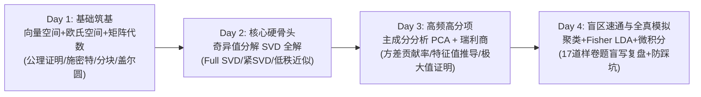

> **课程名称**：《人工智能数学方法》（Mathematical Methods for Artificial Intelligence）  
> **主讲教师**：曾智（北京邮电大学人工智能学院）  
> **复习定位**：期中考试冲刺专属（考前 4 天），全面覆盖课程全部 6 大章节及《题型示范》作业与样卷全部 17 道题。  
> **核心原则**：概念清晰、定理精准、做题有 SOP 模板、手算零失误。

---

## 目录
- [📅 4 天高效冲刺复习规划与提分攻略](#-4-天高效冲刺复习规划与提分攻略)
- [📖 第一部分：6 大核心模块考点全景精讲与核心定理](#-第一部分6-大核心模块考点全景精讲与核心定理)
  - [模块一：向量空间与欧氏空间](#模块一向量空间与欧氏空间)
  - [模块二：矩阵基础、正定性与投影算子](#模块二矩阵基础正定性与投影算子)
  - [模块三：奇异值分解 (SVD) 与最优低秩近似](#模块三奇异值分解-svd-与最优低秩近似)
  - [模块四：主成分分析 (PCA) 与方差贡献率](#模块四主成分分析-pca-与方差贡献率)
  - [模块五：函数、微积分与矩阵函数](#模块五函数微积分与矩阵函数)
  - [模块六：聚类分析与线性判别分析 (Fisher LDA)](#模块六聚类分析与线性判别分析-fisher-lda)
- [🛠️ 第二部分：12 大核心题型解题模板与手算 SOP](#️-第二部分12-大核心题型解题模板与手算-sop)
- [📝 第三部分：《题型示范》（作业与期中样卷）17 道全题标准详尽解析](#-第三部分题型示范作业与期中样卷17-道全题标准详尽解析)
  - [一、选择题（5 道深度题解与陷阱辨析）](#一选择题5-道深度题解与陷阱辨析)
  - [二、解答题（12 道标准推导与步骤规范）](#二解答题12-道标准推导与步骤规范)
- [⚡ 第四部分：考前必背公式速查表与高频易错雷区防踩指南](#-第四部分考前必背公式速查表与高频易错雷区防踩指南)

---

## 📅 4 天高效冲刺复习规划与提分攻略

期中考试仅剩 4 天，复习切忌漫无目的地翻看 PPT。根据曾智老师的教学特色与出题风格，试题结构高度贴近《题型示范》（概念选择题 5 题 + 计算与推导大题 10~12 题，总分 100 分）。

| 阶段 | 复习核心 | 重点覆盖考点 |
| :--- | :--- | :--- |
| **Day 1: 基础筑基** | 向量空间 + 欧氏空间 + 矩阵代数 | 8条公理证明、施密特正交化、分块矩阵乘法、特征值求解、盖尔圆盘定理 |
| **Day 2: 核心硬骨头** | 奇异值分解 SVD 专题全解 | 奇异值几何意义、Full SVD 标准五步法、紧 SVD、Eckart-Young 最优低秩近似 |
| **Day 3: 高频高分项** | 主成分分析 PCA + 瑞利商极大值 | 总体与样本 PCA、方差贡献率、主成分表达式、拉格朗日乘子法推导、瑞利商证明 |
| **Day 4: 盲区速通与模拟** | 聚类 + Fisher LDA + 矩阵微积分 | K-means 收敛性、层次聚类、Fisher 准则推导、矩阵求导、17 道样卷全真盲写 |

### 每日任务清单与复习节奏：
*   **Day 1（基础与线性代数回顾）**：
    *   **上午**：默写向量空间 8 条公理、内积 3 大性质；精通集合判断与内积证明题（样卷解答题 1、2）。
    *   **下午**：施密特正交化手算练习（样卷解答题 3），熟练掌握矩阵分块乘法（样卷解答题 4）。
    *   **晚上**：特征值与特征向量求解、根据特征向量反求待定系数（样卷解答题 5、6）；熟记盖尔圆盘定理与可逆性条件（选择题 1~3）。
*   **Day 2（SVD 专题突破）**：
    *   **上午**：理解 SVD 定义与几何意义，对比特征值与奇异值区别；熟记紧 SVD 与截断 SVD。
    *   **下午**：攻克**完整奇异值分解（Full SVD）标准五步法**（样卷解答题 8），牢记左奇异向量符号对应关系与正交补扩展。
    *   **晚上**：攻克**紧奇异值分解（Compact SVD）**（样卷解答题 9）；掌握 Eckart-Young 最优低秩近似定理与外积展开式。
*   **Day 3（PCA 与极值优化突破）**：
    *   **上午**：理清总体 PCA 与样本 PCA，明确协方差矩阵与相关矩阵的适用条件。
    *   **下午**：熟练掌握已知协方差矩阵求主成分表达式、方差贡献率、累计贡献率（样卷解答题 10）。
    *   **晚上**：熟练推导拉格朗日乘子法求第一主成分；背诵并默写**瑞利商极大值证明**（样卷解答题 12）。
*   **Day 4（聚类、判别分析、矩阵微积分与全真模考）**：
    *   **上午**：相似性度量（闵氏、马氏、余弦）、层次聚类连接法、K-means 迭代算法步骤与收敛性。
*   **下午**：Fisher 线性判别分析（LDA）推导、散度矩阵 $S_w, S_b$、最优投影向量 $w^* = S_w^{-1}(\mu_1 - \mu_2)$；矩阵微积分核心公式与矩阵对角化求矩阵幂（样卷解答题 11）。
    *   **晚上**：**闭卷完成《题型示范》17 道题目**，对照本宝典标准答案逐题核对，消除算术失误。

---

## 📖 第一部分：6 大核心模块考点全景精讲与核心定理

### 模块一：向量空间与欧氏空间

#### 1. 向量空间（Vector Space）的严谨定义与 8 条公理
设 $V$ 是非空集合，$F$ 是数域（通常为实数域 $\mathbb{R}$）。在 $V$ 上定义了两种运算：
*   **加法**：$\forall \alpha, \beta \in V \implies \alpha + \beta \in V$（加法封闭性）
*   **数乘**：$\forall k \in F, \alpha \in V \implies k\alpha \in V$（数乘封闭性）

若这两种运算满足下列 **8 条公理**，则称 $V$ 为数域 $F$ 上的**向量空间（线性空间）**：
1.  **加法交换律**：$\alpha + \beta = \beta + \alpha$
2.  **加法结合律**：$(\alpha + \beta) + \gamma = \alpha + (\beta + \gamma)$
3.  **存在零元（零向量）**：存在 $\mathbf{0} \in V$，使得 $\forall \alpha \in V, \alpha + \mathbf{0} = \alpha$
4.  **存在负元（负向量）**：$\forall \alpha \in V$，存在 $-\alpha \in V$，使得 $\alpha + (-\alpha) = \mathbf{0}$
5.  **标量分配律**：$(k + l)\alpha = k\alpha + l\alpha$（$\forall k, l \in F$）
6.  **向量分配律**：$k(\alpha + \beta) = k\alpha + k\beta$（$\forall k \in F$）
7.  **数乘结合律**：$k(l\alpha) = (kl)\alpha$
8.  **数乘单位元**：$1\alpha = \alpha$（$1 \in F$ 为数域的单位元）

> **易错核心推论**：
> *   零向量是**唯一**的。
> *   任意向量 $\alpha$ 的负向量是**唯一**的。
> *   $0\alpha = \mathbf{0}$，$(-1)\alpha = -\alpha$。
> *   若非空子集 $W \subseteq V$ 对加法与数乘运算封闭，则 $W$ 为 $V$ 的**子空间**。

#### 2. 基、维数与坐标
*   **线性无关**：若 $k_1\alpha_1 + \dots + k_m\alpha_m = \mathbf{0}$ 仅当 $k_1 = \dots = k_m = 0$ 时成立。
*   **基与维数**：若向量组 $\alpha_1, \dots, \alpha_n$ 线性无关，且 $V$ 中任意向量均可由其线性表出，则称其为 $V$ 的一组**基**，基所含向量个数 $n$ 称为 $V$ 的**维数**（$\dim V = n$）。
*   **定理**：在 $n$ 维向量空间中，任意 $n$ 个线性无关的向量必为一组基；任意超过 $n$ 个向量必线性相关；但**任意不少于 $n$ 个向量不一定线性相关**（当恰有 $n$ 个且线性无关时相关性不成立）。

#### 3. 欧氏空间（Euclidean Space）与内积
实数域 $\mathbb{R}$ 上的向量空间 $V$ 中，若定义了实值函数 $\langle \alpha, \beta \rangle$（内积），满足：
1.  **对称性**：$\langle \alpha, \beta \rangle = \langle \beta, \alpha \rangle$
2.  **线性性（可加性与齐次性）**：$\langle k\alpha + l\beta, \gamma \rangle = k\langle \alpha, \gamma \rangle + l\langle \beta, \gamma \rangle$
3.  **严格正定性**：$\langle \alpha, \alpha \rangle \ge 0$，且 $\langle \alpha, \alpha \rangle = 0 \iff \alpha = \mathbf{0}$
则称 $V$ 为**欧氏空间**。

*   **范数（长度）**：$\|\alpha\| = \sqrt{\langle \alpha, \alpha \rangle}$。
*   **柯西-施瓦茨不等式（Cauchy-Schwarz）**：$|\langle \alpha, \beta \rangle| \le \|\alpha\| \|\beta\|$，等号成立当且仅当 $\alpha, \beta$ 线性相关。
*   **格兰姆-施密特正交化（Gram-Schmidt）**：
    设 $\alpha_1, \alpha_2, \dots, \alpha_m$ 线性无关，构造正交向量组 $\beta_1, \beta_2, \dots, \beta_m$：

$$
\beta_1 = \alpha_1
$$

$$
\beta_2 = \alpha_2 - \frac{\langle \alpha_2, \beta_1 \rangle}{\|\beta_1\|^2} \beta_1
$$

$$
\beta_k = \alpha_k - \sum_{j=1}^{k-1} \frac{\langle \alpha_k, \beta_j \rangle}{\|\beta_j\|^2} \beta_j
$$

单位化：$e_i = \frac{\beta_i}{\|\beta_i\|}$，即得规范正交基（标准正交基）。

---

### 模块二：矩阵基础、正定性与投影算子

#### 1. 矩阵基本性质与运算
*   **乘法前提**：矩阵 $A_{m \times p}$ 与 $B_{q \times n}$ 能相乘的充要条件是 $p = q$（第一个矩阵的列数等于第二个矩阵的行数）。矩阵乘法满足结合律、分配律，但**不满足交换律**（$AB \ne BA$）。
*   **矩阵的秩**：$\text{rank}(A) = $ 行空间维数 = 列空间维数。初等变换保秩。
*   **可逆充要条件**：$n$ 阶实方阵 $A$ 可逆 $\iff \det(A) \ne 0 \iff \text{rank}(A) = n \iff$ 所有的特征值 $\lambda_i \ne 0$（**注意：特征值非零即可，可正可负，绝非全大于0**）。
*   **LoRA 算法与低秩原理**：
    预训练权重 $W_0 \in \mathbb{R}^{d \times d}$ 保持冻结，微调增量参数化为低秩分解：$\Delta W = BA$（$B \in \mathbb{R}^{d \times r}, A \in \mathbb{R}^{r \times d}, r \ll d$）。由秩的次可加性与乘法性质：$\text{rank}(\Delta W) \le \min(\text{rank} B, \text{rank} A) \le r$。参数量由 $d^2$ 骤降至 $2rd$。

#### 2. 特征多项式与两大重要定理
*   **特征值方程**：$Ax = \lambda x$ ($x \ne \mathbf{0}$) $\iff \det(\lambda I - A) = 0$。
*   **哈密顿-凯莱定理（Cayley-Hamilton Theorem）**：
设方阵 $A$ 的特征多项式为 $p(\lambda) = \det(\lambda I - A) = \lambda^n + p_{n-1}\lambda^{n-1} + \dots + p_0$，则矩阵 $A$ 满足其自身的特征方程，即：

$$
p(A) = A^n + p_{n-1}A^{n-1} + \dots + p_0 I = O
$$

*用途*：可用于将矩阵高次幂 $A^k$ 降次，以及快速计算矩阵逆 $A^{-1} = -\frac{1}{p_0}(A^{n-1} + p_{n-1}A^{n-2} + \dots + p_1 I)$。
*   **盖尔圆盘定理（Gerschgorin Circle Theorem）**：
    设 $A = (a_{ij}) \in \mathbb{C}^{n \times n}$，定义第 $i$ 个盖尔圆：

$$
G_i = \{ z \in \mathbb{C} \mid |z - a_{ii}| \le R_i \}, \quad \text{其中行半径 } R_i = \sum_{j \ne i} |a_{ij}|
$$

*   **定理 1**：$A$ 的所有特征值都落在其 $n$ 个盖尔圆的**并集**（Union）之中，即 $\sigma(A) \subseteq \bigcup_{i=1}^n G_i$（**绝非交集！**）。
    *   **定理 2**：若 $k$ 个盖尔圆组成的连通区域与其余 $n-k$ 个盖尔圆不相交，则该连通区域恰好包含 $A$ 的 $k$ 个特征值。
    *   **定理 3（对角占优与可逆）**：若 $A$ 严格对角占优（即 $|a_{ii}| > R_i, \forall i$），则原点 $0$ 不属于任何盖尔圆，因此 $0$ 不是特征值，矩阵 $A$ 必非奇异可逆！

#### 3. 正定矩阵（Positive Definite Matrix）
*   **定义**：实对称矩阵 $A \in \mathbb{R}^{n \times n}$，若对任意非零向量 $x \in \mathbb{R}^n$，恒有 $x^T A x > 0$，则称 $A$ 为正定矩阵（记作 $A \succ 0$）。
*   **充要条件（等价命题）**：
1.  $A$ 的所有特征值全大于 0（$\lambda_i > 0, \forall i$）；
    2.  $A$ 的各阶顺序主子式全大于 0（Sylvester 判据）；
    3.  存在可逆实矩阵 $P$，使得 $A = P^T P$（Cholesky 分解 $A = L L^T$）。
*   **重要性质**：
    *   若 $A \succ 0$，则 $A^{-1}$ 存在且 $A^{-1} \succ 0$。
    *   若 $A, B \succ 0$ 且 $AB = BA$，则 $AB \succ 0$。
    *   对角线上元素恒大于 0（$a_{ii} > 0$）。

#### 4. 投影算子与正交投影矩阵
*   **投影算子定义**：线性映射 $P$ 称为投影算子，当且仅当具有**幂等性**：$P^2 = P$。
*   **正交投影**：若除幂等性外，还满足**自伴性（对称性）**：$P^T = P$，则为正交投影。
*   **列空间投影矩阵公式**：
    设满列秩矩阵 $A \in \mathbb{R}^{m \times n}$（$\text{rank}(A) = n$），向其列空间 $\text{Col}(A)$ 的正交投影矩阵为：

$$
P_A = A (A^T A)^{-1} A^T
$$

    若 $A$ 的奇异值分解中列空间基矩阵为 $U_1$，则 $P_A = U_1 U_1^T$。

---

### 模块三：奇异值分解 (SVD) 与最优低秩近似

#### 1. SVD 基本定理与定义
对于任意实矩阵 $A \in \mathbb{R}^{m \times n}$，必定存在 $m$ 阶正交矩阵 $U$、$n$ 阶正交矩阵 $V$ 以及 $m \times n$ 的矩形对角矩阵 $\Sigma$，使得：

$$
A = U \Sigma V^T
$$

*   $U = [u_1, u_2, \dots, u_m] \in \mathbb{R}^{m \times m}$ 为**左奇异向量矩阵**，满足 $U U^T = I_m$；
*   $V = [v_1, v_2, \dots, v_n] \in \mathbb{R}^{n \times n}$ 为**右奇异向量矩阵**，满足 $V V^T = I_n$；
*   $\Sigma \in \mathbb{R}^{m \times n}$，对角线元素为奇异值 $\sigma_1 \ge \sigma_2 \ge \dots \ge \sigma_p \ge 0$（其中 $p = \min(m, n)$）。

> **高频概念辨析**：
> 1.  **存在性与唯一性**：任意实矩阵的 SVD **必定存在，但并不唯一**（奇异向量符号同向取反或有重奇异值时基可旋转）。
> 2.  **特征值 vs 奇异值**：
>     *   特征值仅对方阵定义，可为复数或负数；
>     *   奇异值对任意长方矩阵均有定义，且**恒为非负实数**；
>     *   实对称矩阵 $A$ 的奇异值等于其特征值的绝对值：$\sigma_i = |\lambda_i|$。

#### 2. 三种 SVD 分解形式
1.  **完全奇异值分解（Full SVD）**：
$A = U \Sigma V^T$，$U$ 为 $m \times m$，$\Sigma$ 为 $m \times n$，$V$ 为 $n \times n$。
2.  **紧奇异值分解（Compact SVD）**：
    设 $\text{rank}(A) = r \le \min(m, n)$，仅保留 $r$ 个严格正奇异值：

$$
A = U_r \Sigma_r V_r^T
$$

其中 $U_r \in \mathbb{R}^{m \times r}$, $\Sigma_r = \text{diag}(\sigma_1, \dots, \sigma_r) \in \mathbb{R}^{r \times r}$, $V_r \in \mathbb{R}^{n \times r}$。
3.  **截断奇异值分解（Truncated SVD）**：
只取前 $k$ 个最大奇异值（$k < r$）：$A_k = U_k \Sigma_k V_k^T$。

#### 3. 外积展开式与最优低秩近似（Eckart-Young-Mirsky 定理）
*   **外积展开式**：矩阵 $A$ 可表示为秩 1 矩阵的加权和：

$$
A = \sum_{j=1}^r \sigma_j u_j v_j^T
$$

*   **最优低秩近似定理**：
    在所有秩不超过 $k$ 的 $m \times n$ 矩阵中，截断 SVD 矩阵 $A_k$ 在 Frobenius 范数意义下是 $A$ 的最优近似：

$$
\min_{\text{rank}(B) \le k} \|A - B\|_F = \|A - A_k\|_F = \sqrt{\sum_{j=k+1}^r \sigma_j^2}
$$

#### 4. 摩尔-彭罗斯伪逆（Moore-Penrose Pseudoinverse）

$$
A^+ = V \Sigma^+ U^T = \sum_{j=1}^r \frac{1}{\sigma_j} v_j u_j^T
$$

其中 $\Sigma^+ = \text{diag}\left(\frac{1}{\sigma_1}, \dots, \frac{1}{\sigma_r}, 0, \dots, 0\right)^T$。最小二乘问题 $\min \|Ax - b\|_2$ 的最小范数解即为 $x^* = A^+ b$。

---

### 模块四：主成分分析 (PCA) 与方差贡献率

#### 1. 核心数学思想
PCA 是一种无监督线性降维方法。其数学本质是通过**正交坐标变换（旋转）**，将原始一组线性相关的变量转换为少数几个相互不相关的综合变量（主成分），使得：
1.  第一主成分的方差最大（保留最多信息）；
2.  后续主成分与前序主成分正交不相关，且方差依次递减；
3.  投影后的重构误差（点到超平面的垂直距离平方和）最小。

#### 2. 总体主成分推导（拉格朗日乘子法）
设随机向量 $x = (x_1, \dots, x_m)^T$，均值 $\mu$，协方差矩阵为 $\Sigma$。
考虑线性变换 $y_1 = \alpha_1^T x$（$\alpha_1 \in \mathbb{R}^m$），施加单位模长约束 $\alpha_1^T \alpha_1 = 1$。
方差目标：$\text{Var}(y_1) = \alpha_1^T \Sigma \alpha_1$。
构造拉格朗日函数：

$$
\mathcal{L}(\alpha_1, \lambda) = \alpha_1^T \Sigma \alpha_1 - \lambda (\alpha_1^T \alpha_1 - 1)
$$

求偏导令其为零：

$$
\frac{\partial \mathcal{L}}{\partial \alpha_1} = 2 \Sigma \alpha_1 - 2 \lambda \alpha_1 = 0 \implies \Sigma \alpha_1 = \lambda \alpha_1
$$

两边左乘 $\alpha_1^T$：$\text{Var}(y_1) = \alpha_1^T \Sigma \alpha_1 = \lambda \alpha_1^T \alpha_1 = \lambda$。
故最大方差对应 $\Sigma$ 的**最大特征值 $\lambda_1$**，$\alpha_1$ 为其对应的**单位特征向量**。
同理，第 $k$ 主成分 $y_k = \alpha_k^T x$ 对应第 $k$ 大特征值 $\lambda_k$，且系数向量 $\alpha_k$ 对应单位特征向量。

#### 3. 主成分四大核心性质
1.  **各主成分互不相关**：$\text{Cov}(y_i, y_j) = 0$（$\forall i \ne j$）。
2.  **总方差守恒定理**：

$$
\sum_{i=1}^m \text{Var}(y_i) = \sum_{i=1}^m \lambda_i = \text{tr}(\Sigma) = \sum_{i=1}^m \sigma_{ii}
$$

    即主成分分析不改变所有变量的总方差之和。
3.  **因子负荷量（Factor Loading）**：主成分 $y_k$ 与原变量 $x_i$ 的相关系数为：

$$
\rho(y_k, x_i) = \frac{\sqrt{\lambda_k} \alpha_{ik}}{\sqrt{\sigma_{ii}}}
$$

4.  **因子负荷量平方和定理**：

$$
\sum_{i=1}^m \sigma_{ii} \rho^2(y_k, x_i) = \lambda_k
$$

#### 4. 方差贡献率与累计贡献率
*   第 $k$ 主成分的**方差贡献率**：

$$
\eta_k = \frac{\lambda_k}{\sum_{i=1}^m \lambda_i}
$$

*   前 $q$ 个主成分的**累计方差贡献率**：

$$
\text{G}(q) = \frac{\sum_{k=1}^q \lambda_k}{\sum_{i=1}^m \lambda_i} \ge 75\% \sim 85\%
$$

#### 5. 协方差矩阵 vs 相关矩阵的选择
*   若各原始变量**量纲相同且量级接近**，直接使用协方差矩阵 $\Sigma$。
*   若变量**量纲不同或方差悬殊**，必须对数据进行标准化（Z-score），此时协方差矩阵即为**样本相关矩阵 $R$**（对角线元素全为 1，$\text{tr}(R) = m$）。

#### 6. 样本 PCA 的 SVD 算法
将中心化样本矩阵记作 $X' \in \mathbb{R}^{m \times n}$，令构造矩阵 $X'' = \frac{1}{\sqrt{n-1}} X'$。
对其进行奇异值分解：$X'' = U \Sigma V^T$。
则样本协方差矩阵：

$$
S = X'' (X'')^T = U \Sigma^2 U^T
$$

因此：**$X''$ 的左奇异向量矩阵 $U$ 的列即为主成分系数向量，奇异值的平方 $\sigma_i^2 = \lambda_i$ 即为主成分的方差**。

---

### 模块五：函数、微积分与矩阵函数

#### 1. 矩阵函数与矩阵级数
*   **矩阵级数定义**：若标量函数在原点附近可展成绝对收敛的幂级数 $f(z) = \sum_{k=0}^\infty c_k z^k$，则对方阵 $A$，定义其矩阵函数为：

$$
f(A) = \sum_{k=0}^\infty c_k A^k
$$

*   **对角化法求矩阵函数**：若 $A$ 可相似对角化 $A = P \Lambda P^{-1}$（$\Lambda = \text{diag}(\lambda_1, \dots, \lambda_n)$），则：

$$
f(A) = P f(\Lambda) P^{-1} = P \begin{pmatrix} f(\lambda_1) & & 0 \\ & \ddots & \\ 0 & & f(\lambda_n) \end{pmatrix} P^{-1}
$$

*   **矩阵指数与三角函数求导**：

$$
\frac{d}{dt} e^{At} = A e^{At} = e^{At} A
$$

$$
\frac{d}{dt} \cos(tA) = -A \sin(tA) = -\sin(tA) A
$$

$$
\frac{d}{dt} \sin(tA) = A \cos(tA) = \cos(tA) A
$$

#### 2. 函数矩阵导数与乘积求导法则
设 $A(t) = (a_{ij}(t))$，其导数定义为元素导数矩阵 $A'(t) = \left( \frac{d a_{ij}(t)}{dt} \right)$。
*   **乘积导数法则（顺序极度重要）**：

$$
\frac{d}{dt} [A(t)B(t)] = A'(t)B(t) + A(t)B'(t)
$$

    **绝不能写成 $A'(t)B(t) + B'(t)A(t)$，因为矩阵乘法不交换！**
*   **逆矩阵导数**：

$$
\frac{d}{dt} A^{-1}(t) = -A^{-1}(t) A'(t) A^{-1}(t)
$$

#### 3. 常用向量与矩阵求导公式
设 $x, a \in \mathbb{R}^n$，$A \in \mathbb{R}^{n \times n}$：
*   $\nabla_x (a^T x) = a$
*   $\nabla_x (x^T A x) = (A + A^T) x$；**若 $A$ 为实对称矩阵，则 $\nabla_x (x^T A x) = 2Ax$**
*   $\nabla_x \|Ax - b\|_2^2 = 2 A^T (Ax - b)$
*   $\nabla_A \text{tr}(AB) = B^T$
*   $\nabla_A \log \det(A) = A^{-T}$（正定对称阵时为 $A^{-1}$）

#### 4. 泰勒展开与极值条件
*   二元/多元函数泰勒展开：

$$
f(x) \approx f(x_0) + \nabla f(x_0)^T (x - x_0) + \frac{1}{2} (x - x_0)^T \nabla^2 f(x_0) (x - x_0)
$$

    其中 $\nabla^2 f(x)$ 为 Hessian 矩阵。
*   极值判别：若 $\nabla f(x^*) = 0$（驻点）：
    *   $\nabla^2 f(x^*) \succ 0$（正定） $\implies$ 极小值点；
    *   $\nabla^2 f(x^*) \prec 0$（负定） $\implies$ 极大值点；
    *   $\nabla^2 f(x^*)$ 不定 $\implies$ 鞍点。

#### 5. 瑞利商定理（Rayleigh Quotient）
设 $A$ 为 $n$ 阶实对称矩阵，定义瑞利商函数：

$$
F(x) = \frac{x^T A x}{x^T x} \quad (x \ne \mathbf{0})
$$

*   **定理**：$F(x)$ 的最大值为 $A$ 的最大特征值 $\lambda_{\max}$，最小值为最小特征值 $\lambda_{\min}$。

---

### 模块六：聚类分析与线性判别分析 (Fisher LDA)

#### 1. 相似性度量与度量空间
*   **度量空间 4 大公理**：距离函数 $d(x, y)$ 满足：
    1.  非负性：$d(x, y) \ge 0$；
    2.  同一性：$d(x, y) = 0 \iff x = y$；
    3.  对称性：$d(x, y) = d(y, x)$；
    4.  三角不等式：$d(x, y) \le d(x, z) + d(z, y)$。
*   **高频距离公式**：
    *   **闵可夫斯基距离（$L_p$ 范数）**：$d(x, y) = \left( \sum_{i=1}^m |x_i - y_i|^p \right)^{1/p}$
        *   $p=1$：曼哈顿距离（City block）
        *   $p=2$：欧氏距离（Euclidean）
        *   $p \to \infty$：切比雪夫距离（Chebyshev）
    *   **马氏距离（Mahalanobis Distance）**：

$$
d_M(x, y) = \sqrt{(x - y)^T \Sigma^{-1} (x - y)}
$$

        *优势*：排除了各维度量纲不同及变量间线性相关性的干扰。
*   **余弦相似度**：$\cos(x, y) = \frac{x^T y}{\|x\|_2 \|y\|_2}$。

#### 2. 层次聚类（Hierarchical Clustering）
*   **三大类间连接方式（Linkage）**：
    1.  **单连接（最短距离法 Single Linkage）**：$D(G_p, G_q) = \min_{x \in G_p, y \in G_q} d(x, y)$
    2.  **全连接（最长距离法 Complete Linkage）**：$D(G_p, G_q) = \max_{x \in G_p, y \in G_q} d(x, y)$
3.  **均值连接（平均距离法 Average Linkage）**：$D(G_p, G_q) = \frac{1}{|G_p||G_q|} \sum_{x \in G_p} \sum_{y \in G_q} d(x, y)$
*   **算法流程**：每个样本自成一类 $\to$ 算类间距离矩阵 $\to$ 合并最近的两类 $\to$ 更新距离矩阵 $\to$ 重复直到只剩一类。

#### 3. K-means 聚类算法
*   **优化目标（畸变函数 / SSE 误差平方和）**：

$$
J = \sum_{k=1}^K \sum_{x \in C_k} \|x - \mu_k\|^2
$$

其中 $\mu_k = \frac{1}{|C_k|} \sum_{x \in C_k} x$ 为第 $k$ 个簇的质心（均值）。
*   **算法两步迭代（坐标下降法 / EM 思想）**：
1.  **分配步**：保持质心 $\mu_k$ 不变，将每个样本点分配到距离最近的质心所在簇；
    2.  **更新步**：保持样本簇划分不变，重新计算每个簇的新质心为其算术平均值；
    3.  **收敛性**：每一步迭代都使目标函数 $J$ 单调非增，且 $J \ge 0$ 有下界，故算法必在有限步内收敛到局部极小值。

#### 4. Fisher 线性判别分析 (LDA)
*   **核心思想**：“投影后**类内方差最小，类间方差最大**”。
*   **核心矩阵构建**（以二分类为例）：
*   各类别均值向量：$\mu_1 = \frac{1}{N_1}\sum_{x \in C_1} x$，$\mu_2 = \frac{1}{N_2}\sum_{x \in C_2} x$
    *   **类内散度矩阵（Within-class scatter matrix）**：

$$
S_w = S_1 + S_2 = \sum_{x \in C_1} (x - \mu_1)(x - \mu_1)^T + \sum_{x \in C_2} (x - \mu_2)(x - \mu_2)^T
$$

    *   **类间散度矩阵（Between-class scatter matrix）**：

$$
S_b = (\mu_1 - \mu_2)(\mu_1 - \mu_2)^T
$$

*   **优化目标（广义瑞利商）**：

$$
\max_w J(w) = \frac{w^T S_b w}{w^T S_w w}
$$

*   **拉格朗日乘子法求解推导**：
    令分母 $w^T S_w w = 1$，优化问题等价为 $\max_w w^T S_b w$ s.t. $w^T S_w w = 1$。
构造拉格朗日函数：$\mathcal{L}(w, \lambda) = w^T S_b w - \lambda(w^T S_w w - 1)$。
求导：$2 S_b w - 2 \lambda S_w w = 0 \implies S_b w = \lambda S_w w \implies S_w^{-1} S_b w = \lambda w$。
注意：$S_b w = (\mu_1 - \mu_2) [(\mu_1 - \mu_2)^T w]$，方括号内是标量。因此 $S_b w$ 的方向恒与 $(\mu_1 - \mu_2)$ 一致！
    故可直接解出**最优投影方向向量**：

$$
w^* = S_w^{-1} (\mu_1 - \mu_2)
$$

---

## 🛠️ 第二部分：12 大核心题型解题模板与手算 SOP

### SOP 1：向量空间 8 条公理判定证明
*   **典型设问**：设集合 $V$ 带有特殊定义的加法 $\oplus$ 和数乘 $\odot$，证明 $V$ 构成向量空间。
*   **解题步骤**：
    1.  **封闭性**：写出 $a \oplus b \in V$ 和 $k \odot a \in V$。
    2.  **加法 4 条**：依次验证交换律、结合律；
        *   **求零元**：设零元为 $e$，列方程 $a \oplus e = a$，求出 $e$ 并确认 $e \in V$；
        *   **求负元**：设负元为 $a'$，列方程 $a \oplus a' = e$，求出 $a'$ 并确认 $a' \in V$。
    3.  **数乘 4 条**：依次验证分配律 $(k+l)\odot a$、$k\odot(a\oplus b)$、结合律 $k\odot(l\odot a) = (kl)\odot a$、单位元 $1\odot a = a$。
    4.  **总结**：8 条公理均成立，得证。

### SOP 2：内积与欧氏空间判定证明
*   **典型设问**：定义实值函数 $\langle a, b \rangle = \sum c_i x_i y_i$，证明其构成内积。
*   **解题步骤**：
    1.  **对称性**：$\langle a, b \rangle = \sum c_i x_i y_i = \sum c_i y_i x_i = \langle b, a \rangle$；
    2.  **线性性**：分别写出加法 $\langle a+c, b \rangle = \langle a, b \rangle + \langle c, b \rangle$ 与数乘 $\langle ka, b \rangle = k \langle a, b \rangle$；
    3.  **严格正定性**：$\langle a, a \rangle = \sum c_i x_i^2$。指出 $c_i > 0$ 且 $x_i^2 \ge 0 \implies \langle a, a \rangle \ge 0$；且 $\sum c_i x_i^2 = 0 \iff$ 每个 $x_i = 0 \iff a = \mathbf{0}$。

### SOP 3：格兰姆-施密特正交化
*   **典型设问**：给定一组基 $\alpha_1, \alpha_2, \alpha_3$，求正交基 $\beta_1, \beta_2, \beta_3$。
*   **解题步骤**：
    1.  令 $\beta_1 = \alpha_1$，算 $\|\beta_1\|^2 = \langle \beta_1, \beta_1 \rangle$；
2.  算投影系数 $c_{21} = \frac{\langle \alpha_2, \beta_1 \rangle}{\|\beta_1\|^2}$，得 $\beta_2 = \alpha_2 - c_{21}\beta_1$；算 $\|\beta_2\|^2$；
3.  算投影系数 $c_{31} = \frac{\langle \alpha_3, \beta_1 \rangle}{\|\beta_1\|^2}, c_{32} = \frac{\langle \alpha_3, \beta_2 \rangle}{\|\beta_2\|^2}$，得 $\beta_3 = \alpha_3 - c_{31}\beta_1 - c_{32}\beta_2$；
    4.  *(检查)*：心算检验 $\langle \beta_1, \beta_2 \rangle = 0$ 和 $\langle \beta_1, \beta_3 \rangle = 0$；若题目要求“规范正交基”，再除以模长单位化。

### SOP 4：分块矩阵相乘法
*   **解题步骤**：
    1.  观察 $A_{m \times k}$ 与 $B_{k \times n}$ 的结构（寻找单位矩阵、零矩阵、对角矩阵）；
    2.  按行和列划分虚线，**必须确保 $A$ 的列划分与 $B$ 的行划分尺寸完全一致**；
    3.  按分块形式代入矩阵乘法公式 $C_{ij} = \sum_l A_{il} B_{lj}$，计算各子块并还原总矩阵。

### SOP 5：特征值求解与特征向量反求待定参数
*   **题型 A（求解特征值）**：计算特征方程 $\det(\lambda I - A) = 0$，通过行列式初等行变换提取公因式因式分解，切忌盲目硬展开三次多项式。
*   **题型 B（反求参数）**：已知 $p$ 是 $A$ 的特征向量，直接根据定义列出方程：

$$
A p = \lambda p
$$

由没有未知数的行先求出特征值 $\lambda$，再代入含未知参数的行解出参数 $a, b$。

### SOP 6：对称正定矩阵性质证明
*   **典型设问**：证明若 $A$ 正定，则 $A^{-1}$ 正定。
*   **双保险证明模板**：
    *   **对称性**：$(A^{-1})^T = (A^T)^{-1} = A^{-1}$，故对称；
    *   **正定性（二次型法）**：任取非零向量 $x \in \mathbb{R}^n$，令 $y = A^{-1} x$。因为 $A^{-1}$ 可逆且 $x \ne 0$，故 $y \ne 0$。
        则 $x^T A^{-1} x = (Ay)^T A^{-1} (Ay) = y^T A^T y = y^T A y$。
        因为 $A \succ 0$ 且 $y \ne 0$，所以 $y^T A y > 0 \implies x^T A^{-1} x > 0$。得证！

### SOP 7：完整奇异值分解 (Full SVD) 标准五步法
*   **解题步骤**（以 $A_{m \times n}$ 为例，设 $m \ge n$）：
    1.  **算 $A^T A$**：得到 $n \times n$ 实对称矩阵；
2.  **求特征值与奇异值**：求 $\det(\lambda I - A^T A) = 0$ 的非负特征值，降序排列 $\lambda_1 \ge \lambda_2 \ge \dots \ge 0$，求得奇异值 $\sigma_i = \sqrt{\lambda_i}$；
    3.  **求右奇异向量 $V$**：求特征向量并正交单位化，组成正交矩阵 $V = [v_1, \dots, v_n]$；
4.  **求前 $r$ 个左奇异向量**：对非零奇异值 $\sigma_i > 0$，利用公式求：

$$
u_i = \frac{1}{\sigma_i} A v_i \quad (i = 1, \dots, r)
$$

        **（绝对不能随意指定符号，必须严格用此公式绑定！）**
    5.  **补充正交基构造 $U$**：解方程 $A^T u = \mathbf{0}$，求出正交补空间的单位正交基 $u_{r+1}, \dots, u_m$，拼接为 $U = [u_1, \dots, u_m]$。
6.  **组装**：写出 $A = U \Sigma V^T$，其中 $\Sigma \in \mathbb{R}^{m \times n}$。

### SOP 8：紧奇异值分解 (Compact SVD) 快速算法
*   当 $\text{rank}(A) = r < \min(m, n)$ 时，无需扩展正交补空间！
*   直接取前 $r$ 个正奇异值 $\Sigma_r = \text{diag}(\sigma_1, \dots, \sigma_r)$；
*   取对应的 $U_r = [u_1, \dots, u_r] \in \mathbb{R}^{m \times r}$ 与 $V_r = [v_1, \dots, v_r] \in \mathbb{R}^{n \times r}$；
*   写出紧分解式：$A = U_r \Sigma_r V_r^T$。

### SOP 9：主成分分析 (PCA) 手算标准流程
*   **解题步骤**：
1.  写出协方差矩阵 $\Sigma$（或相关矩阵 $R$）；
2.  求特征值并降序排列：$\lambda_1 \ge \lambda_2 \ge \dots \ge \lambda_m$；
3.  对每个 $\lambda_k$，解方程 $(\lambda_k I - \Sigma) \alpha_k = \mathbf{0}$，求出**单位特征向量** $\alpha_k$（必须满秩且 $\|\alpha_k\| = 1$）；
    4.  **写出主成分表达式**：$F_k = \alpha_k^T X = \sum_{i=1}^m \alpha_{ik} X_i$；
5.  **算方差贡献率**：计算总方差 $S_{\text{total}} = \sum \lambda_i$；第 $k$ 主成分贡献率 $\eta_k = \frac{\lambda_k}{S_{\text{total}}}$，累计贡献率 $\sum_{k=1}^q \eta_k$。

### SOP 10：矩阵幂 $A^n$ 的谱对角化算法
*   **解题步骤**：
1.  求特征值 $\lambda_i$ 与线性无关特征向量 $P$；
    2.  对实对称矩阵，正交化特征向量构成正交矩阵 $P$（此时 $P^{-1} = P^T$）；
3.  对角矩阵 $\Lambda = \text{diag}(\lambda_1, \dots, \lambda_n)$，则 $\Lambda^n = \text{diag}(\lambda_1^n, \dots, \lambda_n^n)$；
    4.  计算 $A^n = P \Lambda^n P^{-1}$。

### SOP 11：瑞利商极大值证明题模板
*   **证明方法（谱分解代换法）**：
设实对称矩阵 $A$ 的特征值降序为 $\lambda_1 \ge \lambda_2 \ge \dots \ge \lambda_n$。
    存在正交矩阵 $P = [u_1, \dots, u_n]$ 使得 $P^T A P = \Lambda$。
    对任意非零向量 $x$，令正交坐标代换 $y = P^T x = (y_1, \dots, y_n)^T \ne \mathbf{0}$。
    则 $x^T x = y^T P^T P y = y^T y = \sum_{i=1}^n y_i^2$；
$x^T A x = y^T P^T A P y = y^T \Lambda y = \sum_{i=1}^n \lambda_i y_i^2$。
    因此：

$$
F(x) = \frac{\sum_{i=1}^n \lambda_i y_i^2}{\sum_{i=1}^n y_i^2} \le \frac{\sum_{i=1}^n \lambda_1 y_i^2}{\sum_{i=1}^n y_i^2} = \lambda_1
$$

取 $x = u_1$（对应 $\lambda_1$ 的特征向量）时，$y = (1, 0, \dots, 0)^T$，$F(u_1) = \lambda_1$。
故最大值恰为 $A$ 的最大特征值 $\lambda_1 = \lambda_{\max}$。

### SOP 12：Fisher 线性判别分析 (LDA) 计算
*   **解题步骤**：
1.  算两类均值向量 $\mu_1, \mu_2$；
2.  算各类散度矩阵 $S_1 = \sum (x-\mu_1)(x-\mu_1)^T, S_2 = \sum (x-\mu_2)(x-\mu_2)^T$，求和得类内散度矩阵 $S_w = S_1 + S_2$；
    3.  求逆矩阵 $S_w^{-1}$；
4.  计算最优投影向量 $w^* = S_w^{-1}(\mu_1 - \mu_2)$；
5.  计算阈值 $y_0 = w^{*T} \frac{\mu_1 + \mu_2}{2}$ 实现分类决策。

---

## 📝 第三部分：《题型示范》（作业与期中样卷）17 道全题标准详尽解析

### 一、选择题（5 道深度题解与陷阱辨析）

#### 1. 下列说法正确的是 ( A )
*   **选项**：
    *   A. 在一个向量空间 $V$ 里，零向量是唯一的
    *   B. $W$ 是数域 $F$ 上向量空间 $V$ 的一个非空子集，则 $W$ 本身也是 $F$ 上一个向量空间
    *   C. $n$ 维向量空间中任意不少于 $n$ 个向量一定线性相关
    *   D. 一个 $n$ 维欧氏空间里, 不一定存在规范正交基
*   **详细解析**：
    *   **A 正确**：由向量空间公理推论，零向量是唯一的（若有两个零元 $0_1, 0_2$，则 $0_1 = 0_1 + 0_2 = 0_2$）。
    *   **B 错误**：非空子集必须对加法和数乘**封闭**才能成为子空间。反例：平面 $\mathbb{R}^2$ 中第一象限点集是非空子集，但数乘负数会跳出，不是向量空间。
    *   **C 错误**：$n$ 维向量空间中，恰好有 $n$ 个向量时，它们可以线性无关（比如一组基），只有**严格大于 $n$ 个向量**才一定线性相关。
    *   **D 错误**：利用格兰姆-施密特正交化，任何有限维欧氏空间都**必定存在**规范正交基。

#### 2. 下列说法错误的是 ( B )
*   **选项**：
    *   A. 一个矩阵的行空间的维数等于列空间的维数
    *   B. $n$ 阶实矩阵 $A$ 是可逆矩阵的充要条件是它的 $n$ 个特征值全大于 0
    *   C. 矩阵的乘法和加法混合运算满足分配律
    *   D. 当第一个矩阵的列数等于第二个矩阵的行数时，两矩阵才能相乘
*   **详细解析**：
*   **B 说法错误（故选 B）**：$A$ 可逆的充要条件是 $\det(A) \ne 0$，即**所有特征值全不等于 0**（$\lambda_i \ne 0$），可以为负数！“特征值全大于 0”是**正定矩阵**的充要条件，不是可逆矩阵的充要条件。
    *   **A 正确**：矩阵的行秩等于列秩，都等于矩阵的秩 $\text{rank}(A)$。
    *   **C 正确**：$A(B+C) = AB + AC$。
    *   **D 正确**：矩阵乘法相乘的基本唯一起始维度匹配准则。

#### 3. 下列说法正确的是 ( C )
*   **选项**：
    *   A. 在一个向量空间 $V$ 里，存在一个向量 $\alpha$，它的负向量不是唯一的
    *   B. 在欧氏空间中，任意两个线性无关的向量都相互正交
    *   C. 矩阵函数由收敛的矩阵幂级数定义
    *   D. $n$ 阶方阵 $A$ 的所有特征值都在它的 $n$ 个盖尔圆交集之中
*   **详细解析**：
*   **C 正确**：课件第 5 章 5.1.2 节明确给出定义：矩阵函数由收敛的矩阵幂级数定义（如 $e^A = \sum_{k=0}^\infty \frac{A^k}{k!}$）。
    *   **A 错误**：每个向量的负向量在向量空间中是**唯一**的。
    *   **B 错误**：线性无关不等于正交。反例：二维平面中 $(1, 0)$ 和 $(1, 1)$ 线性无关，但内积为 $1 \ne 0$，不正交。
    *   **D 错误**：盖尔圆盘定理明确指出：所有特征值都在 $n$ 个盖尔圆的**并集（Union）**之中，绝非交集。

#### 4. 在主成分分析中，下列关于主成分与原始变量之间关系的说法，正确的是 ( D )
*   **选项**：
    *   A. 每个主成分必定等于某个原始变量
    *   B. 每个主成分必定是原始变量的非线性函数
    *   C. 每个主成分中，各原始变量的系数必须均不为零
    *   D. 每个主成分是原始变量的线性组合，允许部分系数为零
*   **详细解析**：
*   **D 正确**：主成分是原始变量的正交线性组合 $F_k = \sum_{i=1}^m \alpha_{ik} X_i$。特征向量分量允许为 0（如样卷解答题 10 中 $\alpha_1 = (\frac{1}{\sqrt{5}}, \frac{2}{\sqrt{5}}, 0)^T$，第三个分量系数为 0）。
    *   **A 错误**：主成分是综合变量，通常不等于单一变量。
    *   **B 错误**：PCA 是纯线性变换（非线性的是核主成分分析 Kernel PCA）。
    *   **C 错误**：允许系数为零。

#### 5. 关于奇异值分解，下列说法正确的是 ( A )
*   **选项**：
    *   A. 任意实矩阵都能进行奇异值分解
    *   B. 只有方阵能进行奇异值分解
    *   C. 实对称矩阵的奇异值就是其特征值
    *   D. 只有非奇异矩阵能进行奇异值分解
*   **详细解析**：
*   **A 正确**：SVD 基本定理：任意非零实矩阵 $A \in \mathbb{R}^{m \times n}$ 均存在奇异值分解 $A = U \Sigma V^T$。
    *   **B、D 错误**：长方矩阵、奇异矩阵、降秩矩阵都可以进行 SVD。
*   **C 错误**：奇异值恒为非负实数，若实对称矩阵有负特征值，其奇异值是特征值的**绝对值**（$\sigma_i = |\lambda_i|$）。

---

### 二、解答题（12 道标准推导与步骤规范）

#### 1. 向量空间判定题
**题目**：设 $\mathbb{R}^+$ 是所有正实数组成的集合，定义其加法和数乘运算分别如下：

$$
a \oplus b = ab, \quad k \odot a = a^k \quad (a, b \in \mathbb{R}^+, k \in \mathbb{R})
$$

证明：$\mathbb{R}^+$ 是 $\mathbb{R}$ 上的向量空间。

**【规范解答】**：
需验证封闭性及 8 条公理：
1.  **封闭性**：
    *   $\forall a, b \in \mathbb{R}^+$，$a \oplus b = ab > 0 \implies a \oplus b \in \mathbb{R}^+$；
    *   $\forall k \in \mathbb{R}, a \in \mathbb{R}^+$，$k \odot a = a^k > 0 \implies k \odot a \in \mathbb{R}^+$。封闭性成立。
2.  **加法公理 (1)~(4)**：
    *   (1) **交换律**：$a \oplus b = ab = ba = b \oplus a$；
    *   (2) **结合律**：$(a \oplus b) \oplus c = (ab)c = a(bc) = a \oplus (b \oplus c)$；
    *   (3) **零元**：设零元为 $e$，满足 $a \oplus e = a \implies ae = a \implies e = 1$。因为 $1 \in \mathbb{R}^+$，故存在唯一的零元 $\mathbf{0} = 1$；
*   (4) **负元**：对任意 $a \in \mathbb{R}^+$，设其负元为 $a'$，满足 $a \oplus a' = e = 1 \implies aa' = 1 \implies a' = \frac{1}{a}$。因为 $a > 0 \implies \frac{1}{a} \in \mathbb{R}^+$，故存在唯一的负元 $-a = \frac{1}{a}$。
3.  **数乘公理 (5)~(8)**：
    *   (5) **向量分配律**：$k \odot (a \oplus b) = (ab)^k = a^k b^k = (a^k) \oplus (b^k) = (k \odot a) \oplus (k \odot b)$；
    *   (6) **标量分配律**：$(k + l) \odot a = a^{k+l} = a^k a^l = a^k \oplus a^l = (k \odot a) \oplus (l \odot a)$；
    *   (7) **结合律**：$k \odot (l \odot a) = k \odot (a^l) = (a^l)^k = a^{kl} = (kl) \odot a$；
    *   (8) **单位元**：$1 \odot a = a^1 = a$。
综上所述，8 条公理全部满足，因此 $\mathbb{R}^+$ 是实数域 $\mathbb{R}$ 上的向量空间。$\blacksquare$

---

#### 2. 内积与欧氏空间判定题
**题目**：设 $V$ 是实数域 $\mathbb{R}$ 上的向量空间，对于任意向量 $a = (x_1, \dots, x_n)$ 和 $b = (y_1, \dots, y_n)$，定义实值函数：

$$
\langle a, b \rangle = 5 x_1 y_1 + 7 x_2 y_2 + \dots + (2n+3) x_n y_n = \sum_{i=1}^n (2i+3) x_i y_i
$$

证明：该函数是 $V$ 上的一个内积，$V$ 关于此内积构成欧氏空间。

**【规范解答】**：
需验证内积的三大性质：
1.  **对称性**：

$$
\langle a, b \rangle = \sum_{i=1}^n (2i+3) x_i y_i = \sum_{i=1}^n (2i+3) y_i x_i = \langle b, a \rangle
$$

2.  **线性性**：
    对任意实数 $k \in \mathbb{R}$ 及向量 $c = (z_1, \dots, z_n)$：
    *   齐次性：$\langle ka, b \rangle = \sum_{i=1}^n (2i+3)(kx_i)y_i = k \sum_{i=1}^n (2i+3)x_i y_i = k \langle a, b \rangle$；
    *   可加性：$\langle a + c, b \rangle = \sum_{i=1}^n (2i+3)(x_i + z_i)y_i = \sum_{i=1}^n (2i+3)x_i y_i + \sum_{i=1}^n (2i+3)z_i y_i = \langle a, b \rangle + \langle c, b \rangle$。
3.  **严格正定性**：

$$
\langle a, a \rangle = \sum_{i=1}^n (2i+3) x_i^2
$$

    因为对所有 $i \in \{1, \dots, n\}$，均有系数 $2i + 3 \ge 5 > 0$，且 $x_i^2 \ge 0$，所以各项乘积非负，总和必满足：

$$
\langle a, a \rangle \ge 0
$$

    进一步，当且仅当每一个项 $(2i+3)x_i^2 = 0$ 时，总和为 0。由于 $2i+3 > 0$，这等价于 $x_i = 0$ 对所有 $i$ 均成立，即 $a = \mathbf{0}$。
综上，该函数满足对称性、线性性和严格正定性，是 $V$ 上的内积，$V$ 构成欧氏空间。$\blacksquare$

---

#### 3. 格兰姆-施密特正交化题
**题目**：设 $V$ 是三维欧氏空间 $\mathbb{R}^3$，基向量为 $\alpha_1 = (1, 1, 0)$、$\alpha_2 = (0, 1, 1)$、$\alpha_3 = (1, 0, 1)$。求利用施密特正交化方法求一组正交基 $\beta_1, \beta_2, \beta_3$。

**【规范解答】**：
1.  **取第一个正交向量**：

$$
\beta_1 = \alpha_1 = (1, 1, 0)
$$

    计算模长平方：$\|\beta_1\|^2 = 1^2 + 1^2 + 0^2 = 2$。
2.  **计算第二个正交向量**：
    投影内积：$\langle \alpha_2, \beta_1 \rangle = 0 \times 1 + 1 \times 1 + 1 \times 0 = 1$。

$$
\beta_2 = \alpha_2 - \frac{\langle \alpha_2, \beta_1 \rangle}{\|\beta_1\|^2} \beta_1 = (0, 1, 1) - \frac{1}{2} (1, 1, 0) = \left(-\frac{1}{2}, \frac{1}{2}, 1\right)
$$

    *(注：亦可将 $\beta_2$ 乘以 2 取同向向量 $(-1, 1, 2)$，此处保留标准公式所得结果)*
计算模长平方：$\|\beta_2\|^2 = \left(-\frac{1}{2}\right)^2 + \left(\frac{1}{2}\right)^2 + 1^2 = \frac{1}{4} + \frac{1}{4} + 1 = \frac{3}{2}$。
3.  **计算第三个正交向量**：
    投影内积：
    $\langle \alpha_3, \beta_1 \rangle = 1 \times 1 + 0 \times 1 + 1 \times 0 = 1$；
$\langle \alpha_3, \beta_2 \rangle = 1 \times \left(-\frac{1}{2}\right) + 0 \times \frac{1}{2} + 1 \times 1 = \frac{1}{2}$。
    则：

$$
\beta_3 = \alpha_3 - \frac{\langle \alpha_3, \beta_1 \rangle}{\|\beta_1\|^2} \beta_1 - \frac{\langle \alpha_3, \beta_2 \rangle}{\|\beta_2\|^2} \beta_2
$$

$$
= (1, 0, 1) - \frac{1}{2} (1, 1, 0) - \frac{1/2}{3/2} \left(-\frac{1}{2}, \frac{1}{2}, 1\right)
$$

$$
= (1, 0, 1) - \left(\frac{1}{2}, \frac{1}{2}, 0\right) - \frac{1}{3} \left(-\frac{1}{2}, \frac{1}{2}, 1\right)
$$

$$
= \left(1 - \frac{1}{2} + \frac{1}{6}, \; 0 - \frac{1}{2} - \frac{1}{6}, \; 1 - 0 - \frac{1}{3}\right) = \left(\frac{2}{3}, -\frac{2}{3}, \frac{2}{3}\right)
$$

4.  **校验与结论**：
检验：$\langle \beta_1, \beta_2 \rangle = -\frac{1}{2} + \frac{1}{2} + 0 = 0$；
$\langle \beta_1, \beta_3 \rangle = \frac{2}{3} - \frac{2}{3} + 0 = 0$；
$\langle \beta_2, \beta_3 \rangle = -\frac{1}{3} - \frac{1}{3} + \frac{2}{3} = 0$。
    故求得的一组正交基为：

$$
\beta_1 = (1, 1, 0), \quad \beta_2 = \left(-\frac{1}{2}, \frac{1}{2}, 1\right), \quad \beta_3 = \left(\frac{2}{3}, -\frac{2}{3}, \frac{2}{3}\right)
$$

    *(或等价的正交整数基：$\beta_1 = (1, 1, 0), \beta_2 = (-1, 1, 2), \beta_3 = (1, -1, 1)$)*。$\blacksquare$

---

#### 4. 分块矩阵乘法题
**题目**：设有矩阵 $A = \begin{pmatrix} -1 & 0 & 2 & 0 \\ 0 & -1 & 0 & 2 \\ 0 & 0 & 4 & 3 \end{pmatrix}$，$B = \begin{pmatrix} 2 & 0 & -1 \\ 1 & 1 & 0 \\ 0 & 1 & 0 \\ 0 & 0 & 1 \end{pmatrix}$，用分块矩阵乘法求 $AB$。

**【规范解答】**：
观察 $A$ 的前两行带有 $-I_2$ 与 $2I_2$ 结构，$B$ 的尺寸为 $4 \times 3$。
对 $A$ 采用 $2+1$ 行划分与 $2+2$ 列划分；对 $B$ 对应采用 $2+2$ 行划分与 $2+1$ 列划分：

$$
A = \begin{pmatrix} A_{11} & A_{12} \\ A_{21} & A_{22} \end{pmatrix}, \quad B = \begin{pmatrix} B_{11} & B_{12} \\ B_{21} & B_{22} \end{pmatrix}
$$

其中各子块具体为：
*   $A_{11} = \begin{pmatrix} -1 & 0 \\ 0 & -1 \end{pmatrix} = -I_2$ ($2 \times 2$), $A_{12} = \begin{pmatrix} 2 & 0 \\ 0 & 2 \end{pmatrix} = 2I_2$ ($2 \times 2$);
*   $A_{21} = \begin{pmatrix} 0 & 0 \end{pmatrix}$ ($1 \times 2$), $A_{22} = \begin{pmatrix} 4 & 3 \end{pmatrix}$ ($1 \times 2$);
*   $B_{11} = \begin{pmatrix} 2 & 0 \\ 1 & 1 \end{pmatrix}$ ($2 \times 2$), $B_{12} = \begin{pmatrix} -1 \\ 0 \end{pmatrix}$ ($2 \times 1$);
*   $B_{21} = \begin{pmatrix} 0 & 1 \\ 0 & 0 \end{pmatrix}$ ($2 \times 2$), $B_{22} = \begin{pmatrix} 0 \\ 1 \end{pmatrix}$ ($2 \times 1$)。

按照分块乘法公式计算各子块：
1.  **左上块 $C_{11} = A_{11}B_{11} + A_{12}B_{21}$**：

$$
C_{11} = (-I_2) \begin{pmatrix} 2 & 0 \\ 1 & 1 \end{pmatrix} + (2I_2) \begin{pmatrix} 0 & 1 \\ 0 & 0 \end{pmatrix} = \begin{pmatrix} -2 & 0 \\ -1 & -1 \end{pmatrix} + \begin{pmatrix} 0 & 2 \\ 0 & 0 \end{pmatrix} = \begin{pmatrix} -2 & 2 \\ -1 & -1 \end{pmatrix}
$$

2.  **右上块 $C_{12} = A_{11}B_{12} + A_{12}B_{22}$**：

$$
C_{12} = (-I_2) \begin{pmatrix} -1 \\ 0 \end{pmatrix} + (2I_2) \begin{pmatrix} 0 \\ 1 \end{pmatrix} = \begin{pmatrix} 1 \\ 0 \end{pmatrix} + \begin{pmatrix} 0 \\ 2 \end{pmatrix} = \begin{pmatrix} 1 \\ 2 \end{pmatrix}
$$

3.  **左下块 $C_{21} = A_{21}B_{11} + A_{22}B_{21}$**：

$$
C_{21} = \begin{pmatrix} 0 & 0 \end{pmatrix} + \begin{pmatrix} 4 & 3 \end{pmatrix} \begin{pmatrix} 0 & 1 \\ 0 & 0 \end{pmatrix} = \begin{pmatrix} 0 & 4 \end{pmatrix}
$$

4.  **右下块 $C_{22} = A_{21}B_{12} + A_{22}B_{22}$**：

$$
C_{22} = 0 + \begin{pmatrix} 4 & 3 \end{pmatrix} \begin{pmatrix} 0 \\ 1 \end{pmatrix} = (3)
$$

拼接可得乘积矩阵：

$$
AB = \begin{pmatrix} C_{11} & C_{12} \\ C_{21} & C_{22} \end{pmatrix} = \begin{pmatrix} -2 & 2 & 1 \\ -1 & -1 & 2 \\ 0 & 4 & 3 \end{pmatrix} \blacksquare
$$

---

#### 5. 矩阵特征值求解题
**题目**：求矩阵 $A = \begin{pmatrix} 4 & 2 & -5 \\ 6 & 4 & -9 \\ 5 & 3 & -7 \end{pmatrix}$ 的特征值。

**【规范解答】**：
计算特征多项式 $\det(\lambda I - A) = 0$：

$$
\det(\lambda I - A) = \begin{vmatrix} \lambda - 4 & -2 & 5 \\ -6 & \lambda - 4 & 9 \\ -5 & -3 & \lambda + 7 \end{vmatrix}
$$

观察各行关系（或行初等变换）：
第 1 行加上第 2 行：$(\lambda - 10, \; \lambda - 6, \; 14)$；
注意原矩阵行 1 与行 2 之和：$r_1 + r_2 = (10, 6, -14) = 2 \times (5, 3, -7) = 2 r_3$！
这说明原矩阵的行线性相关，$\det(A) = 0$，必有特征值 $\lambda = 0$。
直接进行行列式初等变换：
将第 1 行与第 2 行相加减去 2 倍第 3 行，即 $r_1 + r_2 - 2r_3$ 放到第 1 行：
*   第 1 列：$(\lambda - 4) + (-6) - 2(-5) = \lambda$；
*   第 2 列：$(-2) + (\lambda - 4) - 2(-3) = \lambda$；
*   第 3 列：$5 + 9 - 2(\lambda + 7) = -2\lambda$。
行列式化为：

$$
\begin{vmatrix} \lambda & \lambda & -2\lambda \\ -6 & \lambda - 4 & 9 \\ -5 & -3 & \lambda + 7 \end{vmatrix} = \lambda \begin{vmatrix} 1 & 1 & -2 \\ -6 & \lambda - 4 & 9 \\ -5 & -3 & \lambda + 7 \end{vmatrix}
$$

对内层行列式做列变换：$c_2 - c_1$，$c_3 + 2c_1$：

$$
= \lambda \begin{vmatrix} 1 & 0 & 0 \\ -6 & \lambda + 2 & -3 \\ -5 & 2 & \lambda - 3 \end{vmatrix} = \lambda \left[ (\lambda + 2)(\lambda - 3) - (-3)(2) \right]
$$

展开方括号内多项式：

$$
(\lambda^2 - \lambda - 6) + 6 = \lambda^2 - \lambda = \lambda(\lambda - 1)
$$

因此整个特征方程为：

$$
\det(\lambda I - A) = \lambda \cdot \lambda (\lambda - 1) = \lambda^2 (\lambda - 1) = 0
$$

解得矩阵 $A$ 的特征值为：

$$
\lambda_1 = 1, \quad \lambda_2 = \lambda_3 = 0 \text{（2 重特征值）} \blacksquare
$$

---

#### 6. 特征向量反求参数题
**题目**：已知 $p = \begin{pmatrix} 1 \\ 1 \\ -1 \end{pmatrix}$ 是矩阵 $A = \begin{pmatrix} 2 & -1 & 2 \\ 5 & a & 3 \\ -1 & b & -2 \end{pmatrix}$ 的一个特征向量，求参数 $a, b$ 及特征向量 $p$ 对应的特征值。

**【规范解答】**：
由特征值与特征向量的定义，必存在标量 $\lambda$，满足：

$$
A p = \lambda p
$$

将矩阵和向量代入：

$$
\begin{pmatrix} 2 & -1 & 2 \\ 5 & a & 3 \\ -1 & b & -2 \end{pmatrix} \begin{pmatrix} 1 \\ 1 \\ -1 \end{pmatrix} = \lambda \begin{pmatrix} 1 \\ 1 \\ -1 \end{pmatrix}
$$

分别写出 3 个坐标分量方程：
1.  **第一行**：

$$
2(1) + (-1)(1) + 2(-1) = 2 - 1 - 2 = -1 = \lambda(1) \implies \lambda = -1
$$

2.  **第二行**：

$$
5(1) + a(1) + 3(-1) = 5 + a - 3 = 2 + a = \lambda(1) = -1 \implies a = -3
$$

3.  **第三行**：

$$
-1(1) + b(1) + (-2)(-1) = -1 + b + 2 = 1 + b = \lambda(-1) = (-1)(-1) = 1 \implies b = 0
$$

**结论**：
特征向量 $p$ 对应的特征值为 $\lambda = -1$，参数为 $a = -3, b = 0$。$\blacksquare$

---

#### 7. 对称正定矩阵性质证明题
**题目**：设 $A$ 为一个 $n \times n$ 对称矩阵。证明：若 $A$ 为正定矩阵，则 $A^{-1}$ 也是正定矩阵。

**【规范解答】**：
**【证法一：二次型定义法（推荐，几何直观强）】**
1.  **证明 $A^{-1}$ 是对称矩阵**：
    由矩阵转置性质：$(A^{-1})^T = (A^T)^{-1}$。因为 $A$ 为实对称矩阵，即 $A^T = A$，所以：

$$
(A^{-1})^T = A^{-1}
$$

    因此 $A^{-1}$ 为对称矩阵。
2.  **证明正定性**：
    对任意非零向量 $x \in \mathbb{R}^n$（$x \ne \mathbf{0}$），考虑二次型 $x^T A^{-1} x$。
    令 $y = A^{-1} x$。
    因为 $A$ 为正定矩阵，其特征值全大于 0，故 $\det(A) \ne 0$，$A$ 必非奇异可逆，从而 $A^{-1}$ 也是可逆矩阵。
    因此当 $x \ne \mathbf{0}$ 时，必有 $y = A^{-1} x \ne \mathbf{0}$。
    同时，两边左乘 $A$ 可得 $x = Ay$。将 $x$ 代回二次型式：

$$
x^T A^{-1} x = (Ay)^T A^{-1} (Ay) = y^T A^T A^{-1} A y = y^T A^T y
$$

    又因为 $A$ 是对称矩阵（$A^T = A$），故：

$$
x^T A^{-1} x = y^T A y
$$

    已知 $A$ 是正定矩阵且 $y \ne \mathbf{0}$，由正定矩阵定义知：

$$
y^T A y > 0 \implies x^T A^{-1} x > 0
$$

    由于该不等式对任意非零向量 $x$ 恒成立，且 $A^{-1}$ 是对称矩阵，所以 $A^{-1}$ 必为正定矩阵。$\blacksquare$

*(注：亦可用特征值法：$A$ 实对称正定 $\implies$ 其特征值 $\lambda_i > 0$；$A^{-1}$ 的特征值为 $\frac{1}{\lambda_i} > 0$，对称矩阵特征值全大于 0 等价于正定，得证。)*

---

#### 8. 完整奇异值分解 (Full SVD) 计算题
**题目**：求矩阵 $A = \begin{pmatrix} -1 & 0 \\ 1 & -1 \\ 0 & 1 \end{pmatrix}$ 的一组奇异值分解。

**【规范解答】**：
$A$ 为 $3 \times 2$ 矩阵。
1.  **计算 $A^T A$**：

$$
A^T A = \begin{pmatrix} -1 & 1 & 0 \\ 0 & -1 & 1 \end{pmatrix} \begin{pmatrix} -1 & 0 \\ 1 & -1 \\ 0 & 1 \end{pmatrix} = \begin{pmatrix} (-1)^2+1^2 & 1(-1) \\ (-1)1 & (-1)^2+1^2 \end{pmatrix} = \begin{pmatrix} 2 & -1 \\ -1 & 2 \end{pmatrix}
$$

2.  **求特征值与奇异值**：

$$
\det(\lambda I - A^T A) = (\lambda - 2)^2 - 1 = \lambda^2 - 4\lambda + 3 = (\lambda - 3)(\lambda - 1) = 0
$$

特征值降序排列为：$\lambda_1 = 3, \lambda_2 = 1$。
    奇异值为：

$$
\sigma_1 = \sqrt{3}, \quad \sigma_2 = 1
$$

    故 $3 \times 2$ 的对角矩阵为：

$$
\Sigma = \begin{pmatrix} \sqrt{3} & 0 \\ 0 & 1 \\ 0 & 0 \end{pmatrix}
$$

3.  **求右奇异向量 $V$**：
*   对 $\lambda_1 = 3$：$(A^T A - 3I)v = \begin{pmatrix} -1 & -1 \\ -1 & -1 \end{pmatrix} \begin{pmatrix} v_{11} \\ v_{21} \end{pmatrix} = 0 \implies v_{11} + v_{21} = 0$。
单位化特征向量：$v_1 = \frac{1}{\sqrt{2}} \begin{pmatrix} 1 \\ -1 \end{pmatrix}$。
*   对 $\lambda_2 = 1$：$(A^T A - I)v = \begin{pmatrix} 1 & -1 \\ -1 & 1 \end{pmatrix} \begin{pmatrix} v_{12} \\ v_{22} \end{pmatrix} = 0 \implies v_{12} - v_{22} = 0$。
单位化特征向量：$v_2 = \frac{1}{\sqrt{2}} \begin{pmatrix} 1 \\ 1 \end{pmatrix}$。
故正交矩阵 $V = \begin{pmatrix} \frac{1}{\sqrt{2}} & \frac{1}{\sqrt{2}} \\ -\frac{1}{\sqrt{2}} & \frac{1}{\sqrt{2}} \end{pmatrix}$，$V^T = \begin{pmatrix} \frac{1}{\sqrt{2}} & -\frac{1}{\sqrt{2}} \\ \frac{1}{\sqrt{2}} & \frac{1}{\sqrt{2}} \end{pmatrix}$。
4.  **求左奇异向量 $u_1, u_2$**：
*   $u_1 = \frac{1}{\sigma_1} A v_1 = \frac{1}{\sqrt{3}} \begin{pmatrix} -1 & 0 \\ 1 & -1 \\ 0 & 1 \end{pmatrix} \begin{pmatrix} 1/\sqrt{2} \\ -1/\sqrt{2} \end{pmatrix} = \frac{1}{\sqrt{6}} \begin{pmatrix} -1 \\ 2 \\ -1 \end{pmatrix}$；
*   $u_2 = \frac{1}{\sigma_2} A v_2 = \frac{1}{1} \begin{pmatrix} -1 & 0 \\ 1 & -1 \\ 0 & 1 \end{pmatrix} \begin{pmatrix} 1/\sqrt{2} \\ 1/\sqrt{2} \end{pmatrix} = \frac{1}{\sqrt{2}} \begin{pmatrix} -1 \\ 0 \\ 1 \end{pmatrix}$。
5.  **求正交补空间的 $u_3$**：
    $u_3 = (x, y, z)^T$ 需满足与 $u_1, u_2$ 正交，或 $A^T u_3 = \mathbf{0}$：

$$
A^T u_3 = \begin{pmatrix} -1 & 1 & 0 \\ 0 & -1 & 1 \end{pmatrix} \begin{pmatrix} x \\ y \\ z \end{pmatrix} = \begin{pmatrix} -x + y \\ -y + z \end{pmatrix} = \begin{pmatrix} 0 \\ 0 \end{pmatrix} \implies x = y = z
$$

单位化得：$u_3 = \frac{1}{\sqrt{3}} \begin{pmatrix} 1 \\ 1 \\ 1 \end{pmatrix}$。
故正交矩阵 $U = \begin{pmatrix} -\frac{1}{\sqrt{6}} & -\frac{1}{\sqrt{2}} & \frac{1}{\sqrt{3}} \\ \frac{2}{\sqrt{6}} & 0 & \frac{1}{\sqrt{3}} \\ -\frac{1}{\sqrt{6}} & \frac{1}{\sqrt{2}} & \frac{1}{\sqrt{3}} \end{pmatrix}$。
6.  **组装结论**：
矩阵 $A$ 的奇异值分解 $A = U \Sigma V^T$ 为：

$$
A = \begin{pmatrix} -\frac{1}{\sqrt{6}} & -\frac{1}{\sqrt{2}} & \frac{1}{\sqrt{3}} \\ \frac{2}{\sqrt{6}} & 0 & \frac{1}{\sqrt{3}} \\ -\frac{1}{\sqrt{6}} & \frac{1}{\sqrt{2}} & \frac{1}{\sqrt{3}} \end{pmatrix} \begin{pmatrix} \sqrt{3} & 0 \\ 0 & 1 \\ 0 & 0 \end{pmatrix} \begin{pmatrix} \frac{1}{\sqrt{2}} & -\frac{1}{\sqrt{2}} \\ \frac{1}{\sqrt{2}} & \frac{1}{\sqrt{2}} \end{pmatrix} \blacksquare
$$

---

#### 9. 紧奇异值分解 (Compact SVD) 计算题
**题目**：求矩阵 $B = \begin{pmatrix} 1 & 0 & 1 \\ 0 & 1 & 1 \\ 0 & 0 & 0 \end{pmatrix}$ 的一组紧奇异值分解。

**【规范解答】**：
$B$ 为 $3 \times 3$ 矩阵，第三行为全 0，前两行明显线性无关，故秩 $r = \text{rank}(B) = 2$。
紧奇异值分解要求形式为 $B = U_r \Sigma_r V_r^T$，其中 $U_r \in \mathbb{R}^{3 \times 2}, \Sigma_r \in \mathbb{R}^{2 \times 2}, V_r \in \mathbb{R}^{3 \times 2}$。
1.  **计算 $B B^T$**（因为 $B$ 的行比列简单）：

$$
B B^T = \begin{pmatrix} 1 & 0 & 1 \\ 0 & 1 & 1 \\ 0 & 0 & 0 \end{pmatrix} \begin{pmatrix} 1 & 0 & 0 \\ 0 & 1 & 0 \\ 1 & 1 & 0 \end{pmatrix} = \begin{pmatrix} 2 & 1 & 0 \\ 1 & 2 & 0 \\ 0 & 0 & 0 \end{pmatrix}
$$

2.  **求非零特征值与奇异值**：
左上角子块特征多项式：$(\lambda - 2)^2 - 1 = 0 \implies \lambda_1 = 3, \lambda_2 = 1$。
    故非零奇异值为：

$$
\sigma_1 = \sqrt{3}, \quad \sigma_2 = 1 \implies \Sigma_r = \begin{pmatrix} \sqrt{3} & 0 \\ 0 & 1 \end{pmatrix}
$$

3.  **求左奇异向量 $U_r$**：
*   对 $\lambda_1 = 3$：$(BB^T - 3I)u = 0 \implies \begin{pmatrix} -1 & 1 & 0 \\ 1 & -1 & 0 \\ 0 & 0 & -3 \end{pmatrix} u = 0 \implies u_1 = \frac{1}{\sqrt{2}} \begin{pmatrix} 1 \\ 1 \\ 0 \end{pmatrix}$；
*   对 $\lambda_2 = 1$：$(BB^T - I)u = 0 \implies \begin{pmatrix} 1 & 1 & 0 \\ 1 & 1 & 0 \\ 0 & 0 & -1 \end{pmatrix} u = 0 \implies u_2 = \frac{1}{\sqrt{2}} \begin{pmatrix} 1 \\ -1 \\ 0 \end{pmatrix}$。
故 $U_r = \begin{pmatrix} \frac{1}{\sqrt{2}} & \frac{1}{\sqrt{2}} \\ \frac{1}{\sqrt{2}} & -\frac{1}{\sqrt{2}} \\ 0 & 0 \end{pmatrix}$。
4.  **利用公式求右奇异向量 $V_r$**：
由 $v_j = \frac{1}{\sigma_j} B^T u_j$：
*   $v_1 = \frac{1}{\sqrt{3}} \begin{pmatrix} 1 & 0 & 0 \\ 0 & 1 & 0 \\ 1 & 1 & 0 \end{pmatrix} \begin{pmatrix} 1/\sqrt{2} \\ 1/\sqrt{2} \\ 0 \end{pmatrix} = \frac{1}{\sqrt{6}} \begin{pmatrix} 1 \\ 1 \\ 2 \end{pmatrix}$；
*   $v_2 = \frac{1}{1} \begin{pmatrix} 1 & 0 & 0 \\ 0 & 1 & 0 \\ 1 & 1 & 0 \end{pmatrix} \begin{pmatrix} 1/\sqrt{2} \\ -1/\sqrt{2} \\ 0 \end{pmatrix} = \frac{1}{\sqrt{2}} \begin{pmatrix} 1 \\ -1 \\ 0 \end{pmatrix}$。
经检验：$\|v_1\| = 1, \|v_2\| = 1$，且 $v_1^T v_2 = \frac{1}{\sqrt{12}}(1 - 1 + 0) = 0$。
故 $V_r = \begin{pmatrix} \frac{1}{\sqrt{6}} & \frac{1}{\sqrt{2}} \\ \frac{1}{\sqrt{6}} & -\frac{1}{\sqrt{2}} \\ \frac{2}{\sqrt{6}} & 0 \end{pmatrix}$，$V_r^T = \begin{pmatrix} \frac{1}{\sqrt{6}} & \frac{1}{\sqrt{6}} & \frac{2}{\sqrt{6}} \\ \frac{1}{\sqrt{2}} & -\frac{1}{\sqrt{2}} & 0 \end{pmatrix}$。
5.  **结论**：
    矩阵 $B$ 的紧奇异值分解为：

$$
B = U_r \Sigma_r V_r^T = \begin{pmatrix} \frac{1}{\sqrt{2}} & \frac{1}{\sqrt{2}} \\ \frac{1}{\sqrt{2}} & -\frac{1}{\sqrt{2}} \\ 0 & 0 \end{pmatrix} \begin{pmatrix} \sqrt{3} & 0 \\ 0 & 1 \end{pmatrix} \begin{pmatrix} \frac{1}{\sqrt{6}} & \frac{1}{\sqrt{6}} & \frac{2}{\sqrt{6}} \\ \frac{1}{\sqrt{2}} & -\frac{1}{\sqrt{2}} & 0 \end{pmatrix} \blacksquare
$$

---

#### 10. 主成分分析与方差贡献率计算题
**题目**：设随机向量 $X = (X_1, X_2, X_3)^T$ 的协方差矩阵为：

$$
\Sigma = \begin{pmatrix} 2 & 2 & 0 \\ 2 & 5 & 0 \\ 0 & 0 & 3 \end{pmatrix}
$$

求：$X$ 的主成分 $F_k (k=1,2,3)$ 及各主成分的方差贡献率。

**【规范解答】**：
1.  **求特征值**：
矩阵为分块对角矩阵：左上角 $2 \times 2$ 子块记为 $A = \begin{pmatrix} 2 & 2 \\ 2 & 5 \end{pmatrix}$，右下角为标量 $3$。
    特征多项式：

$$
\det(\lambda I - \Sigma) = \left[ (\lambda - 2)(\lambda - 5) - 4 \right] (\lambda - 3) = (\lambda^2 - 7\lambda + 6)(\lambda - 3) = (\lambda - 6)(\lambda - 1)(\lambda - 3) = 0
$$

    将特征值按由大到小降序排列：

$$
\lambda_1 = 6, \quad \lambda_2 = 3, \quad \lambda_3 = 1
$$

2.  **求单位特征向量与主成分表达式**：
*   **第 1 主成分 $F_1$（对应 $\lambda_1 = 6$）**：

$$
(\Sigma - 6I) \alpha_1 = \begin{pmatrix} -4 & 2 & 0 \\ 2 & -1 & 0 \\ 0 & 0 & -3 \end{pmatrix} \begin{pmatrix} \alpha_{11} \\ \alpha_{21} \\ \alpha_{31} \end{pmatrix} = \begin{pmatrix} 0 \\ 0 \\ 0 \end{pmatrix} \implies \begin{cases} -2\alpha_{11} + \alpha_{21} = 0 \\ \alpha_{31} = 0 \end{cases}
$$

解得基础解系 $(1, 2, 0)^T$，单位化得 $\alpha_1 = \left(\frac{1}{\sqrt{5}}, \frac{2}{\sqrt{5}}, 0\right)^T$。
        故第一主成分为：

$$
F_1 = \frac{1}{\sqrt{5}} X_1 + \frac{2}{\sqrt{5}} X_2
$$

*   **第 2 主成分 $F_2$（对应 $\lambda_2 = 3$）**：

$$
(\Sigma - 3I) \alpha_2 = \begin{pmatrix} -1 & 2 & 0 \\ 2 & 2 & 0 \\ 0 & 0 & 0 \end{pmatrix} \begin{pmatrix} \alpha_{12} \\ \alpha_{22} \\ \alpha_{32} \end{pmatrix} = \begin{pmatrix} 0 \\ 0 \\ 0 \end{pmatrix} \implies \begin{cases} \alpha_{12} = 0 \\ \alpha_{22} = 0 \\ \alpha_{32} \text{ 自由} \end{cases}
$$

        单位化得 $\alpha_2 = (0, 0, 1)^T$。
        故第二主成分为：

$$
F_2 = X_3
$$

*   **第 3 主成分 $F_3$（对应 $\lambda_3 = 1$）**：

$$
(\Sigma - I) \alpha_3 = \begin{pmatrix} 1 & 2 & 0 \\ 2 & 4 & 0 \\ 0 & 0 & 2 \end{pmatrix} \begin{pmatrix} \alpha_{13} \\ \alpha_{23} \\ \alpha_{33} \end{pmatrix} = \begin{pmatrix} 0 \\ 0 \\ 0 \end{pmatrix} \implies \begin{cases} \alpha_{13} + 2\alpha_{23} = 0 \\ \alpha_{33} = 0 \end{cases}
$$

解得基础解系 $(2, -1, 0)^T$，单位化得 $\alpha_3 = \left(\frac{2}{\sqrt{5}}, -\frac{1}{\sqrt{5}}, 0\right)^T$。
        故第三主成分为：

$$
F_3 = \frac{2}{\sqrt{5}} X_1 - \frac{1}{\sqrt{5}} X_2
$$

3.  **计算各主成分的方差贡献率**：
总方差：$S = \lambda_1 + \lambda_2 + \lambda_3 = 6 + 3 + 1 = 10$（亦等于 $\text{tr}(\Sigma) = 2 + 5 + 3 = 10$）。
*   $F_1$ 的方差贡献率：$\eta_1 = \frac{\lambda_1}{S} = \frac{6}{10} = 60\%$；
*   $F_2$ 的方差贡献率：$\eta_2 = \frac{\lambda_2}{S} = \frac{3}{10} = 30\%$；
*   $F_3$ 的方差贡献率：$\eta_3 = \frac{\lambda_3}{S} = \frac{1}{10} = 10\%$。
    *(累计贡献率：前两主成分累计达 $60\% + 30\% = 90\%$)*。$\blacksquare$

---

#### 11. 矩阵幂 $A^{100}$ 计算题
**题目**：设矩阵 $A = \begin{pmatrix} 2 & 0 & -1 \\ 0 & 1 & 0 \\ -1 & 0 & 2 \end{pmatrix}$，求 $A^{100}$。

**【规范解答】**：
$A$ 为实对称矩阵，采用正交相似对角化求解。
1.  **求特征值**：

$$
\det(\lambda I - A) = \begin{vmatrix} \lambda - 2 & 0 & 1 \\ 0 & \lambda - 1 & 0 \\ 1 & 0 & \lambda - 2 \end{vmatrix} = (\lambda - 1) \left[ (\lambda - 2)^2 - 1 \right] = (\lambda - 1)(\lambda - 3)(\lambda - 1) = (\lambda - 1)^2 (\lambda - 3) = 0
$$

故特征值为：$\lambda_1 = 3, \lambda_2 = 1, \lambda_3 = 1$。
2.  **求各特征值对应的正交特征向量**：
*   对 $\lambda_1 = 3$：

$$
(3I - A) p = \begin{pmatrix} 1 & 0 & 1 \\ 0 & 2 & 0 \\ 1 & 0 & 1 \end{pmatrix} \begin{pmatrix} x \\ y \\ z \end{pmatrix} = 0 \implies \begin{cases} x + z = 0 \\ y = 0 \end{cases} \implies p_1 = \frac{1}{\sqrt{2}} \begin{pmatrix} 1 \\ 0 \\ -1 \end{pmatrix}
$$

*   对重特征值 $\lambda_2 = \lambda_3 = 1$：

$$
(I - A) p = \begin{pmatrix} -1 & 0 & 1 \\ 0 & 0 & 0 \\ 1 & 0 & -1 \end{pmatrix} \begin{pmatrix} x \\ y \\ z \end{pmatrix} = 0 \implies x - z = 0
$$

        取相互正交的两个单位特征向量：
令 $y = 1, x = z = 0 \implies p_2 = \begin{pmatrix} 0 \\ 1 \\ 0 \end{pmatrix}$；
令 $y = 0, x = z = 1 \implies$ 单位化得 $p_3 = \frac{1}{\sqrt{2}} \begin{pmatrix} 1 \\ 0 \\ 1 \end{pmatrix}$。
3.  **构造正交矩阵 $P$**：
令 $P = [p_1, p_2, p_3] = \begin{pmatrix} \frac{1}{\sqrt{2}} & 0 & \frac{1}{\sqrt{2}} \\ 0 & 1 & 0 \\ -\frac{1}{\sqrt{2}} & 0 & \frac{1}{\sqrt{2}} \end{pmatrix}$。
由于 $P$ 为正交矩阵，故 $P^{-1} = P^T = \begin{pmatrix} \frac{1}{\sqrt{2}} & 0 & -\frac{1}{\sqrt{2}} \\ 0 & 1 & 0 \\ \frac{1}{\sqrt{2}} & 0 & \frac{1}{\sqrt{2}} \end{pmatrix}$。
对角矩阵 $\Lambda = \begin{pmatrix} 3 & 0 & 0 \\ 0 & 1 & 0 \\ 0 & 0 & 1 \end{pmatrix}$。
4.  **计算 $A^{100} = P \Lambda^{100} P^T$**：

$$
\Lambda^{100} = \begin{pmatrix} 3^{100} & 0 & 0 \\ 0 & 1^{100} & 0 \\ 0 & 0 & 1^{100} \end{pmatrix} = \begin{pmatrix} 3^{100} & 0 & 0 \\ 0 & 1 & 0 \\ 0 & 0 & 1 \end{pmatrix}
$$

    矩阵乘法：

$$
P \Lambda^{100} = \begin{pmatrix} \frac{1}{\sqrt{2}} & 0 & \frac{1}{\sqrt{2}} \\ 0 & 1 & 0 \\ -\frac{1}{\sqrt{2}} & 0 & \frac{1}{\sqrt{2}} \end{pmatrix} \begin{pmatrix} 3^{100} & 0 & 0 \\ 0 & 1 & 0 \\ 0 & 0 & 1 \end{pmatrix} = \begin{pmatrix} \frac{3^{100}}{\sqrt{2}} & 0 & \frac{1}{\sqrt{2}} \\ 0 & 1 & 0 \\ -\frac{3^{100}}{\sqrt{2}} & 0 & \frac{1}{\sqrt{2}} \end{pmatrix}
$$

$$
A^{100} = (P \Lambda^{100}) P^T = \begin{pmatrix} \frac{3^{100}}{\sqrt{2}} & 0 & \frac{1}{\sqrt{2}} \\ 0 & 1 & 0 \\ -\frac{3^{100}}{\sqrt{2}} & 0 & \frac{1}{\sqrt{2}} \end{pmatrix} \begin{pmatrix} \frac{1}{\sqrt{2}} & 0 & -\frac{1}{\sqrt{2}} \\ 0 & 1 & 0 \\ \frac{1}{\sqrt{2}} & 0 & \frac{1}{\sqrt{2}} \end{pmatrix}
$$

    计算各元素：
*   $(1, 1)$：$\frac{3^{100}}{2} + \frac{1}{2} = \frac{3^{100} + 1}{2}$；
*   $(1, 3)$：$-\frac{3^{100}}{2} + \frac{1}{2} = \frac{1 - 3^{100}}{2}$；
    *   $(2, 2)$：$1$；
*   $(3, 1)$：$-\frac{3^{100}}{2} + \frac{1}{2} = \frac{1 - 3^{100}}{2}$；
*   $(3, 3)$：$\frac{3^{100}}{2} + \frac{1}{2} = \frac{3^{100} + 1}{2}$；
    *   其余元素均为 0。
5.  **结论**：

$$
A^{100} = \begin{pmatrix} \frac{3^{100}+1}{2} & 0 & \frac{1-3^{100}}{2} \\ 0 & 1 & 0 \\ \frac{1-3^{100}}{2} & 0 & \frac{3^{100}+1}{2} \end{pmatrix} \blacksquare
$$

---

#### 12. 瑞利商极大值证明题
**题目**：设 $A$ 为 $n$ 阶实对称矩阵，$x$ 为 $n$ 阶非零向量，证明：函数 $F(x) = \frac{x^T A x}{x^T x}$ 的最大值为矩阵 $A$ 的最大特征值。

**【规范解答】**：
1.  **利用谱定理进行正交对角化**：
    因为 $A$ 为 $n$ 阶实对称矩阵，根据实对称矩阵的谱定理（Spectral Theorem），$A$ 的所有特征值均为实数，且存在一个 $n$ 阶正交矩阵 $P = [u_1, u_2, \dots, u_n]$（满足 $P^T P = P P^T = I$），使得：

$$
P^T A P = \Lambda = \begin{pmatrix} \lambda_1 & & 0 \\ & \lambda_2 & \\ & & \ddots & \\ 0 & & & \lambda_n \end{pmatrix}
$$

不妨设其特征值按降序排列：$\lambda_1 \ge \lambda_2 \ge \dots \ge \lambda_n$，其中 $\lambda_1 = \lambda_{\max}(A)$，$u_1$ 为对应于 $\lambda_1$ 的单位特征向量（$A u_1 = \lambda_1 u_1, \|u_1\| = 1$）。
2.  **正交坐标变换**：
    对于任意非零向量 $x \in \mathbb{R}^n$（$x \ne \mathbf{0}$），令：

$$
y = P^T x = \begin{pmatrix} y_1 \\ y_2 \\ \vdots \\ y_n \end{pmatrix}
$$

    由于 $P$ 是正交矩阵（满秩非奇异），且 $x \ne \mathbf{0}$，因此 $y \ne \mathbf{0}$，即 $\sum_{i=1}^n y_i^2 > 0$。同时有 $x = P y$。
3.  **代换分子与分母**：
    *   **分母**：

$$
x^T x = (P y)^T (P y) = y^T (P^T P) y = y^T I y = y^T y = \sum_{i=1}^n y_i^2
$$

    *   **分子**：

$$
x^T A x = (P y)^T A (P y) = y^T (P^T A P) y = y^T \Lambda y = \sum_{i=1}^n \lambda_i y_i^2
$$

4.  **放大放缩与求界**：
    将分子分母代入 $F(x)$：

$$
F(x) = \frac{\sum_{i=1}^n \lambda_i y_i^2}{\sum_{i=1}^n y_i^2}
$$

由于 $\lambda_1 \ge \lambda_i$ 对所有的 $i = 1, 2, \dots, n$ 恒成立，且 $y_i^2 \ge 0$，所以：

$$
\sum_{i=1}^n \lambda_i y_i^2 \le \sum_{i=1}^n \lambda_1 y_i^2 = \lambda_1 \sum_{i=1}^n y_i^2
$$

    因此：

$$
F(x) = \frac{\sum_{i=1}^n \lambda_i y_i^2}{\sum_{i=1}^n y_i^2} \le \frac{\lambda_1 \sum_{i=1}^n y_i^2}{\sum_{i=1}^n y_i^2} = \lambda_1 = \lambda_{\max}(A)
$$

5.  **验证极大值可达**：
取非零向量 $x = u_1$（即对应最大特征值 $\lambda_1$ 的特征向量），则：

$$
y = P^T u_1 = \begin{pmatrix} 1 \\ 0 \\ \vdots \\ 0 \end{pmatrix}
$$

    此时：

$$
F(u_1) = \frac{u_1^T A u_1}{u_1^T u_1} = \frac{u_1^T (\lambda_1 u_1)}{1} = \lambda_1
$$

综上所述，函数 $F(x)$ 的最大值为矩阵 $A$ 的最大特征值 $\lambda_{\max}(A)$。$\blacksquare$

---

## ⚡ 第四部分：考前必背公式速查表与高频易错雷区防踩指南

### 1. 考前必背核心公式速查表

| 序号 | 概念 / 算法 | 核心数学公式 | 备考记忆关键 |
| :--- | :--- | :--- | :--- |
| 1 | **施密特正交化** | $\beta_k = \alpha_k - \sum_{j=1}^{k-1} \frac{\langle \alpha_k, \beta_j \rangle}{\Vert \beta_j\Vert ^2} \beta_j$ | 减去所有先前正交向量上的投影分量 |
| 2 | **正交投影矩阵** | $P_A = A(A^T A)^{-1}A^T = U_1 U_1^T$ | 满足 $P^2 = P$（幂等）且 $P^T = P$（对称） |
| 3 | **盖尔圆行半径** | $R_i = \sum_{j \ne i} \Vert a_{ij}\Vert $，圆盘 $\Vert z - a_{ii}\Vert  \le R_i$ | 特征值位于 $n$ 个盖尔圆的**并集**中 |
| 4 | **矩阵函数幂级数** | $f(A) = P \text{diag}(f(\lambda_1), \dots, f(\lambda_n)) P^{-1}$ | 仅对角化特征值，两边特征向量基不变 |
| 5 | **矩阵指数导数** | $\frac{d}{dt} e^{At} = A e^{At} = e^{At} A$ | 导数与自身矩阵相乘满足交换律 |
| 6 | **矩阵乘积导数** | $\frac{d}{dt}[A(t)B(t)] = A'(t)B(t) + A(t)B'(t)$ | **严格保持矩阵原乘法顺序** |
| 7 | **二次型求导** | $\nabla_x (x^T A x) = 2Ax$（实对称矩阵） | 非对称时为 $(A + A^T)x$ |
| 8 | **SVD 外积展开** | $A = \sum_{j=1}^r \sigma_j u_j v_j^T$ | 秩 1 正交外积矩阵的加权求和 |
| 9 | **最优低秩近似误差** | $\Vert A - A_k\Vert _F^2 = \sum_{j=k+1}^r \sigma_j^2$ | 舍弃奇异值的平方和 |
| 10 | **PCA 第一主成分方差** | $\max_{\Vert \alpha_1\Vert =1} \alpha_1^T \Sigma \alpha_1 = \lambda_1$ | 最大特征值就是第一主成分的最大方差 |
| 11 | **PCA 总方差守恒** | $\sum_{i=1}^m \text{Var}(y_i) = \sum_{i=1}^m \lambda_i = \text{tr}(\Sigma)$ | 主成分变换不丢失总方差总量 |
| 12 | **PCA 因子负荷量** | $\rho(y_k, x_i) = \frac{\sqrt{\lambda_k} \alpha_{ik}}{\sqrt{\sigma_{ii}}}$ | 主成分 $y_k$ 与原变量 $x_i$ 的相关系数 |
| 13 | **Fisher LDA 最优投影向** | $w^* = S_w^{-1} (\mu_1 - \mu_2)$ | 类内散度逆矩阵乘类均值差向量 |
| 14 | **K-means 畸变函数** | $J = \sum_{k=1}^K \sum_{x \in C_k} \Vert x - \mu_k\Vert ^2$ | 每步迭代单调非增，必收敛于局部极小 |
| 15 | **马氏距离** | $d_M(x, y) = \sqrt{(x - y)^T \Sigma^{-1} (x - y)}$ | 消除量纲与变量相关性干扰的标准化距离 |

---

### 2. 考场 8 大致命高频易错雷区防踩指南

> [!CAUTION]
> **雷区 1：混淆“可逆矩阵”与“正定矩阵”的特征值条件**
> *   **错误认识**：以为“可逆矩阵的特征值全大于 0”。
> *   **纠偏**：可逆的充要条件是 $\det(A) \ne 0 \iff$ **特征值全不等于 0**（允许为负数！）。**正定矩阵**的特征值才要求全大于 0。

> [!WARNING]
> **雷区 2：盖尔圆盘定理的“交集”与“并集”**
> *   **错误认识**：以为特征值落在盖尔圆的交集内。
> *   **纠偏**：特征值落在 $n$ 个盖尔圆的**并集（Union）**之内！只有在连通分支隔离时，孤立的 $k$ 个圆的并集内部恰有 $k$ 个特征值。

> [!WARNING]
> **雷区 3：实对称矩阵的奇异值与特征值直接画等号**
> *   **错误认识**：以为实对称矩阵的奇异值就是特征值。
> *   **纠偏**：奇异值是半正定矩阵 $A^T A$ 的特征值的算术平方根，恒满足 $\sigma_i \ge 0$。若实对称矩阵存在负特征值（如 $\lambda = -3$），其奇异值为绝对值 $\sigma = |-3| = 3$！

> [!WARNING]
> **雷区 4：SVD 手算中左奇异向量 $u_i$ 符号算错**
> *   **错误认识**：分别求 $A A^T$ 的特征向量当 $u_i$，分别求 $A^T A$ 的特征向量当 $v_i$。
> *   **纠偏**：**严禁分开独立求 $u_i$ 和 $v_i$！**若独立求，符号极容易反向导致 $A \ne U \Sigma V^T$。必须先求 $v_i$，再用绑定公式 $u_i = \frac{1}{\sigma_i} A v_i$ 严格计算！

> [!WARNING]
> **雷区 5：施密特正交化分母写成模长而非模长平方**
> *   **错误认识**：投影项分母写成 $\|\beta_j\|$。
> *   **纠偏**：分母是内积 $\langle \beta_j, \beta_j \rangle = \|\beta_j\|^2$！只有最后一步做单位化时才除以 $\|\beta_j\|$。

> [!WARNING]
> **雷区 6：矩阵求导乱套交换律**
> *   **错误认识**：将 $\frac{d}{dt}[A(t)B(t)]$ 写成 $A'(t)B(t) + B'(t)A(t)$。
> *   **纠偏**：矩阵乘法不交换！必须严格写成 $A'(t)B(t) + A(t)B'(t)$。

> [!WARNING]
> **雷区 7：PCA 协方差矩阵特征向量未做单位化**
> *   **错误认识**：直接拿解方程得到的基础解系（如 $(1, 2, 0)^T$）写主成分表达式。
> *   **纠偏**：主成分系数向量必须满足模长为 1（$\alpha_k^T \alpha_k = 1$），必须做单位化除以 $\sqrt{1^2+2^2} = \sqrt{5}$，否则方差总和不再守恒！

> [!WARNING]
> **雷区 8：欧氏空间中误认“线性无关即正交”**
> *   **错误认识**：以为线性无关的向量自动垂直。
> *   **纠偏**：正交必线性无关（非零向量），但线性无关绝不等于正交。施密特正交化的存在正是为了消除线性无关向量之间的非正交分量！

---
