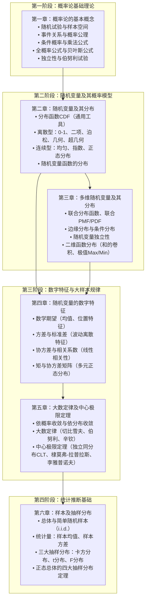
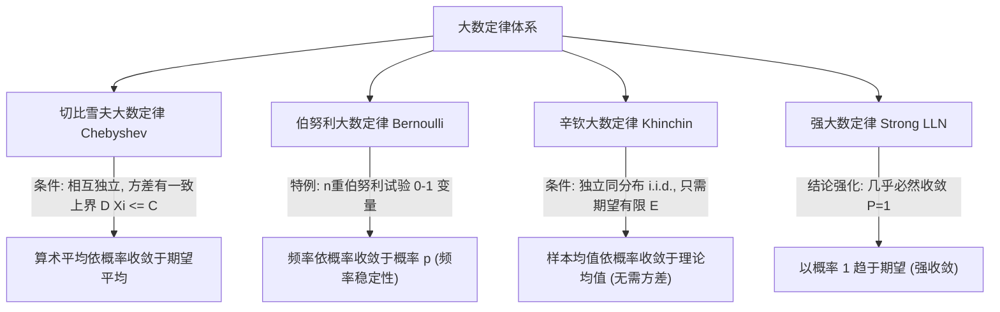
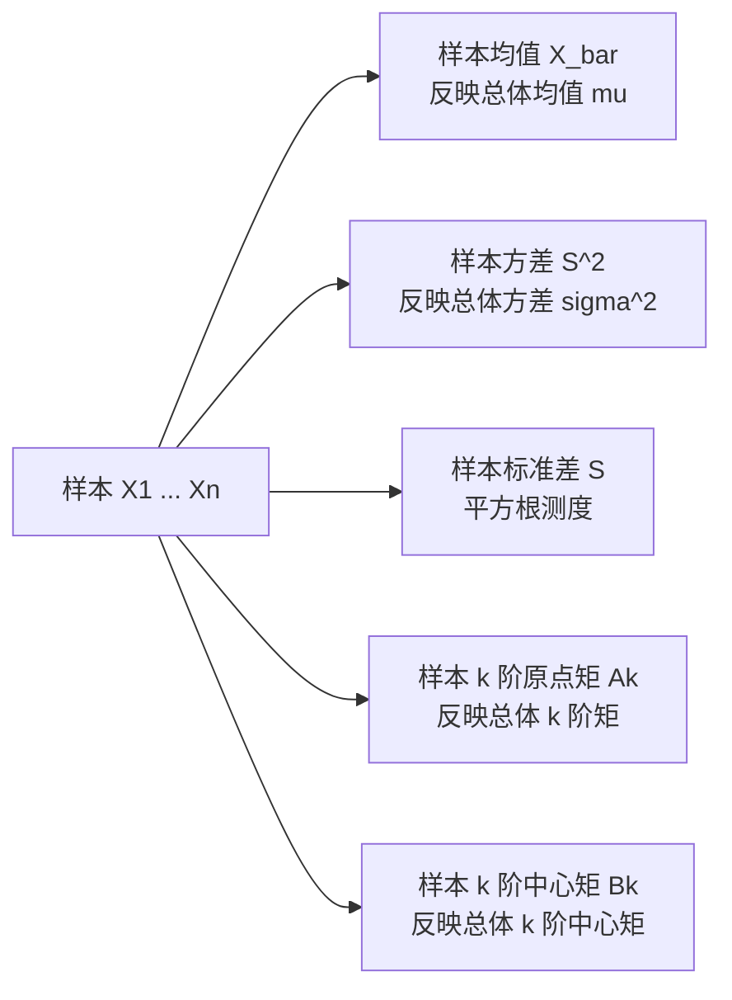
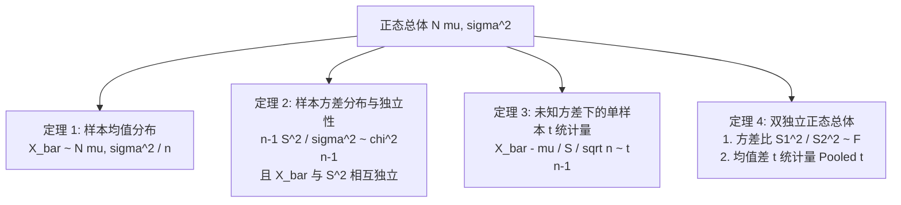

> **说明**：本文档基于课程课件（北京邮电大学概率论与数理统计课件系列）以及经典教材《概率论与数理统计》（浙江大学高等教育出版社第五版）全部内容深度总结提炼。
> 文档遵循**课件优先、教材对齐、逻辑严密、例题详尽**的原则，全面梳理核心概念、定理公式、做题思维范式，并对课件及教材中的**全部主要例题**进行深入剖析与步骤详解。

---

## 全书总览与知识脉络体系图谱

概率论与数理统计是一门研究随机现象统计规律性的数学学科。前五章为**概率论**部分，从微观到宏观探讨随机现象的数学建模；第六章为**数理统计**的起点，探讨如何以样本推断总体。



---

## 目录导航

- [第一章 概率论的基本概念](#第一章-概率论的基本概念)
  - [1.1 随机试验、样本空间与随机事件](#11-随机试验样本空间与随机事件)
  - [1.2 事件的运算律与集合关系](#12-事件的运算律与集合关系)
  - [1.3 古典概型与几何概型](#13-古典概型与几何概型)
  - [1.4 概率的公理化定义与性质](#14-概率的公理化定义与性质)
  - [1.5 条件概率与全概率公式、贝叶斯公式](#15-条件概率与全概率公式贝叶斯公式)
  - [1.6 随机事件的独立性与伯努利概型](#16-随机事件的独立性与伯努利概型)
  - [1.7 第一章课件与教材核心例题精讲](#17-第一章课件与教材核心例题精讲)
  - [1.8 第一章做题方法与高频考点陷阱剖析](#18-第一章做题方法与高频考点陷阱剖析)
- [第二章 随机变量及其分布](#第二章-随机变量及其分布)
  - [2.1 随机变量与分布函数（CDF）](#21-随机变量与分布函数cdf)
  - [2.2 离散型随机变量及其常见分布](#22-离散型随机变量及其常见分布)
  - [2.3 连续型随机变量及其常见分布](#23-连续型随机变量及其常见分布)
  - [2.4 随机变量函数的分布](#24-随机变量函数的分布)
  - [2.5 第二章课件与教材核心例题精讲](#25-第二章课件与教材核心例题精讲)
  - [2.6 第二章做题方法与解题套路归纳](#26-第二章做题方法与解题套路归纳)
- [第三章 多维随机变量及其分布](#第三章-多维随机变量及其分布)
  - [3.1 二维随机变量及其分布函数](#31-二维随机变量及其分布函数)
  - [3.2 二维离散型与连续型随机变量](#32-二维离散型与连续型随机变量)
  - [3.3 边缘分布与随机变量的独立性](#33-边缘分布与随机变量的独立性)
  - [3.4 条件分布](#34-条件分布)
  - [3.5 两个随机变量函数的分布](#35-两个随机变量函数的分布)
  - [3.6 拓展：多维随机变量与 AI 传感器融合案例](#36-拓展多维随机变量与-ai-传感器融合案例)
  - [3.7 第三章课件与教材核心例题精讲](#37-第三章课件与教材核心例题精讲)
  - [3.8 第三章做题方法与重积分区域划分技巧](#38-第三章做题方法与重积分区域划分技巧)
- [第四章 随机变量的数字特征](#第四章-随机变量的数字特征)
  - [4.1 数学期望](#41-数学期望)
  - [4.2 方差与标准差](#42-方差与标准差)
  - [4.3 七大常见分布的期望与方差推导速查大表](#43-七大常见分布的期望与方差推导速查大表)
  - [4.4 切比雪夫不等式与马尔可夫不等式](#44-切比雪夫不等式与马尔可夫不等式)
  - [4.5 协方差与相关系数](#45-协方差与相关系数)
  - [4.6 矩与协方差矩阵（多元正态分布）](#46-矩与协方差矩阵多元正态分布)
  - [4.7 第四章课件与教材核心例题精讲](#47-第四章课件与教材核心例题精讲)
  - [4.8 第四章做题方法与计算套路总结](#48-第四章做题方法与计算套路总结)
- [第五章 大数定律及中心极限定理](#第五章-大数定律及中心极限定理)
  - [5.1 极限定理的提出与收敛性概念](#51-极限定理的提出与收敛性概念)
  - [5.2 大数定律 (Laws of Large Numbers)](#52-大数定律-laws-of-large-numbers)
  - [5.3 中心极限定理 (Central Limit Theorems)](#53-中心极限定理-central-limit-theorems)
  - [5.4 课件精选核心例题与考研经典题深度全解](#54-课件精选核心例题与考研经典题深度全解)
  - [5.5 第五章做题方法与高频命题陷阱总结](#55-第五章做题方法与高频命题陷阱总结)
- [第六章 样本及抽样分布](#第六章-样本及抽样分布)
  - [6.1 数理统计的基本概念](#61-数理统计的基本概念)
  - [6.2 统计量及其常用构造](#62-统计量及其常用构造)
  - [6.3 三大抽样分布 (Sampling Distributions)](#63-三大抽样分布-sampling-distributions)
  - [6.4 正态总体的四大抽样分布定理](#64-正态总体的四大抽样分布定理)
  - [6.5 课件精选核心例题全解](#65-课件精选核心例题全解)
  - [6.6 第六章做题方法与高频命题陷阱总结](#66-第六章做题方法与高频命题陷阱总结)
- [附录：全书核心公式速查与高频易错辨析大表](#附录全书核心公式速查与高频易错辨析大表)
  - [附录 A：全书核心概率分布超全汇总速查表](#附录-a全书核心概率分布超全汇总速查表)
  - [附录 B：概率论与数理统计核心公式全景速查](#附录-b概率论与数理统计核心公式全景速查)
  - [附录 C：概率论与数理统计十大最高频“命题雷区”深度辨析](#附录-c概率论与数理统计十大最高频命题雷区深度辨析)
  - [学习与应试方法总结倡议](#学习与应试方法总结倡议)

---

# 第一章 概率论的基本概念

## 1.1 随机试验、样本空间与随机事件

### 1. 确定性现象与随机现象
- **确定性现象**：在一定条件下必然发生或必然不发生的现象（如“水从高处流向低处”、“同性电荷相斥”、“在间断点处函数不可导”）。特征是**条件完全决定结果**。
- **随机现象**：在基本条件保持不变的情况下，可能出现不同结果，且在一次观察之前无法预知具体会出现哪个结果的现象（如掷硬币、股票涨跌、灯泡寿命、原神抽卡出现5星角色）。特征是**个别结果具有不确定性，但大量重复试验呈现统计规律性**。

### 2. 随机试验（Random Experiment, 简称 $E$）
概率论中所研究的随机试验满足三大特征：
1. **可重复性**：可以在相同的条件下重复进行；
2. **多可能结果**：每次试验的全部可能结果是预先可知的，且不止一个；
3. **不可预知性**：每次试验之前不能确定哪一个结果会出现。

### 3. 样本空间与样本点
- **样本空间（Sample Space, 记为 $\Omega$ 或 $S$）**：随机试验 $E$ 的所有可能结果组成的集合。
- **样本点（Sample Point, 记为 $\omega$）**：样本空间中的每个元素（即试验的单一基本结果）。
  - *有限样本空间*：如掷一枚骰子，$\Omega = \{1, 2, 3, 4, 5, 6\}$；
  - *无限可列样本空间*：如一天内收到的微信条数，$\Omega = \{0, 1, 2, \dots\}$；
  - *不可列连续样本空间*：如测试灯泡的使用寿命，$\Omega = \{t \mid t \ge 0\}$。

### 4. 随机事件、必然事件与不可能事件
- **随机事件（Random Event, 简称事件，用 $A, B, C, \dots$ 表示）**：样本空间 $\Omega$ 的子集。当试验结果 $\omega \in A$ 时，称事件 $A$ **发生**。
- **基本事件**：由单个样本点构成的单点集 $\{\omega\}$。
- **必然事件（$\Omega$）**：在每次试验中必然发生的事件。
- **不可能事件（$\varnothing$）**：在每次试验中绝对不可能发生的事件（空集）。

---

## 1.2 事件的运算律与集合关系

随机事件与集合论完全一一对应。熟练掌握集合语言是概率计算的基础：

| 事件语言 | 集合符号 | 含义 |
| :--- | :--- | :--- |
| 事件 $A$ 包含于 $B$ ($A$ 发生必然导致 $B$ 发生) | $A \subset B$ | 若 $\omega \in A$，则 $\omega \in B$ |
| 事件 $A$ 与 $B$ 相等 | $A = B$ | $A \subset B$ 且 $B \subset A$ |
| 事件 $A$ 与 $B$ 的和事件 ($A$ 或 $B$ 至少有一个发生) | $A \cup B$ (或 $A + B$) | $\{\omega \mid \omega \in A \text{ 或 } \omega \in B\}$ |
| 事件 $A$ 与 $B$ 的积事件 ($A$ 与 $B$ 同时发生) | $A \cap B$ (或 $AB$) | $\{\omega \mid \omega \in A \text{ 且 } \omega \in B\}$ |
| 事件 $A$ 与 $B$ 的差事件 ($A$ 发生而 $B$ 不发生) | $A - B$ (或 $A\overline{B}$) | $\{\omega \mid \omega \in A \text{ 且 } \omega \notin B\} = A \cap \overline{B}$ |
| 事件 $A$ 与 $B$ 互不相容（互斥） | $AB = \varnothing$ | $A$ 与 $B$ 不能同时发生 |
| 对立事件（逆事件，非 $A$） | $\overline{A}$ | $A \cup \overline{A} = \Omega$ 且 $A \cap \overline{A} = \varnothing$ |

### 核心运算定律
1. **交换律**：$A \cup B = B \cup A$，$AB = BA$
2. **结合律**：$(A \cup B) \cup C = A \cup (B \cup C)$，$(AB)C = A(BC)$
3. **分配律**：
   - 积对和分配：$A(B \cup C) = (AB) \cup (AC)$
   - 和对积分配：$A \cup (BC) = (A \cup B)(A \cup C)$
4. **德·摩根定律（对偶律）**（极其高频且重要）：

$$
\overline{A \cup B} = \overline{A} \cap \overline{B}, \quad \overline{A \cap B} = \overline{A} \cup \overline{B}
$$

   推广至 $n$ 个事件：

$$
\overline{\bigcup_{i=1}^n A_i} = \bigcap_{i=1}^n \overline{A_i}, \quad \overline{\bigcap_{i=1}^n A_i} = \bigcup_{i=1}^n \overline{A_i}
$$

---

## 1.3 古典概型与几何概型

### 1. 古典概型（等可能概型）
具备两个基本特征的试验模型：
1. **有限性**：样本空间的样本点总数是有限的，即 $\Omega = \{\omega_1, \omega_2, \dots, \omega_n\}$；
2. **等可能性**：每个基本事件出现的可能性均相同，即 $P(\{\omega_1\}) = P(\{\omega_2\}) = \dots = P(\{\omega_n\}) = \frac{1}{n}$。

**计算公式**：
若事件 $A$ 包含 $k$ 个样本点，则：

$$
P(A) = \frac{A \text{ 所包含的样本点数}}{\Omega \text{ 包含的样本点总数}} = \frac{k}{n}
$$

**排列与组合计数速查**：
- 排列数（有顺序）：$A_n^m = \frac{n!}{(n-m)!}$
- 组合数（无顺序）：$C_n^m = \binom{n}{m} = \frac{n!}{m!(n-m)!}$
- 允许重复的排列：$n^m$

### 2. 几何概型（几何概率）
当试验结果具有无限不可列个，但仍具有“均匀对称分布”的性质时，推广为几何概型：
1. 样本空间 $\Omega$ 是某个有界度量区域（线段、平面区域、空间体等），度量 $L(\Omega) < \infty$；
2. 每个样本点落入区域内任意子区域的可能性只与该子区域的几何度量（长度、面积、体积）成正比，而与位置和形状无关。

**计算公式**：

$$
P(A) = \frac{L(A)}{L(\Omega)}
$$

---

## 1.4 概率的公理化定义与性质

### 1. 柯尔莫哥洛夫（Kolmogorov）概率公理化定义
设 $\Omega$ 是试验 $E$ 的样本空间，对于 $E$ 的每一个事件 $A$，赋予一个实数 $P(A)$，若满足以下三条公理：
1. **非负性公理**：对任意事件 $A$，$0 \le P(A) \le 1$；
2. **规范性公理**：$P(\Omega) = 1$；
3. **可列可加性公理**：若可列个事件 $A_1, A_2, \dots, A_n, \dots$ 两两互不相容（即 $A_i A_j = \varnothing, i \ne j$），则：

$$
P\left(\bigcup_{i=1}^\infty A_i\right) = \sum_{i=1}^\infty P(A_i)
$$

称 $P(A)$ 为事件 $A$ 的概率。

### 2. 概率的重要性质
- **性质 1（不可能事件概率为0）**：$P(\varnothing) = 0$。（注意反之不成立，在连续型中概率为0的事件不一定是不可能事件）。
- **性质 2（有限可加性）**：若 $A_1, A_2, \dots, A_n$ 两两互斥，则 $P(\bigcup_{i=1}^n A_i) = \sum_{i=1}^n P(A_i)$。
- **性质 3（对立事件公式）**：$P(\overline{A}) = 1 - P(A)$。
- **性质 4（单调性与差事件公式）**：
  - 对任意两事件 $A, B$，有：

$$
P(A - B) = P(A\overline{B}) = P(A) - P(AB)
$$

  - 若 $B \subset A$，则 $P(A - B) = P(A) - P(B)$，且 $P(B) \le P(A)$。
- **性质 5（加法定理 / 容斥原理）**：
  - 两事件加法：

$$
P(A \cup B) = P(A) + P(B) - P(AB)
$$

  - 三事件加法：

$$
P(A \cup B \cup C) = P(A) + P(B) + P(C) - P(AB) - P(BC) - P(CA) + P(ABC)
$$

  - $n$ 事件容斥原理：

$$
P\left(\bigcup_{i=1}^n A_i\right) = \sum_{i=1}^n P(A_i) - \sum_{1 \le i < j \le n} P(A_i A_j) + \sum_{1 \le i < j < k \le n} P(A_i A_j A_k) - \dots + (-1)^{n-1} P(A_1 A_2 \dots A_n)
$$

---

## 1.5 条件概率与全概率公式、贝叶斯公式

### 1. 条件概率
- **定义**：设 $A, B$ 是同一试验中的两个事件，且 $P(B) > 0$，则称

$$
P(A|B) = \frac{P(AB)}{P(B)}
$$

  为在事件 $B$ 已经发生的条件下，事件 $A$ 发生的**条件概率**。
- **条件概率的本质**：把样本空间从全局的 $\Omega$ 压缩收缩到了给定的条件集合 $B$ 上。
- **条件概率满足概率的三条公理**：
  1. $0 \le P(A|B) \le 1$；
  2. $P(\Omega|B) = 1$，$P(B|B) = 1$；
  3. 若 $A_1, A_2, \dots$ 两两互不相容，则 $P(\bigcup_{i=1}^\infty A_i \mid B) = \sum_{i=1}^\infty P(A_i \mid B)$。
  所有常规概率的性质（如减法、对立事件、加法公式）对条件概率均完全成立，如 $P(\overline{A}|B) = 1 - P(A|B)$。

### 2. 乘法公式（Multiplication Rule）
- 若 $P(B) > 0$，则：

$$
P(AB) = P(B)P(A|B)
$$

- 若 $P(A) > 0$，则：

$$
P(AB) = P(A)P(B|A)
$$

- **多事件链式乘法公式**：若 $P(A_1 A_2 \dots A_{n-1}) > 0$，则：

$$
P(A_1 A_2 \dots A_n) = P(A_1) P(A_2 | A_1) P(A_3 | A_1 A_2) \dots P(A_n | A_1 A_2 \dots A_{n-1})
$$

### 3. 样本空间的划分（Partition）
设 $\Omega$ 为试验 $E$ 的样本空间，$B_1, B_2, \dots, B_n$ 为一组事件，若满足：
1. 两两互不相容：$B_i B_j = \varnothing \quad (\forall i \ne j)$；
2. 完备覆盖：$\bigcup_{i=1}^n B_i = \Omega$；
3. 且 $P(B_i) > 0 \quad (i = 1, 2, \dots, n)$。
则称 $\{B_1, B_2, \dots, B_n\}$ 为样本空间 $\Omega$ 的一个**划分（或分割）**。

### 4. 全概率公式（Law of Total Probability）
- **定理**：设 $\{B_1, B_2, \dots, B_n\}$ 是样本空间 $\Omega$ 的一个划分，且 $P(B_i) > 0$，$A$ 为任意事件，则：

$$
P(A) = \sum_{i=1}^n P(B_i) P(A|B_i)
$$

- **思维图解（“化整为零，分而治之”）**：
  事件 $A$ 的发生可以由导致它的各个互斥原因 $B_i$ 引起，将 $A$ 分解为 $A = AB_1 \cup AB_2 \cup \dots \cup AB_n$。全概公式是由“因”推“果”。

### 5. 贝叶斯公式（Bayes' Theorem / 逆概率公式）
- **定理**：设 $\{B_1, B_2, \dots, B_n\}$ 是样本空间 $\Omega$ 的一个划分，且 $P(B_i) > 0$；$A$ 是一个事件且 $P(A) > 0$，则对任意 $k \in \{1, 2, \dots, n\}$：

$$
P(B_k | A) = \frac{P(B_k A)}{P(A)} = \frac{P(B_k) P(A|B_k)}{\sum_{i=1}^n P(B_i) P(A|B_i)}
$$

- **概念升华**：
  - **先验概率（Prior Probability）** $P(B_k)$：试验前根据历史经验或先验信息得到的各种原因 $B_k$ 发生的概率。
  - **后验概率（Posterior Probability）** $P(B_k | A)$：在观察到试验结果 $A$ 已经发生后，对造成这一结果的原因 $B_k$ 重新评估得到的条件概率。
  - 贝叶斯公式是现代统计推断、机器学习与信息更新的核心基石（“执果索因”）。

---

## 1.6 随机事件的独立性与伯努利概型

### 1. 两个事件的相互独立性
- **定义**：若两事件 $A, B$ 满足：

$$
P(AB) = P(A)P(B)
$$

  则称事件 $A$ 与事件 $B$ **相互独立**（简称独立）。
- **等价性质**：当 $P(B) > 0$ 时，$A, B$ 相互独立 $\iff P(A|B) = P(A)$。
- **重要定理**：若事件 $A$ 与 $B$ 相互独立，则下列三对事件也相互独立：

$$
A \text{ 与 } \overline{B}, \quad \overline{A} \text{ 与 } B, \quad \overline{A} \text{ 与 } \overline{B}
$$

- **必然/不可能事件的独立性**：若 $P(A) = 0$ 或 $P(A) = 1$，则对任意事件 $B$，$A$ 与 $B$ 必然相互独立。

### 2. 多个事件的相互独立性
- **三个事件相互独立**：若 $A, B, C$ 满足以下4个等式同时成立：

$$
\begin{cases}
  P(AB) = P(A)P(B) \\
  P(BC) = P(B)P(C) \\
  P(AC) = P(A)P(C) \\
  P(ABC) = P(A)P(B)P(C)
\end{cases}
$$

  则称 $A, B, C$ 相互独立。
  > [!WARNING]
  > **两两独立 $\ne$ 相互独立**：前三个等式只说明两两独立，无法推出第四个等式成立（见后文四面体例题反例）。

- **$n$ 个事件相互独立**：任取 $k$ 个事件（$2 \le k \le n$），它们的积事件概率等于各自概率的乘积（共需满足 $2^n - n - 1$ 个等式）。
- **独立事件至少一个发生的概率计算法宝**：
  若 $A_1, A_2, \dots, A_n$ 相互独立，记 $P(A_i) = p_i$，则它们中至少有一个发生的概率为：

$$
P\left(\bigcup_{i=1}^n A_i\right) = 1 - P\left(\bigcap_{i=1}^n \overline{A_i}\right) = 1 - \prod_{i=1}^n (1 - p_i)
$$

### 3. 伯努利试验与二项概率公式
- **伯努利试验（Bernoulli Trial）**：只有两个可能结果 $A$ 和 $\overline{A}$ 的单次试验，设 $P(A) = p \ (0 < p < 1)$。
- **$n$ 重伯努利试验**：将伯努利试验独立重复进行 $n$ 次。各次试验互不影响且每次试验中 $P(A) = p$ 保持不变。
- **二项概率定理**：在 $n$ 重伯努利试验中，事件 $A$ 恰好发生 $k$ 次的概率为：

$$
P_n(k) = C_n^k p^k (1-p)^{n-k}, \quad k = 0, 1, 2, \dots, n
$$

  记 $q = 1 - p$。显然 $\sum_{k=0}^n P_n(k) = \sum_{k=0}^n C_n^k p^k q^{n-k} = (p + q)^n = 1$。

---

## 1.7 第一章课件与教材核心例题精讲

### 【例题 1】数字抽取与组合（课件 P.41 例1）
**题目**：在数字 $1, 2, 3, 4, 5, 6$ 中任取不同的两个数构成一个两位数，求这两个数都是偶数的概率。
- **解析与思路**：
  - 构造两位数，取出顺序与个位十位有关，因此属于有序排列。也可以直接看作不考虑顺序选出两个不同数。
- **详细解答**：
  - **方法一（排列视角）**：
    样本空间样本点总数为从 6 个数中选 2 个作排列：$n = A_6^2 = 6 \times 5 = 30$。
    偶数有 $\{2, 4, 6\}$ 共 3 个，两个数均为偶数的排列数：$r = A_3^2 = 3 \times 2 = 6$。
    故所求概率为：

$$
P(A) = \frac{A_3^2}{A_6^2} = \frac{6}{30} = \frac{1}{5}
$$

  - **方法二（组合视角）**：
    若不考虑顺序，直接任取 2 个数：$n = C_6^2 = 15$。
    在 3 个偶数中任取 2 个：$r = C_3^2 = 3$。
    概率同样为 $P(A) = \frac{3}{15} = \frac{1}{5}$。
- **方法总结**：计算古典概型时，分子分母的计数口径必须严格一致（要么同时考虑顺序，要么同时不考虑顺序）。

---

### 【例题 2】经典取球模型：放回与不放回抽样对比（课件 P.42-46 例2）
**题目**：袋中共有 $N$ 个球，其中 $N_1$ 个白球，$N_2$ 个红球（$N_1 + N_2 = N$）。分别按“不放回”与“放回”两种方式任取出 $a + b$ 个球（$a \le N_1, b \le N_2$），试求这 $a+b$ 个球中恰含 $a$ 个白球、$b$ 个红球的概率。
- **解析与详细推导**：
  1. **不放回抽样**：
     - *视角一（一次性取出组合法）*：
       总样本数从 $N$ 个球中取 $a+b$ 个：$n = C_N^{a+b}$。
       有利样本数分步完成：从 $N_1$ 个白球取 $a$ 个，从 $N_2$ 个红球取 $b$ 个，乘法原理得 $C_{N_1}^a C_{N_2}^b$。
       故超几何概率为：

$$
P(A) = \frac{C_{N_1}^a C_{N_2}^b}{C_N^{a+b}}
$$

     - *视角二（逐个取出排列法）*：
       每次取 1 个球不放回取 $a+b$ 次，总样本点为 $A_N^{a+b}$。
       有利样本点分解：在 $a+b$ 次抽取位置中选 $a$ 个位置出白球（$C_{a+b}^a$ 种），白球在这些位置的排列有 $A_{N_1}^a$ 种，红球在剩余 $b$ 个位置的排列有 $A_{N_2}^b$ 种。

$$
P(A) = \frac{C_{a+b}^a A_{N_1}^a A_{N_2}^b}{A_N^{a+b}} = \frac{\frac{(a+b)!}{a!b!} \frac{N_1!}{(N_1-a)!} \frac{N_2!}{(N_2-b)!}}{\frac{N!}{(N-(a+b))!}} = \frac{C_{N_1}^a C_{N_2}^b}{C_N^{a+b}}
$$

       两种解法结果完全相同！这表明抽球“一次取出”与“逐个不放回取出”在概率本质上完全等价。
  2. **放回抽样**：
     - 每次取球后放回搅匀，每次抽取都有 $N$ 种可能，取 $a+b$ 次的总样本点数为 $N^{a+b}$。
     - 有利样本点：在 $a+b$ 次抽取中选 $a$ 次出现白球（$C_{a+b}^a$ 种），每次抽到白球有 $N_1$ 种可能，每次抽到红球有 $N_2$ 种可能。
     - 故所求概率为二项式项形式：

$$
P(A) = \frac{C_{a+b}^a N_1^a N_2^b}{N^{a+b}} = C_{a+b}^a \left(\frac{N_1}{N}\right)^a \left(\frac{N_2}{N}\right)^b
$$

- **方法总结**：不放回抽样对应**超几何分布**模型；放回抽样对应**二项分布**模型。

---

### 【例题 3】经典放球模型（课件 P.47-48 例3）
**题目**：将 $n$ 个球随机放入 $N$ 个盒子中（$n \le N$），每盒容量不限。求下列事件的概率：
(1) 某指定的 $n$ 个盒子中各有一个球；
(2) 恰有 $n$ 个盒子中各有一个球；
(3) 某指定的盒子中恰有 $k$ 个球；
(4) 设 $n = N$，恰好有一个盒子是空盒。
- **解析与解答**：
  每个球放入盒子都有 $N$ 种选法，因此 $n$ 个球放入 $N$ 盒的基本事件总数为 $N^n$。
  - **(1) 某指定的 $n$ 个盒中各有一个球**：
    指定的 $n$ 盒已经固定，只需将 $n$ 个不同球排列全放到这 $n$ 个盒中，有利数即为 $n!$。

$$
P(A_1) = \frac{n!}{N^n}
$$

  - **(2) 恰有 $n$ 个盒中各有一球**：
    首先需在 $N$ 个盒中任选 $n$ 个盒子（$C_N^n$ 种），然后再将 $n$ 个球全排列放入（$n!$ 种），有利数为 $C_N^n \cdot n! = A_N^n$。

$$
P(A_2) = \frac{A_N^n}{N^n}
$$

  - **(3) 某指定的盒子中恰有 $k$ 个球**：
    从 $n$ 个球中任选 $k$ 个放入该指定盒子（$C_n^k$ 种）；剩余的 $n - k$ 个球只能放入其余的 $N - 1$ 个盒子中（$(N-1)^{n-k}$ 种）。

$$
P(A_3) = \frac{C_n^k (N-1)^{n-k}}{N^n} = C_n^k \left(\frac{1}{N}\right)^k \left(1 - \frac{1}{N}\right)^{n-k}
$$

    此即二项分布模型。
  - **(4) 设 $n = N$，恰有一个盒子是空盒子**：
    由于 $n=N$ 个球且恰有 1 个空盒，说明必有 1 个盒子里装有 2 个球，其余 $n-2$ 个盒子里各有 1 个球。
    1. 从 $N$ 个盒子中选出 1 个空盒：$C_N^1 = N$ 种；
    2. 从剩下的 $N-1$ 个盒子中选出装 2 个球的盒子：$C_{N-1}^1 = N-1$ 种；
    3. 从 $N$ 个球中选 2 个球放入该盒子：$C_N^2$ 种；
    4. 剩余 $N-2$ 个球全排列放入剩余的 $N-2$ 个盒中：$(N-2)!$ 种。
    有利样本点数：$N \times (N-1) \times C_N^2 \times (N-2)! = C_N^2 \cdot N!$。

$$
P(A_4) = \frac{C_N^2 \cdot N!}{N^N}
$$

---

### 【例题 4】抽数放回模型与极值概率（课件 P.49-51 例4）
**题目**：从 $1, 2, \dots, N$ 这 $N$ 个数字中任取 $k$ 个数字，一个一个地取，取后放回。求下列事件的概率：
(1) $A =$ “$k$ 个数字完全不同”；
(2) $B =$ “不含 $1, 2, \dots, N$ 中指定的 $r$ 个数字”；
(3) $C =$ “某指定的数字恰好出现 $m$ 次（$m \le k$）”；
(4) $D =$ “$k$ 个数字中最大数恰好为 $M$”。
- **解答推导**：
  总样本点数为 $N^k$。
  - (1) 有序且不重复抽取，有利数为 $A_N^k$，故 $P(A) = \frac{A_N^k}{N^k}$。
  - (2) 每次只能在剩余的 $N-r$ 个数字中抽取，故 $P(B) = \frac{(N-r)^k}{N^k} = \left(1 - \frac{r}{N}\right)^k$。
  - (3) 在 $k$ 次中选 $m$ 次放置指定数字（$C_k^m$ 种），其余 $k-m$ 次在其余 $N-1$ 个数中选：$P(C) = \frac{C_k^m (N-1)^{k-m}}{N^k}$。
  - (4) **极值求解核心技巧**：
    最大数恰好为 $M$，等价于“全部 $k$ 个数都不超过 $M$”减去“全部 $k$ 个数都不超过 $M-1$”。
    - $k$ 个数均在 $1 \sim M$ 中选，取法有 $M^k$ 种；
    - $k$ 个数均在 $1 \sim M-1$ 中选，取法有 $(M-1)^k$ 种；
    故包含最大数等于 $M$ 的取法共有 $M^k - (M-1)^k$ 种。

$$
P(D) = \frac{M^k - (M-1)^k}{N^k}
$$

---

### 【例题 5】几何概型：两数之和（课件 P.55 例5）
**题目**：在区间 $[0, 1]$ 上任意取两个数，求这两个数之和大于 $3/4$ 的概率。
- **解答推导**：
  设两数分别为 $x, y \in [0, 1]$。
  样本空间 $\Omega = \{(x, y) \mid 0 \le x \le 1, 0 \le y \le 1\}$，面积 $S(\Omega) = 1 \times 1 = 1$。
  事件 $A = \{(x, y) \in \Omega \mid x + y > 3/4\}$。
  考虑逆事件 $\overline{A} = \{(x, y) \in \Omega \mid x + y \le 3/4\}$。
  $\overline{A}$ 是直角顶点在原点、两腰在坐标轴且长度均为 $3/4$ 的等腰直角三角形，其面积为：

$$
S(\overline{A}) = \frac{1}{2} \times \frac{3}{4} \times \frac{3}{4} = \frac{9}{32}
$$

  故由对立事件概率公式得：

$$
P(A) = 1 - P(\overline{A}) = 1 - \frac{9}{32} = \frac{23}{32}
$$

---

### 【例题 6】约会问题（课件 P.56-57 例6）
**题目**：甲、乙两人约定中午 1 点到 2 点间在某地会面，约定先到者等候 10 分钟即离去。设想甲、乙两人各自随意地在 1~2 点之间选一个时刻到达约会点，问“甲、乙两人能约会成功”的概率为多少？
- **解答推导**：
  设甲、乙两人到达的时刻分别为 $x, y$（以分钟计，自 1 点起算），则 $0 \le x \le 60, 0 \le y \le 60$。
  样本空间 $\Omega = \{(x, y) \mid 0 \le x \le 60, 0 \le y \le 60\}$，平面正方形面积 $S(\Omega) = 60^2 = 3600$。
  能会面的充要条件是 $|x - y| \le 10$。
  所求事件 $A$ 的区域夹在两条直线 $y - x = 10$ 与 $y - x = -10$ 之间。
  计算对立事件 $\overline{A}$（未能会面，即 $|x - y| > 10$）：
  $\overline{A}$ 包含两个等腰直角三角形（右上角和左下角），直角边长均为 $60 - 10 = 50$。

$$
S(\overline{A}) = 2 \times \left(\frac{1}{2} \times 50 \times 50\right) = 2500
$$

  因此会面区域面积 $S(A) = 3600 - 2500 = 1100$。

$$
P(A) = \frac{S(A)}{S(\Omega)} = \frac{1100}{3600} = \frac{11}{36} \approx 0.3056
$$

---

### 【例题 7】蒲丰投针问题（Buffon's Needle Problem）（课件 P.58-59 例3）
**题目**：平面上画有等距离为 $a$ 的一组平行线。向平面上任意投一长为 $l$ 的针（$l < a$），求针与平行线相交的概率。
- **严密推导**：
  设 $x$ 为针的中点 $M$ 与最近一条平行线的距离，$\varphi$ 为针与该平行线的夹角。
  由对称性与几何意义可知：

$$
0 \le x \le \frac{a}{2}, \quad 0 \le \varphi \le \pi
$$

  样本空间 $\Omega$ 对应的平面矩形区域面积：

$$
S(\Omega) = \frac{a}{2} \times \pi = \frac{a\pi}{2}
$$

  针与平行线相交的充要几何条件为（针长一半在垂直方向的投影大于等于中点到平行线的距离）：

$$
x \le \frac{l}{2}\sin\varphi
$$

  因此，事件 $A$ 对应的面积为积分：

$$
S(A) = \int_0^\pi \frac{l}{2}\sin\varphi \, d\varphi = \frac{l}{2} [-\cos\varphi]_0^\pi = \frac{l}{2} [1 - (-1)] = l
$$

  由几何概型概率公式：

$$
P(A) = \frac{S(A)}{S(\Omega)} = \frac{l}{\frac{a\pi}{2}} = \frac{2l}{\pi a}
$$

- **历史意义与蒙特卡洛方法**：
  若投针 $n$ 次，相交次数为 $m$，当 $n$ 充分大时频率稳定于概率 $\frac{m}{n} \approx \frac{2l}{\pi a}$，由此可得圆周率的估计值：

$$
\pi \approx \frac{2ln}{am}
$$

  这是历史上最早利用随机投点实验模拟求解数学常数的蒙特卡洛（Monte Carlo）实验。

---

### 【例题 8】贝特朗悖论（Bertrand's Paradox）（课件 P.60-62 例8）
**题目**：在半径为 $R$ 的圆内任作一弦，求弦长超过圆内接等边三角形边长（$\sqrt{3}R$）的概率。
- **三种不同合理建模的对比剖析**：
  - **方法一（随机端点法）**：
    固定弦的一个端点 $A$。此时弦由另一个端点 $B$ 在圆周上的位置决定。圆内接等边三角形的三个顶点将圆周三等分。只有当端点 $B$ 落在不包含 $A$ 的对边弧段上时，弦长才大于 $\sqrt{3}R$。该弧长占圆周长的 $1/3$。

$$
P_1 = \frac{1}{3}
$$

  - **方法二（随机半径/垂直切分法）**：
    由于对称性，可假定弦的方向与某特定半径垂直。内接正三角形的边与该半径垂直相交于中点（距离圆心 $R/2$ 处）。弦长大于 $\sqrt{3}R$ 当且仅当弦与圆心的距离小于 $R/2$。若认为弦与圆心的垂足在半径上是均匀分布的，则垂足落在 $[0, R/2]$ 内的概率为：

$$
P_2 = \frac{R/2}{R} = \frac{1}{2}
$$

  - **方法三（随机中点法）**：
    圆内的任意一条弦由其中点唯一确定。弦长大于 $\sqrt{3}R$ 当且仅当弦中点到圆心的距离小于 $R/2$，即中点落在半径为 $R/2$ 的同心圆内部。若假设弦的中点在圆内是均匀分布的，则：

$$
P_3 = \frac{\pi (R/2)^2}{\pi R^2} = \frac{1}{4}
$$

- **深度哲学总结**：
  同一个问题得出三种不同的答案，并非数学推导错误，而是因为题干中“任作一弦”没有明确说明“等可能性”所依托的测度空间。**在无限集上定义几何概型，必须先明确指定几何变换下的不变测度（概率空间）。**

---

### 【例题 9】集合运算与概率性质应用（课件 P.73 例1）
**题目**：已知 $P(A) = 0.2$，$P(B) = 0.6$。
(1) 若事件 $A, B$ 互不相容，求 $P(A \cup B)$ 与 $P(B\overline{A})$；
(2) 若 $A \subset B$，求 $P(A \cup B)$ 与 $P(B\overline{A})$；
(3) 若 $P(A - B) = 0.1$，求 $P(A \cup B)$ 与 $P(B\overline{A})$。
- **解答**：
  - (1) 互不相容时 $AB = \varnothing$，$P(AB) = 0$：
    $P(A \cup B) = P(A) + P(B) = 0.2 + 0.6 = 0.8$；
    $P(B\overline{A}) = P(B - A) = P(B) - P(AB) = 0.6 - 0 = 0.6$。
  - (2) $A \subset B$ 时 $A \cup B = B$，$AB = A$：
    $P(A \cup B) = P(B) = 0.6$；
    $P(B\overline{A}) = P(B - A) = P(B) - P(A) = 0.6 - 0.2 = 0.4$。
  - (3) $P(A - B) = P(A) - P(AB) = 0.1 \implies P(AB) = P(A) - 0.1 = 0.2 - 0.1 = 0.1$。
    $P(A \cup B) = P(A) + P(B) - P(AB) = 0.2 + 0.6 - 0.1 = 0.7$；
    $P(B\overline{A}) = P(B - A) = P(B) - P(AB) = 0.6 - 0.1 = 0.5$。

---

### 【例题 10】生日问题（Birthday Problem）（课件 P.76-77 例4）
**题目**：设每人的生日在一年 365 天中任意一天是等可能的。求 $n$（$n \le 365$）个人中至少有两人生日相同的概率。
- **解答推导**：
  设 $A =$ “$n$ 个人中至少两人生日相同”。
  总样本点数为 $365^n$。
  逆事件 $\overline{A} =$ “$n$ 个人的生日完全不相同”，有利样本点数为 $A_{365}^n$。

$$
P(\overline{A}) = \frac{A_{365}^n}{365^n} = \frac{365 \times 364 \times \dots \times (365 - n + 1)}{365^n} = \prod_{k=1}^{n-1} \left(1 - \frac{k}{365}\right)
$$

  故所求概率为：

$$
P(A) = 1 - P(\overline{A}) = 1 - \frac{A_{365}^n}{365^n}
$$

  数值代入结论：
  - 当 $n = 23$ 时，$P(A) \approx 0.507$（仅需23人，至少两人同生日的概率就已过半！）；
  - 当 $n = 50$ 时，$P(A) \approx 0.970$；
  - 当 $n = 64$ 时，$P(A) \approx 0.997$。
  该直观上的“反常”被称为“生日悖论”，本质上是因为两两组合数 $C_n^2$ 随 $n$ 迅速增长。

---

### 【例题 11】配对问题与帽子错排极限（课件 P.79-81 例6）
**题目**：在有 $n$ 人参加的晚会上，每人各带一顶帽子且互不相同。离开时每人随机拿走一顶帽子。问至少有一人拿对属于自己帽子的概率是多少？
- **解答推导（经典容斥原理）**：
  设事件 $A_i =$ “第 $i$ 个人拿对了自己的帽子”（$i = 1, 2, \dots, n$）。
  所求事件为 $A = \bigcup_{i=1}^n A_i$。
  $n$ 个人取帽子的全排列总数为 $n!$。
  对于任意单个人 $i$：$A_i$ 发生相当于该人帽子固定，其余 $n-1$ 人全排列，故 $P(A_i) = \frac{(n-1)!}{n!} = \frac{1}{n}$。
  对于任意两人 $i < j$：$P(A_i A_j) = \frac{(n-2)!}{n!} = \frac{1}{n(n-1)}$。
  对于任意 $k$ 个人：$P(A_{i_1} \dots A_{i_k}) = \frac{(n-k)!}{n!}$。
  应用容斥原理：

$$
P\left(\bigcup_{i=1}^n A_i\right) = \sum_{i=1}^n P(A_i) - \sum_{i<j} P(A_i A_j) + \dots + (-1)^{n-1} P(A_1 \dots A_n)
$$

$$
= C_n^1 \frac{1}{n} - C_n^2 \frac{1}{n(n-1)} + C_n^3 \frac{1}{n(n-1)(n-2)} - \dots + (-1)^{n-1} C_n^n \frac{1}{n!}
$$

$$
= 1 - \frac{1}{2!} + \frac{1}{3!} - \frac{1}{4!} + \dots + (-1)^{n-1} \frac{1}{n!}
$$

- **泰勒展开极限**：
  回忆指数函数麦克劳林展开式：$e^{-1} = 1 - 1 + \frac{1}{2!} - \frac{1}{3!} + \dots + (-1)^n \frac{1}{n!} + \dots$
  因此，当 $n \to \infty$ 时：

$$
\lim_{n \to \infty} P(A) = 1 - e^{-1} \approx 1 - 0.3679 = 0.6321
$$

- **结论**：即使晚会参加人数 $n$ 极大（如数万人），至少一人拿到自己帽子的概率稳定在约 63.21%，既不会趋于 1 也不会趋于 0。

---

### 【例题 12】Polya 罐子模型（课件 P.95 例3）
**题目**：袋中装有 $r$ 个红球，$t$ 个白球。每次任取一球，观察颜色后放回，并**再放入 $a$ 个同色球和 $b$ 个异色球**。连续取球 4 次，求前两次取得红球且后两次取得白球的概率。
- **解答**：
  设 $A_i =$ “第 $i$ 次取到红球”，$\overline{A_i} =$ “第 $i$ 次取到白球”。
  所求事件为 $A_1 A_2 \overline{A_3} \overline{A_4}$。使用乘法公式链式法则：

$$
P(A_1 A_2 \overline{A_3} \overline{A_4}) = P(A_1) P(A_2 | A_1) P(\overline{A_3} | A_1 A_2) P(\overline{A_4} | A_1 A_2 \overline{A_3})
$$

  1. 第一次取球前，红球数 $r$，白球数 $t$，总数 $r+t$：
     $P(A_1) = \frac{r}{r+t}$；
  2. 第一次取到红球，放回并加入 $a$ 红 $b$ 白，此时红球 $r+a$，白球 $t+b$，总数 $r+t+a+b$：
     $P(A_2 | A_1) = \frac{r+a}{r+t+a+b}$；
  3. 第二次又取到红球，放回并加入 $a$ 红 $b$ 白，此时红球 $r+2a$，白球 $t+2b$，总数 $r+t+2(a+b)$：
     $P(\overline{A_3} | A_1 A_2) = \frac{t+2b}{r+t+2(a+b)}$；
  4. 第三次取到白球，放回并加入 $a$ 白 $b$ 红，此时红球 $r+2a+b$，白球 $t+a+2b$，总数 $r+t+3(a+b)$：
     $P(\overline{A_4} | A_1 A_2 \overline{A_3}) = \frac{t+a+2b}{r+t+3(a+b)}$。
  将四项连乘即可得到所求概率。
- **特殊特例退化**：
  - 当 $a = -1, b = 0$ 时，退化为经典**不放回抽样**；
  - 当 $a = 0, b = 0$ 时，退化为经典**放回抽样**；
  - 当 $a > 0, b = 0$ 时，称为**传染病（扩散）模型**（取出的病原体会传染导致该颜色球比例增大）。

---

### 【例题 13】抽签顺序的公平性（课件 P.100 例1）
**题目**：某 10 个考签中有 4 个难签，甲、乙、丙三人依次参加抽签（不放回），抽签顺序为甲先、乙中、丙后。求三人各自抽得难签的概率。
- **解答推导（全概率公式示范）**：
  设 $A_1, A_2, A_3$ 分别表示甲、乙、丙抽得难签。
  1. 甲最先抽：$P(A_1) = \frac{4}{10} = 0.4$。
  2. 乙抽签时，样本空间按甲的结果划分：$\Omega = A_1 \cup \overline{A_1}$：

$$
P(A_2) = P(A_1) P(A_2 | A_1) + P(\overline{A_1}) P(A_2 | \overline{A_1}) = \frac{4}{10} \times \frac{3}{9} + \frac{6}{10} \times \frac{4}{9} = \frac{12 + 24}{90} = \frac{36}{90} = \frac{4}{10} = 0.4
$$

  3. 丙抽签时，按前两人的情况四种划分：

$$
P(A_3) = P(A_1 A_2) P(A_3|A_1 A_2) + P(A_1 \overline{A_2}) P(A_3|A_1 \overline{A_2}) + P(\overline{A_1} A_2) P(A_3|\overline{A_1} A_2) + P(\overline{A_1}\overline{A_2}) P(A_3|\overline{A_1}\overline{A_2})
$$

$$
= \frac{4 \times 3 \times 2 + 4 \times 6 \times 3 + 6 \times 4 \times 3 + 6 \times 5 \times 4}{10 \times 9 \times 8} = \frac{24 + 72 + 72 + 120}{720} = \frac{288}{720} = \frac{4}{10} = 0.4
$$

- **核心结论**：抽签中不论先后顺序，每个人抽到目标签的概率完全相同！**抽签公平与次序无关**。

---

### 【例题 14】贝叶斯抗原检测与基础比率谬误（课件 P.112-115 例1）
**题目**：某一城市人口为 100 万。已知感染者对抗原检测呈阳性的概率（灵敏度）为 $90\%$，未感染者对抗原检测呈阳性的概率（假阳性率/误报率）为 $5\%$。
(1) 在阶段一，全城仅有 10 例确诊。现随机抽查一人检测呈阳性，此人真正感染新冠的概率是多少？
(2) 在阶段二，全城感染人数达到 20 万。此时随机抽查一人检测呈阳性，此人真正感染的概率是多少？
(3) 在阶段三，对阶段二中首次检验呈阳性的人群立即进行**复检**，若复检仍为阳性，此人感染的概率是多少？
- **严密解答与数据分析**：
  设 $A =$ “抽检人真正被感染”，$B =$ “抗原检测结果呈阳性”。
  已知：$P(B|A) = 0.90$（敏感度），$P(B|\overline{A}) = 0.05$（误报率）。
  
  **解答 (1)**：
  先验感染率 $P(A) = \frac{10}{1000000} = 10^{-5}$，$P(\overline{A}) = 1 - 10^{-5} \approx 1$。
  由全概公式计算总阳性率：

$$
P(B) = P(A)P(B|A) + P(\overline{A})P(B|\overline{A}) = 10^{-5} \times 0.90 + 0.99999 \times 0.05 \approx 0.050009
$$

  由贝叶斯公式求后验概率：

$$
P(A|B) = \frac{P(A)P(B|A)}{P(B)} = \frac{10^{-5} \times 0.90}{0.050009} \approx 0.00018 = 0.018\%
$$

  > **现象解读**：虽然抗原检测号称“90%准确率”，但阳性者感染概率竟然不到万分之二！原因在于**极度罕见病背景下，健康人数量压倒性多数，5%假阳性所制造的健康假阳性人数（约5万人）远远超过了全部真实感染者（10人）**。这在认知心理学与医学上称为**基础比率谬误（Base Rate Fallacy）**。

  **解答 (2)**：
  当疫情暴发，感染者达到 20 万人时，先验概率变为 $P(A) = \frac{20}{100} = 0.20$，$P(\overline{A}) = 0.80$。

$$
P(B) = 0.20 \times 0.90 + 0.80 \times 0.05 = 0.18 + 0.04 = 0.22
$$

  此时后验概率：

$$
P(A|B) = \frac{0.18}{0.22} = \frac{9}{11} \approx 0.8182 \approx 82\%
$$

  由于先验感染率提高，检测阳性的置信度跃升至 $82\%$。

  **解答 (3)**：
  首次阳性的人群进入复检。此时这群人的先验概率已被更新为第一次的后验概率：$P(A) = 0.82$，$P(\overline{A}) = 0.18$。
  设 $B_2$ 为第二次检测呈阳性，由于两次检测独立：$P(B_2|A) = 0.90$，$P(B_2|\overline{A}) = 0.05$。

$$
P(B_2) = 0.82 \times 0.90 + 0.18 \times 0.05 = 0.738 + 0.009 = 0.747
$$

  复检后验概率：

$$
P(A|B_2) = \frac{0.82 \times 0.90}{0.747} = \frac{0.738}{0.747} \approx 0.9879 \approx 98.8\%
$$

  两次阳性将确诊率推升至 $98.8\%$ 以上！充分展示了**连续贝叶斯更新（Sequential Bayesian Updating）**的威力。

---

### 【例题 15】四面体两两独立与相互独立反例（课件 P.121 例1）
**题目**：一个正四面体，第一面上涂红色，第二面上涂白色，第三面上涂蓝色，第四面上同时涂红、白、蓝三种颜色。抛掷此四面体，记：
$A =$ “底面含有红色”，$B =$ “底面含有白色”，$C =$ “底面含有蓝色”。
证明：$A, B, C$ 两两独立，但并不相互独立。
- **严密证明**：
  四面体的四个面底面朝下的概率均为 $1/4$。
  - 含有红色的面有：第1面、第4面（共2个面），故 $P(A) = \frac{2}{4} = \frac{1}{2}$；
  - 含有白色的面有：第2面、第4面（共2个面），故 $P(B) = \frac{2}{4} = \frac{1}{2}$；
  - 含有蓝色的面有：第3面、第4面（共2个面），故 $P(C) = \frac{2}{4} = \frac{1}{2}$。
  
  检验两两积事件：
  - $AB$ 表示底面同时含有红与白，只有第4面，故 $P(AB) = \frac{1}{4}$；
    而 $P(A)P(B) = \frac{1}{2} \times \frac{1}{2} = \frac{1}{4}$，故 $P(AB) = P(A)P(B)$，$A$ 与 $B$ 独立。
  - 同理 $P(BC) = \frac{1}{4} = P(B)P(C)$，$P(AC) = \frac{1}{4} = P(A)P(C)$。
  因此，$A, B, C$ **两两独立**。

  检验三者乘积：
  - $ABC$ 表示底面同时含红、白、蓝三种颜色，仅有第4面，故 $P(ABC) = \frac{1}{4}$。
  - 但 $P(A)P(B)P(C) = \frac{1}{2} \times \frac{1}{2} \times \frac{1}{2} = \frac{1}{8}$。
  - 显然 $P(ABC) = \frac{1}{4} \ne \frac{1}{8} = P(A)P(B)P(C)$。
  因此，$A, B, C$ **不相互独立**！

---

### 【例题 16】伯努利试验与小概率事件检验（课件 P.129 例2）
**题目**：某厂自称产品的次品率不超过 $0.5\%$。经质检验收，随机抽检 200 件产品就查出了 5 件次品。试问：厂方声称的次品率是否可信？
- **解答与统计学原理**：
  若次品率确实为 $p = 0.005$，从大批量产品中抽检 200 件可视为 200 重伯努利试验。
  抽查出 5 件次品的概率为：

$$
P_{200}(5) = C_{200}^5 (0.005)^5 (1 - 0.005)^{195} \approx 0.00298
$$

  - **小概率原理**：概率极小（通常 $< 0.01$ 或 $< 0.05$）的事件在一次独立的试验中是几乎不可能发生的。
  - 现在仅抽验一次 200 件，这个概率不足千分之三的极端事件居然发生了，根据“小概率反证逻辑”，我们有充分理由怀疑厂方的断言，结论为：**该厂产品次品率不超过 0.5% 的声称是不可信的**。

---

## 1.8 第一章做题方法与高频考点陷阱剖析

### 1. 解题方法思维体系
1. **逆向思维（对立事件法）**：
   凡是题干出现**“至少有一个”、“至多有一个”、“不全为”、“至少两人相同”**等词眼时，正面讨论通常需要枚举多种情况极其繁琐，第一反应应考虑计算对立事件：$P(A) = 1 - P(\overline{A})$。
2. **全概与贝叶斯的“两步判定法”**：
   - 看到“分阶段”、“多种机制/机床/箱子抽取”、“由因索果” $\implies$ **全概率公式**；
   - 看到“已知结果已发生（如抽出红球、检测阳性、报废），求源自某一原因” $\implies$ **贝叶斯公式**；
   - *解题模板*：① 明确设出完备划分 $B_1, \dots, B_n$（通常是机床、箱子号、是否患病等产生原因）；② 明确设出结果事件 $A$；③ 写出先验概率 $P(B_i)$ 与条件概率 $P(A|B_i)$；④ 套入公式计算。
3. **独立性与互不相容（互斥）的严防死守**：
   - **概念混淆陷阱**：“互斥”是几何/集合层面的无交集关系（$AB = \varnothing$）；“独立”是概率度量上的乘积可乘关系（$P(AB) = P(A)P(B)$）。
   - 若 $P(A) > 0, P(B) > 0$，**互斥必不独立，独立必不互斥**！
   - 证明独立性唯一黄金法则：计算 $P(AB)$ 与 $P(A)P(B)$ 是否严格相等。
'''

# 第二章 随机变量及其分布

## 2.1 随机变量与分布函数（CDF）

### 1. 为什么引入随机变量？
随机试验的结果往往是非数量的（例如抛硬币出现“正面”、“反面”，摸球出现“红球”、“白球”，产品质量为“合格品”、“次品”）。
**核心思想**：建立一个从样本空间 $\Omega$ 到实数集 $\mathbb{R}$ 的映射，将原本非数值的试验结果**数量化**，从而能够借助高等数学（微积分、线性代数）的强大分析工具来系统研究随机现象的统计规律。

### 2. 随机变量的严格定义
设随机试验的样本空间为 $\Omega$。如果对于每一个样本点 $\omega \in \Omega$，均有唯一确定的实数 $X(\omega)$ 与之对应，则称实值函数 $X = X(\omega)$ 为定义在样本空间 $\Omega$ 上的**随机变量（Random Variable, 简称 r.v.）**。
- 随机变量本质上是**样本点的一个实值函数**，但它的取值随试验结果而随机变动，且在试验前只能预先知道它的取值范围及各范围出现的概率。

### 3. 分布函数的定义与几何解释
- **定义**：设 $X$ 是一个随机变量，$x$ 为任意实数，称函数

$$
F(x) = P\{X \le x\}, \quad -\infty < x < +\infty
$$

  为随机变量 $X$ 的**分布函数（Cumulative Distribution Function, 简称 CDF）**，记作 $X \sim F(x)$。
- **几何解释**：$F(x)$ 的函数值即为随机点 $X$ 落在数轴区间 $(-\infty, x]$ 上的概率。

### 4. 分布函数的核心性质（四大家族）
1. **单调不减性**：对任意实数 $x_1 < x_2$，有 $F(x_1) \le F(x_2)$。
2. **有界性与极限值**：对任意实数 $x$，$0 \le F(x) \le 1$，且：

$$
F(-\infty) = \lim_{x \to -\infty} F(x) = 0, \quad F(+\infty) = \lim_{x \to +\infty} F(x) = 1
$$

3. **右连续性**：对任意实数 $x_0$，有：

$$
F(x_0 + 0) = \lim_{x \to x_0^+} F(x) = F(x_0)
$$

4. **区间概率计算法则（必背工具箱）**：
   - 半开半闭区间：$P\{a < X \le b\} = F(b) - F(a)$
   - 单点概率：$P\{X = b\} = F(b) - F(b - 0)$（等于函数在 $b$ 处的右极限减左极限，即**跃度**）
   - 开区间：$P\{a < X < b\} = F(b - 0) - F(a)$
   - 闭区间：$P\{a \le X \le b\} = F(b) - F(a - 0)$
   - 严格大于：$P\{X > b\} = 1 - F(b)$
   - 大于等于：$P\{X \ge b\} = 1 - F(b - 0)$

---

## 2.2 离散型随机变量及其常见分布

### 1. 离散型随机变量
- **定义**：如果随机变量 $X$ 的全部可能取值只有**有限个或可列无穷多个**（$x_1, x_2, \dots, x_k, \dots$），则称 $X$ 为**离散型随机变量**。
- **分布律（概率函数 / PMF）**：

$$
P\{X = x_k\} = p_k, \quad k = 1, 2, \dots
$$

  满足两条充要性质：
  1. **非负性**：$p_k \ge 0$；
  2. **归一性**：$\sum_{k} p_k = 1$。
- **由分布律求分布函数**：

$$
F(x) = P\{X \le x\} = \sum_{x_k \le x} p_k
$$

  离散型随机变量的分布函数是**阶梯状单调不减函数**，跳跃间断点正好是 $X$ 的可能取值 $x_k$，跃度即为 $p_k$。

### 2. 常见重要离散分布大盘点

#### (1) 0-1 分布（两点分布 / 伯努利分布）$X \sim b(1, p)$
- **背景**：单次伯努利试验（成功记为1，失败记为0）。
- **分布律**：$P\{X = 1\} = p, \quad P\{X = 0\} = 1 - p \quad (0 < p < 1)$。
- 公式紧凑形式：$P\{X = k\} = p^k (1-p)^{1-k}, \quad k \in \{0, 1\}$。

#### (2) 二项分布 $X \sim b(n, p)$
- **背景**：$n$ 重独立重复伯努利试验中，事件 $A$（单次发生概率为 $p$）发生的总次数。
- **分布律**：

$$
P\{X = k\} = C_n^k p^k (1-p)^{n-k}, \quad k = 0, 1, 2, \dots, n
$$

- 归一化验证：$\sum_{k=0}^n C_n^k p^k (1-p)^{n-k} = [p + (1-p)]^n = 1^n = 1$。

#### (3) 泊松分布 $X \sim \pi(\lambda)$
- **背景**：描述大样本下**稀有事件（Rare Events）**在一定时间或空间内发生的总次数（如服务台呼叫次数、放射性粒子衰变数、交通事故数、印刷错误数）。
- **分布律**：

$$
P\{X = k\} = \frac{\lambda^k e^{-\lambda}}{k!}, \quad k = 0, 1, 2, \dots \quad (\lambda > 0)
$$

- 归一化验证：$\sum_{k=0}^\infty \frac{\lambda^k e^{-\lambda}}{k!} = e^{-\lambda} \sum_{k=0}^\infty \frac{\lambda^k}{k!} = e^{-\lambda} e^\lambda = 1$。
- **泊松定理（二项分布的泊松极限逼近）**：
  若 $n \to \infty$，$p \to 0$，而 $np = \lambda$ 保持常数，则对于固定的任意整数 $k$：

$$
\lim_{n \to \infty} C_n^k p^k (1-p)^{n-k} = \frac{\lambda^k e^{-\lambda}}{k!}
$$

  *实用法则*：当 $n \ge 100$ 且 $np \le 10$ 时，泊松分布能极高精度逼近二项分布，极大简化大组合数阶乘计算！

#### (4) 几何分布 $X \sim \text{Geo}(p)$
- **背景**：在独立重复伯努利试验中，事件 $A$（概率为 $p$）**首次发生**所需的试验总次数。
- **分布律**：

$$
P\{X = k\} = (1-p)^{k-1} p, \quad k = 1, 2, 3, \dots
$$

- **无记忆性（Memoryless Property）**：几何分布是离散型中**唯一具有无记忆性**的分布：

$$
P\{X > m + n \mid X > m\} = P\{X > n\} \quad (\forall m, n \in \mathbb{N}^+)
$$

#### (5) 巴斯卡分布（负二项分布）
- **背景**：在独立重复伯努利试验中，事件 $A$ 第 $r$ 次发生时的试验次数 $X$。
- **分布律**：$P\{X = k\} = C_{k-1}^{r-1} p^r (1-p)^{k-r}, \quad k = r, r+1, \dots$。当 $r=1$ 时即为几何分布。

#### (6) 超几何分布 $X \sim H(n, M, N)$
- **背景**：不放回抽样。总数 $N$ 件产品中含 $M$ 件次品，无放回任抽 $n$ 件，其中所含次品数 $X$。
- **分布律**：

$$
P\{X = k\} = \frac{C_M^k C_{N-M}^{n-k}}{C_N^n}, \quad \max(0, n - (N - M)) \le k \le \min(n, M)
$$

- *关系*：当总数 $N \to \infty$ 且 $\frac{M}{N} \to p$ 时，超几何分布逼近二项分布 $b(n, p)$。

---

## 2.3 连续型随机变量及其常见分布

### 1. 连续型随机变量与概率密度
- **定义**：对于随机变量 $X$ 的分布函数 $F(x)$，如果存在一个非负实函数 $f(x)$，使得对于任意实数 $x$，有：

$$
F(x) = \int_{-\infty}^x f(t) \, dt
$$

  则称 $X$ 为**连续型随机变量**，称 $f(x)$ 为 $X$ 的**概率密度函数（Probability Density Function, 简称 PDF 或概率密度）**。
- **概率密度 $f(x)$ 的充要性质**：
  1. **非负性**：$f(x) \ge 0$；
  2. **归一性**：$\int_{-\infty}^{+\infty} f(x) \, dx = 1$（曲线与横轴所夹总面积为 1）。
- **导数关系**：若 $f(x)$ 在 $x$ 处连续，则 $F'(x) = f(x)$。
- **微元概率解释**：$P\{x < X \le x + \Delta x\} \approx f(x) \Delta x$。
- **极为重要的连续型特性**：
  - 连续型随机变量在任意单个点上的概率**恒等于零**：$P\{X = c\} = 0$；
  - 因此不等式带不带等号概率完全相同：

$$
P\{a < X \le b\} = P\{a \le X \le b\} = P\{a < X < b\} = P\{a \le X < b\} = \int_a^b f(x) \, dx
$$

  - 注意：“概率为0的事件”不等于“不可能事件”；同理“概率为1的事件”不等于“必然事件”。

### 2. 常见重要连续分布大盘点

#### (1) 均匀分布 $X \sim U(a, b)$
- **概率密度**：

$$
f(x) = \begin{cases} \frac{1}{b-a}, & a \le x \le b \\ 0, & \text{其他} \end{cases}
$$

- **分布函数**：

$$
F(x) = \begin{cases} 0, & x < a \\ \frac{x - a}{b - a}, & a \le x < b \\ 1, & x \ge b \end{cases}
$$

- **概率积分变换（PIT 定理）**：
  设连续随机变量 $X$ 的分布函数为严格单调递增的 $F(x)$，若 $U \sim U(0, 1)$，则 $Y = F^{-1}(U)$ 的分布函数恰为 $F(y)$！反之，$F(X) \sim U(0, 1)$。该定理是计算机生成任意指定分布随机数的基石。

#### (2) 指数分布 $X \sim \text{Exp}(\lambda)$
- **概率密度**（$\lambda > 0$ 为常数，代表失效率/到达率）：

$$
f(x) = \begin{cases} \lambda e^{-\lambda x}, & x > 0 \\ 0, & x \le 0 \end{cases}
$$

- **分布函数**：

$$
F(x) = \begin{cases} 1 - e^{-\lambda x}, & x > 0 \\ 0, & x \le 0 \end{cases}
$$

- **存活概率公式**：$P\{X > t\} = 1 - F(t) = e^{-\lambda t} \ (t > 0)$。
- **核心性质：无记忆性（Memoryless Property）**：
  对任意 $s > 0, t > 0$，有：

$$
P\{X > s + t \mid X > s\} = P\{X > t\}
$$

  *推导证明*：

$$
P\{X > s + t \mid X > s\} = \frac{P\{X > s + t, X > s\}}{P\{X > s\}} = \frac{P\{X > s + t\}}{P\{X > s\}} = \frac{e^{-\lambda(s+t)}}{e^{-\lambda s}} = e^{-\lambda t} = P\{X > t\}
$$

  *物理意义*：若元件寿命服从指数分布，则“该元件已经工作了 $s$ 小时”的前提下，它还能继续工作 $t$ 小时的概率，与它刚出厂使用 $t$ 小时的概率完全相同！即元件无老化、无损耗。

#### (3) 正态分布（高斯分布）$X \sim N(\mu, \sigma^2)$
- **概率密度**（$\mu \in \mathbb{R}$ 为均值，$\sigma > 0$ 为标准差）：

$$
f(x) = \frac{1}{\sqrt{2\pi}\sigma} \exp\left(-\frac{(x - \mu)^2}{2\sigma^2}\right), \quad -\infty < x < +\infty
$$

- **分布函数**：

$$
F(x) = \frac{1}{\sqrt{2\pi}\sigma} \int_{-\infty}^x \exp\left(-\frac{(t - \mu)^2}{2\sigma^2}\right) dt
$$

- **概率密度曲线（高斯钟形曲线）的 5 大几何特征**：
  1. **对称轴**：关于直线 $x = \mu$ 轴对称；
  2. **极值点**：在 $x = \mu$ 处取得唯一最大值 $f(\mu) = \frac{1}{\sqrt{2\pi}\sigma}$；
  3. **拐点**：曲线的拐点横坐标为 $x = \mu \pm \sigma$；
  4. **渐近线**：以 $x$ 轴为水平渐近线，即 $\lim_{|x| \to \infty} f(x) = 0$；
  5. **参数作用**：$\mu$ 是**位置参数**，决定曲线中心在数轴上的平移；$\sigma$ 是**形态参数**，$\sigma$ 越小峰越陡峭狭窄，$\sigma$ 越大峰越扁平分散。

#### (4) 标准正态分布 $Z \sim N(0, 1)$
- **定义**：当 $\mu = 0, \sigma = 1$ 时的特例，其密度与分布函数记为专用符号：

$$
\varphi(x) = \frac{1}{\sqrt{2\pi}} e^{-\frac{x^2}{2}}, \quad \Phi(x) = \int_{-\infty}^x \varphi(t) \, dt
$$

- **对称性质（极为核心）**：

$$
\Phi(-x) = 1 - \Phi(x)
$$

$$
\Phi(0) = 0.5
$$

- **一般正态分布标准化引理**：
  若 $X \sim N(\mu, \sigma^2)$，令 $Z = \frac{X - \mu}{\sigma}$，则 $Z \sim N(0, 1)$。
  由此，任意一般正态分布的区间概率均可化为标准正态分布函数查表：

$$
P\{a < X \le b\} = \Phi\left(\frac{b - \mu}{\sigma}\right) - \Phi\left(\frac{a - \mu}{\sigma}\right)
$$

$$
P\{|X - \mu| \le c\} = 2\Phi\left(\frac{c}{\sigma}\right) - 1
$$

- **$3\sigma$ 准则（三倍标准差法则）**：

$$
P\{|X - \mu| \le \sigma\} = 2\Phi(1) - 1 = 2(0.8413) - 1 = 0.6826
$$

$$
P\{|X - \mu| \le 2\sigma\} = 2\Phi(2) - 1 = 2(0.9772) - 1 = 0.9544
$$

$$
P\{|X - \mu| \le 3\sigma\} = 2\Phi(3) - 1 = 2(0.99865) - 1 = 0.9973
$$

  *工程意义*：正态随机变量超出 $[\mu - 3\sigma, \mu + 3\sigma]$ 的概率仅有不到 $0.27\%$（即千分之三以下），工程上通常将超出 $3\sigma$ 的测量值视为异常粗大误差并予以剔除。

---

## 2.4 随机变量函数的分布

已知随机变量 $X$ 的分布，求其函数 $Y = g(X)$ 的分布。

### 1. 离散型随机变量函数的分布
设 $X$ 的分布律为 $P\{X = x_k\} = p_k$。
1. 计算出对应的函数值 $y_k = g(x_k)$；
2. 若存在不同的 $x_k$ 对应相同的 $y$，则根据和事件概率将相同的 $y$ 对应的概率**合并相加**；
3. 将 $y_k$ 按从小到大排序列出新分布表。

### 2. 连续型随机变量函数的分布

#### 方法一：分布函数法（万能第一法则）
先求 $Y$ 的分布函数 $F_Y(y)$，再求导得到概率密度 $f_Y(y)$：

$$
F_Y(y) = P\{Y \le y\} = P\{g(X) \le y\} = \int_{\{x \mid g(x) \le y\}} f_X(x) \, dx
$$

求出 $F_Y(y)$ 的显式表达式后，对 $y$ 求导：

$$
f_Y(y) = F_Y'(y) = \frac{d}{dy} F_Y(y)
$$

#### 方法二：公式法（适用于严格单调函数）
- **定理**：设 $X$ 为连续型随机变量，其概率密度为 $f_X(x)$。设函数 $y = g(x)$ 处处可导，且恒有 $g'(x) > 0$（严格单增）或恒有 $g'(x) < 0$（严格单减）。
  设其反函数为 $x = h(y)$，则 $Y = g(X)$ 的概率密度为：

$$
f_Y(y) = \begin{cases} f_X(h(y)) \cdot |h'(y)|, & \alpha < y < \beta \\ 0, & \text{其他} \end{cases}
$$

  其中 $(\alpha, \beta)$ 为 $g(x)$ 的值域。
- **公式记忆法**：$f_Y(y) \, |dy| = f_X(x) \, |dx| \implies f_Y(y) = f_X(x) \left|\frac{dx}{dy}\right| = f_X(h(y)) |h'(y)|$。

#### 核心推论：正态变量的线性变换仍为正态分布
若 $X \sim N(\mu, \sigma^2)$，常数 $a \ne 0, b \in \mathbb{R}$，则线性变换 $Y = aX + b$ 必服从正态分布：

$$
Y = aX + b \sim N(a\mu + b, a^2\sigma^2)
$$

---

## 2.5 第二章课件与教材核心例题精讲

### 【例题 1】抛硬币试验的阶梯分布函数（课件 P.12 Example 1）
**题目**：将一枚均匀硬币抛掷 3 次，记 $X$ 为正面朝上的次数，求 $X$ 的分布律及分布函数 $F(x)$。
- **详细解答**：
  $X$ 的可能取值为 $0, 1, 2, 3$。$X \sim b(3, 0.5)$。

$$
P\{X = 0\} = C_3^0 (0.5)^3 = \frac{1}{8}, \quad P\{X = 1\} = C_3^1 (0.5)^3 = \frac{3}{8}
$$

$$
P\{X = 2\} = C_3^2 (0.5)^3 = \frac{3}{8}, \quad P\{X = 3\} = C_3^3 (0.5)^3 = \frac{1}{8}
$$

  根据累积概率定义 $F(x) = \sum_{x_k \le x} P\{X = x_k\}$ 分段讨论：

$$
F(x) = \begin{cases}
  0, & x < 0 \\
  1/8, & 0 \le x < 1 \\
  1/8 + 3/8 = 1/2, & 1 \le x < 2 \\
  1/2 + 3/8 = 7/8, & 2 \le x < 3 \\
  7/8 + 1/8 = 1, & x \ge 3
\end{cases}
$$

- **分析**：每一段均是左闭右开区间，保证了右连续性。每个跃度正好等于该点的离散概率。

---

### 【例题 2】投质点坐标的分布函数（课件 P.15 Example 2）
**题目**：在区间 $[0, a]$ 上任意投一质点，以 $X$ 表示该质点的坐标。设质点落在 $[0, a]$ 中任意子区间的概率与该区间长度成正比，求 $X$ 的分布函数 $F(x)$。
- **解答**：
  - 当 $x < 0$ 时，点不能落在 $(-\infty, x]$ 上，故 $F(x) = 0$；
  - 当 $0 \le x < a$ 时，质点落在 $[0, x]$ 的长度为 $x$，总长度为 $a$，由几何概率 $P\{X \le x\} = \frac{x}{a}$，故 $F(x) = \frac{x}{a}$；
  - 当 $x \ge a$ 时，质点必然落在 $(-\infty, x]$ 上，故 $F(x) = 1$。
  综合得：

$$
F(x) = \begin{cases} 0, & x < 0 \\ \frac{x}{a}, & 0 \le x < a \\ 1, & x \ge a \end{cases}
$$

  求导得概率密度 $f(x) = \frac{1}{a} \ (0 < x < a)$，此即均匀分布 $U(0, a)$。

---

### 【例题 3】分布律归一性求待定系数（课件 P.19 Example 1）
**题目**：已知随机变量 $X$ 的分布律如下表：
| $X$ | -2 | 0 | 3 | 5 |
| :---: | :---: | :---: | :---: | :---: |
| $P$ | 1/4 | $a$ | 1/2 | 1/12 |
求：(1) 待定系数 $a$；(2) 概率 $P\{X > -1/2\}$。
- **解答**：
  (1) 由分布律归一性性质 $\sum p_k = 1$：

$$
\frac{1}{4} + a + \frac{1}{2} + \frac{1}{12} = 1 \implies a + \frac{3 + 6 + 1}{12} = 1 \implies a + \frac{10}{12} = 1 \implies a = \frac{2}{12} = \frac{1}{6}
$$

  (2) $X > -1/2$ 包含的可能取值为 $0, 3, 5$：

$$
P\{X > -1/2\} = P\{X = 0\} + P\{X = 3\} + P\{X = 5\} = \frac{1}{6} + \frac{1}{2} + \frac{1}{12} = \frac{2 + 6 + 1}{12} = \frac{9}{12} = \frac{3}{4}
$$

---

### 【例题 4】首次命中射击模型与几何分布（课件 P.20 Example 2）
**题目**：某射手连续向一目标射击，直到命中为止。已知他每发命中率为 $p$（$0 < p < 1$），且各次射击独立。求所需射击发数 $X$ 的概率函数。
- **解答**：
  $X$ 的可能取值为 $1, 2, 3, \dots$。
  事件 $\{X = k\}$ 发生，等价于前 $k-1$ 次均未命中，而第 $k$ 次恰好命中。
  由独立性乘法定理：

$$
P\{X = k\} = (1 - p)^{k-1} p, \quad k = 1, 2, 3, \dots
$$

  此即经典的**几何分布**。

---

### 【例题 5】泊松分布待定常数（课件 P.21 Example 3）
**题目**：设随机变量 $X$ 的分布律为 $P\{X = k\} = a \frac{\lambda^k}{k!} \ (k = 0, 1, 2, \dots, \lambda > 0)$。试确定常数 $a$。
- **解答**：
  由归一化性质 $\sum_{k=0}^\infty P\{X = k\} = 1$：

$$
\sum_{k=0}^\infty a \frac{\lambda^k}{k!} = a \sum_{k=0}^\infty \frac{\lambda^k}{k!} = a e^\lambda = 1 \implies a = e^{-\lambda}
$$

  从而带回得到 $P\{X = k\} = \frac{\lambda^k e^{-\lambda}}{k!}$，证毕。

---

### 【例题 6】射击命中问题：二项分布与泊松分布对比（课件 P.34 Example 1）
**题目**：某人射击，每次命中率为 $0.02$。求在独立进行 400 次射击中，至少击中 2 次的概率？分别用精确二项分布和泊松近似公式计算。
- **解答对比**：
  设 $X$ 为击中次数，精确分布为 $X \sim b(400, 0.02)$。
  - **精确公式**：

$$
P\{X \ge 2\} = 1 - P\{X = 0\} - P\{X = 1\} = 1 - (1 - 0.02)^{400} - C_{400}^1 (0.02)(1 - 0.02)^{399}
$$

$$
= 1 - (0.98)^{400} - 400 \times 0.02 \times (0.98)^{399} = 1 - (0.98)^{399} [0.98 + 8] = 1 - 8.98 \times (0.98)^{399}
$$

    高阶幂手算极其困难。
  - **泊松近似法**：
    这里 $n = 400$ 极大，$p = 0.02$ 很小，满足 $np = 400 \times 0.02 = 8 = \lambda \le 10$。
    取 $\lambda = 8$，由泊松近似公式：

$$
P\{X = 0\} \approx \frac{8^0 e^{-8}}{0!} = e^{-8}, \quad P\{X = 1\} \approx \frac{8^1 e^{-8}}{1!} = 8 e^{-8}
$$

$$
P\{X \ge 2\} \approx 1 - (e^{-8} + 8 e^{-8}) = 1 - 9 e^{-8}
$$

    查表或计算 $e^{-8} \approx 0.00033546$：

$$
P\{X \ge 2\} \approx 1 - 9 \times 0.00033546 = 1 - 0.003019 = 0.99698 \approx 0.997
$$

---

### 【例题 7】人寿保单亏损与获利商业概率测算（课件 P.35 Example 2）
**题目**：有 2500 名同一年龄和同社会阶层的人参加了保险公司的人寿保险。在一年中每个人死亡的概率为 $0.002$。每个参保人需在 1 月 1 日交 12 元保费，死亡时家属可领取 2000 元赔偿金。求：
(1) 保险公司亏本的概率；
(2) 保险公司一年内获利不少于 10000 元的概率。
- **解答与分析**：
  以“年”为单位。保险公司的固定总保费收入为：

$$
\text{总收入} = 2500 \times 12 = 30000 \text{ 元}
$$

  设 1 年中死亡人数为 $X$，则 $X \sim b(2500, 0.002)$。
  由于 $n = 2500$ 很大，$p = 0.002$ 很小，采用泊松近似：

$$
\lambda = n p = 2500 \times 0.002 = 5
$$

  即 $X \approx \pi(5)$。
  - **(1) 保险公司亏本的概率**：
    总赔偿金大于总收入即亏本：$2000 X > 30000 \implies X > 15$。

$$
P\{X > 15\} = \sum_{k=16}^\infty \frac{5^k e^{-5}}{k!}
$$

    查泊松累积分布表可得：$P\{X \le 15\} \approx 0.9999$。

$$
P\{\text{亏本}\} = P\{X > 15\} = 1 - P\{X \le 15\} \approx 1 - 0.9999 = 0.0001
$$

    保险公司亏本概率仅有万分之一，业务高度稳健安全。
  - **(2) 保险公司获利不少于 10000 元的概率**：

$$
30000 - 2000 X \ge 10000 \implies 2000 X \le 20000 \implies X \le 10
$$

$$
P\{X \le 10\} = \sum_{k=0}^{10} \frac{5^k e^{-5}}{k!} \approx 0.9863
$$

    保险公司获利超过 1 万元的概率高达 $98.63\%$。

---

### 【例题 8】分段分布函数的待定参数与求导（课件 P.47 Example 2）
**题目**：已知连续型随机变量 $X$ 的分布函数为：

$$
F(x) = \begin{cases} A e^x, & x < 0 \\ B - A e^{-x}, & x \ge 0 \end{cases}
$$

求：(1) 常数 $A, B$；(2) $X$ 的概率密度 $f(x)$；(3) 概率 $P\{-1 < X < 2\}$。
- **解答推导**：
  (1) 由连续型随机变量分布函数必须**全局处处连续**以及极限有界性：
  - $\lim_{x \to -\infty} F(x) = \lim_{x \to -\infty} A e^x = 0$（自然满足）；
  - $\lim_{x \to +\infty} F(x) = \lim_{x \to +\infty} (B - A e^{-x}) = B = 1 \implies B = 1$；
  - 在分界点 $x = 0$ 处必须连续，即 $F(0^-) = F(0^+)$：

$$
F(0^-) = \lim_{x \to 0^-} A e^x = A, \quad F(0^+) = F(0) = B - A = 1 - A
$$

$$
A = 1 - A \implies 2A = 1 \implies A = \frac{1}{2}
$$

  综上，$A = \frac{1}{2}, B = 1$。
  
  (2) 对 $F(x)$ 求导求概率密度 $f(x)$：
  - 当 $x < 0$ 时，$f(x) = F'(x) = \frac{1}{2} e^x$；
  - 当 $x > 0$ 时，$f(x) = F'(x) = -A(-e^{-x}) = \frac{1}{2} e^{-x}$。
  合并写为对称的**双边指数分布（Laplace 分布）**：

$$
f(x) = \frac{1}{2} e^{-|x|}, \quad -\infty < x < +\infty
$$

  
  (3) 计算区间概率：

$$
P\{-1 < X < 2\} = F(2) - F(-1) = \left(1 - \frac{1}{2}e^{-2}\right) - \left(\frac{1}{2}e^{-1}\right) = 1 - \frac{1}{2}(e^{-1} + e^{-2})
$$

---

### 【例题 9】一般正态分布标准化查表（课件 P.64 Example 4）
**题目**：设 $X \sim N(1.5, 2^2)$，求 $P\{-1 \le X \le 2\}$。
- **解答**：
  已知 $\mu = 1.5, \sigma = 2$。
  根据正态分布标准化公式：

$$
P\{-1 \le X \le 2\} = \Phi\left(\frac{2 - 1.5}{2}\right) - \Phi\left(\frac{-1 - 1.5}{2}\right) = \Phi(0.25) - \Phi(-1.25)
$$

  应用对称性 $\Phi(-x) = 1 - \Phi(x)$：

$$
\Phi(-1.25) = 1 - \Phi(1.25)
$$

  故：

$$
P\{-1 \le X \le 2\} = \Phi(0.25) - [1 - \Phi(1.25)] = \Phi(0.25) + \Phi(1.25) - 1
$$

  查标准正态分布数值表：
  $\Phi(0.25) = 0.5987$，$\Phi(1.25) = 0.8944$。
  代入得：

$$
P\{-1 \le X \le 2\} = 0.5987 + 0.8944 - 1 = 0.4931
$$

---

### 【例题 10】正态误差与大样本超差泊松逼近（课件 P.65 Example 5）
**题目**：假设测量的随机误差 $X \sim N(0, 10^2)$。试求在 100 次独立重复测量中，至少有 3 次测量误差的绝对值大于 19.6 的概率 $\alpha$，并利用泊松分布求 $\alpha$ 的近似值。
- **解答**：
  1. 先求单次测量误差绝对值超标的概率 $p$：

$$
p = P\{|X| > 19.6\} = 1 - P\{|X| \le 19.6\} = 1 - P\left\{\left|\frac{X - 0}{10}\right| \le 1.96\right\} = 1 - [2\Phi(1.96) - 1] = 2[1 - \Phi(1.96)]
$$

     查表知 $\Phi(1.96) = 0.9750$，故：

$$
p = 2 \times (1 - 0.9750) = 2 \times 0.025 = 0.05
$$

  2. 100 次独立测量，超标次数 $Y \sim b(100, 0.05)$。
     由于 $n = 100$ 大，$p = 0.05$ 小，使用泊松近似，参数 $\lambda = n p = 100 \times 0.05 = 5$。

$$
P\{Y \ge 3\} = 1 - P\{Y = 0\} - P\{Y = 1\} - P\{Y = 2\} = 1 - \left(e^{-5} + \frac{5^1}{1!}e^{-5} + \frac{5^2}{2!}e^{-5}\right)
$$

$$
= 1 - e^{-5} (1 + 5 + 12.5) = 1 - 18.5 e^{-5}
$$

     代入 $e^{-5} \approx 0.006738$：

$$
\alpha = P\{Y \ge 3\} \approx 1 - 18.5 \times 0.006738 = 1 - 0.12465 = 0.87535 \approx 0.88
$$

---

### 【例题 11】严格单调函数导数公式法（课件 P.71 Example 6）
**题目**：设随机变量 $X$ 具有概率密度 $f_X(x) = \begin{cases} \frac{x}{8}, & 0 < x < 4 \\ 0, & \text{其他} \end{cases}$。求 $Y = 2X + 1$ 的概率密度 $f_Y(y)$。
- **解答**：
  函数 $y = g(x) = 2x + 1$ 在 $(0, 4)$ 上处处可导且 $g'(x) = 2 > 0$，严格单调增加。
  值域范围：当 $x \in (0, 4)$ 时，$y \in (1, 9)$。
  反函数为 $x = h(y) = \frac{y - 1}{2}$，其导数 $h'(y) = \frac{1}{2}$。
  套用单调函数概率密度公式：

$$
f_Y(y) = f_X(h(y)) |h'(y)| = \frac{\frac{y - 1}{2}}{8} \times \frac{1}{2} = \frac{y - 1}{32}, \quad 1 < y < 9
$$

  对于其他 $y$，$f_Y(y) = 0$。
  综合得：

$$
f_Y(y) = \begin{cases} \frac{y - 1}{32}, & 1 < y < 9 \\ 0, & \text{其他} \end{cases}
$$

---

### 【例题 12】二次非单调变换的密度推导（课件 P.72 Example 7）
**题目**：设 $X$ 具有概率密度 $f_X(x)$，求 $Y = X^2$ 的概率密度 $f_Y(y)$。
- **解答（分布函数法示范）**：
  因为 $Y = X^2 \ge 0$，所以当 $y \le 0$ 时，$F_Y(y) = P\{Y \le y\} = 0$，此时 $f_Y(y) = 0$。
  当 $y > 0$ 时，利用分布函数法：

$$
F_Y(y) = P\{Y \le y\} = P\{X^2 \le y\} = P\{-\sqrt{y} \le X \le \sqrt{y}\} = F_X(\sqrt{y}) - F_X(-\sqrt{y})
$$

  对 $y$ 求导（利用复合函数求导链式法则）：

$$
f_Y(y) = \frac{d}{dy} F_Y(y) = f_X(\sqrt{y}) \cdot \frac{1}{2\sqrt{y}} - f_X(-\sqrt{y}) \cdot \left(-\frac{1}{2\sqrt{y}}\right) = \frac{1}{2\sqrt{y}} [f_X(\sqrt{y}) + f_X(-\sqrt{y})]
$$

  综合得：

$$
f_Y(y) = \begin{cases} \frac{1}{2\sqrt{y}} [f_X(\sqrt{y}) + f_X(-\sqrt{y})], & y > 0 \\ 0, & y \le 0 \end{cases}
$$

- **经典特例**：若 $X \sim N(0, 1)$，则 $f_X(x) = \frac{1}{\sqrt{2\pi}} e^{-x^2/2}$。
  代入上式：$f_Y(y) = \frac{1}{2\sqrt{y}} \left[\frac{2}{\sqrt{2\pi}} e^{-y/2}\right] = \frac{1}{\sqrt{2\pi}} y^{-1/2} e^{-y/2} \ (y > 0)$。此即自由度为 1 的 $\chi^2$ 分布（$\chi^2(1)$）！

---

### 【例题 13】正弦函数变换的概率密度（课件 P.76 Example 9）
**题目**：设交流电压 $V = A \sin\Theta$，其中振幅 $A > 0$ 为常数，相角 $\Theta \sim U(-\frac{\pi}{2}, \frac{\pi}{2})$。求电压 $V$ 的概率密度 $f_V(v)$。
- **解答**：
  相角 $\Theta$ 的概率密度为 $f_\Theta(\theta) = \frac{1}{\pi} \ (-\frac{\pi}{2} < \theta < \frac{\pi}{2})$。
  在区间 $(-\frac{\pi}{2}, \frac{\pi}{2})$ 上，函数 $v = A \sin\theta$ 严格单调递增，值域为 $(-A, A)$。
  反函数为 $\theta = \arcsin\left(\frac{v}{A}\right)$。
  其导数为：

$$
\frac{d\theta}{dv} = \frac{1}{\sqrt{1 - (v/A)^2}} \cdot \frac{1}{A} = \frac{1}{\sqrt{A^2 - v^2}}
$$

  由单调函数公式法：

$$
f_V(v) = f_\Theta(h(v)) \left|\frac{d\theta}{dv}\right| = \frac{1}{\pi} \cdot \frac{1}{\sqrt{A^2 - v^2}}, \quad -A < v < A
$$

  综合得：

$$
f_V(v) = \begin{cases} \frac{1}{\pi\sqrt{A^2 - v^2}}, & |v| < A \\ 0, & |v| \ge A \end{cases}
$$

  *物理洞察*：该概率密度在端点 $v \to \pm A$ 处趋于无穷大，表明正弦波在峰值附近停留时间最长，符合物理直觉。

---

### 【例题 14】非单调三角变换分段积分（课件 P.77 Example 10）
**题目**：设随机变量 $X$ 的概率密度为 $f_X(x) = \begin{cases} \frac{2x}{\pi^2}, & 0 < x < \pi \\ 0, & \text{其他} \end{cases}$。求 $Y = \sin X$ 的概率密度 $f_Y(y)$。
- **解答（非单调函数分布函数法）**：
  当 $x \in (0, \pi)$ 时，$y = \sin x \in (0, 1]$。
  - 当 $y \le 0$ 时，$F_Y(y) = 0 \implies f_Y(y) = 0$；
  - 当 $y \ge 1$ 时，$F_Y(y) = 1 \implies f_Y(y) = 0$；
  - 当 $0 < y < 1$ 时，求解不等式 $\sin X \le y$：
    由正弦函数在 $(0, \pi)$ 上的图像可知：$\sin x \le y \iff x \in (0, \arcsin y] \cup [\pi - \arcsin y, \pi)$。

$$
F_Y(y) = P\{0 < X \le \arcsin y\} + P\{\pi - \arcsin y \le X < \pi\}
$$

$$
= \int_0^{\arcsin y} \frac{2x}{\pi^2} \, dx + \int_{\pi - \arcsin y}^\pi \frac{2x}{\pi^2} \, dx = \left[\frac{x^2}{\pi^2}\right]_0^{\arcsin y} + \left[\frac{x^2}{\pi^2}\right]_{\pi - \arcsin y}^\pi
$$

$$
= \frac{(\arcsin y)^2}{\pi^2} + \frac{\pi^2 - (\pi - \arcsin y)^2}{\pi^2} = \frac{(\arcsin y)^2}{\pi^2} + \frac{2\pi \arcsin y - (\arcsin y)^2}{\pi^2} = \frac{2}{\pi} \arcsin y
$$

  对 $y$ 求导得概率密度：

$$
f_Y(y) = \frac{d}{dy} \left(\frac{2}{\pi} \arcsin y\right) = \frac{2}{\pi \sqrt{1 - y^2}}, \quad 0 < y < 1
$$

  综合得：

$$
f_Y(y) = \begin{cases} \frac{2}{\pi \sqrt{1 - y^2}}, & 0 < y < 1 \\ 0, & \text{其他} \end{cases}
$$

---

## 2.6 第二章做题方法与解题套路归纳

### 1. 分布函数的判断准则（“三步法”）
判断一个给定函数 $F(x)$ 是否为某随机变量的分布函数，必须且只需验证三条：
1. **单调性**：对任意 $x$，导数 $F'(x) \ge 0$ 或直接观察不减；
2. **极限值**：$\lim_{x \to -\infty} F(x) = 0$ 且 $\lim_{x \to +\infty} F(x) = 1$；
3. **右连续**：分段点处必须右连续，即 $F(x_0^+) = F(x_0)$。

### 2. 连续型随机变量函数分布求解范式
- **判断单调性是第一要务**：
  - 若 $y = g(x)$ 在 $f_X(x) \ne 0$ 的区间上**严格单调** $\implies$ **首选公式法**（快、准，注意反函数导数加绝对值 $|h'(y)|$ 并注明新定义域！）；
  - 若 $y = g(x)$ **非单调**（如 $Y = X^2$、$Y = |X|$、$Y = \sin X$） $\implies$ **严禁用公式法，必须用分布函数法**：
    ① 画出 $y = g(x)$ 的函数图像与水平线 $y$；
    ② 解出不等式 $g(x) \le y$ 对应的 $x$ 集合区间；
    ③ 分段写出积分形式 $F_Y(y) = \int_{g(x) \le y} f_X(x) dx$；
    ④ 对积分求导得出 $f_Y(y)$。

# 第三章 多维随机变量及其分布

## 3.1 二维随机变量及其分布函数

### 1. 二维随机变量的定义
设 $E$ 是一个随机试验，它的样本空间为 $\Omega$。设 $X = X(\omega)$ 和 $Y = Y(\omega)$ 是定义在同一样本空间 $\Omega$ 上的两个随机变量。由它们构成的向量 $(X, Y)$ 称为**二维随机变量**或**二维随机向量**。
- 随机向量 $(X, Y)$ 不仅刻画各个分量各自的统计规律，更重要的是反映各分量之间的**联合统计规律与相互制约关联**。

### 2. 联合分布函数（Joint CDF）
- **定义**：设 $(X, Y)$ 为二维随机变量，对任意两个实数 $x, y$，二元实函数

$$
F(x, y) = P\{X \le x, Y \le y\}, \quad -\infty < x, y < +\infty
$$

  称为二维随机变量 $(X, Y)$ 的**分布函数**，或称为 $X$ 与 $Y$ 的**联合分布函数**。
- **几何解释**：在平面直角坐标系 $xOy$ 中，$F(x, y)$ 表示随机点 $(X, Y)$ 落在以点 $(x, y)$ 为右上顶角、两条边平行于坐标轴的无限大闭平面的概率：

$$
\{(u, v) \mid u \le x, v \le y\}
$$

### 3. 联合分布函数的基本性质（充要性质）
1. **单调不减性**：$F(x, y)$ 分别关于 $x$ 和关于 $y$ 均为单调不减函数。即：
   - 对任意固定的 $y$，当 $x_1 < x_2$ 时，$F(x_1, y) \le F(x_2, y)$；
   - 对任意固定的 $x$，当 $y_1 < y_2$ 时，$F(x, y_1) \le F(x, y_2)$。
2. **有界性与边界极限**：对任意实数 $x, y$，$0 \le F(x, y) \le 1$，且：

$$
F(-\infty, y) = \lim_{x \to -\infty} F(x, y) = 0, \quad F(x, -\infty) = \lim_{y \to -\infty} F(x, y) = 0
$$

$$
F(-\infty, -\infty) = 0, \quad F(+\infty, +\infty) = 1
$$

3. **右连续性**：$F(x, y)$ 关于 $x$ 和关于 $y$ 均满足右连续：

$$
F(x + 0, y) = F(x, y), \quad F(x, y + 0) = F(x, y)
$$

4. **矩形非负性（二维本质准则）**：
   对任意实数 $x_1 < x_2$ 和 $y_1 < y_2$，随机点 $(X, Y)$ 落在矩形区域 $(x_1, x_2] \times (y_1, y_2]$ 内的概率必须非负：

$$
P\{x_1 < X \le x_2, y_1 < Y \le y_2\} = F(x_2, y_2) - F(x_2, y_1) - F(x_1, y_2) + F(x_1, y_1) \ge 0
$$

   > [!WARNING]
   > **极重要易错陷阱**：仅满足单调性、有界性与右连续性的二元函数**不一定**是分布函数！
   > 例如，令 $F(x, y) = \begin{cases} 1, & x + y \ge 1 \\ 0, & \text{其他} \end{cases}$。容易验证该函数单调不减、有界且右连续。但若取矩形顶点 $(0, 0)$ 与 $(1, 1)$，则：
   > 
   > $$
   > P\{0 < X \le 1, 0 < Y \le 1\} = F(1, 1) - F(1, 0) - F(0, 1) + F(0, 0) = 1 - 1 - 1 + 0 = -1 < 0
   > $$
   > 
   > 概率出现负值，故该函数绝不是任何二维随机变量的分布函数！

---

## 3.2 二维离散型与连续型随机变量

### 1. 二维离散型随机变量
- **定义**：如果二维随机变量 $(X, Y)$ 所有可能的取值对只有**有限对或可列无穷多对** $(x_i, y_j)$，则称 $(X, Y)$ 为二维离散型随机变量。
- **联合分布律（联合 PMF）**：

$$
P\{X = x_i, Y = y_j\} = p_{ij}, \quad i, j = 1, 2, \dots
$$

  具有两大充要性质：
  1. **非负性**：$p_{ij} \ge 0$；
  2. **归一性**：$\sum_{i} \sum_{j} p_{ij} = 1$。
- **由联合分布律求联合分布函数**：

$$
F(x, y) = \sum_{x_i \le x} \sum_{y_j \le y} p_{ij}
$$

### 2. 二维连续型随机变量
- **定义**：设二维随机变量 $(X, Y)$ 的分布函数为 $F(x, y)$。如果存在一个非负的二元实函数 $f(x, y)$，使得对任意实数 $x, y$，有：

$$
F(x, y) = \int_{-\infty}^x \int_{-\infty}^y f(u, v) \, du dv
$$

  则称 $(X, Y)$ 为**二维连续型随机变量**，称 $f(x, y)$ 为其**联合概率密度函数（联合 PDF）**。
- **联合概率密度的充要性质**：
  1. **非负性**：$f(x, y) \ge 0$；
  2. **归一性**：$\int_{-\infty}^{+\infty} \int_{-\infty}^{+\infty} f(x, y) \, dx dy = 1$（空间曲面 $z = f(x, y)$ 与 $xOy$ 平面围成的柱体总体积为 1）；
  3. **区域概率计算公式**：设 $G$ 是平面上的可求面积区域，则：

$$
P\{(X, Y) \in G\} = \iint_G f(x, y) \, dx dy
$$

  4. **偏导数关系**：若 $f(x, y)$ 在点 $(x, y)$ 处连续，则：

$$
\frac{\partial^2 F(x, y)}{\partial x \partial y} = f(x, y)
$$

### 3. 两个重要的二维连续型分布

#### (1) 二维均匀分布 $(X, Y) \sim U(D)$
设 $D$ 是平面上的有限有界区域，其面积记为 $S_D$。若 $(X, Y)$ 的联合概率密度为：

$$
f(x, y) = \begin{cases} \frac{1}{S_D}, & (x, y) \in D \\ 0, & \text{其他} \end{cases}
$$

则称 $(X, Y)$ 在区域 $D$ 上服从**二维均匀分布**。对于 $D$ 内任意子区域 $A$，落在 $A$ 内的概率与其面积成正比：$P\{(X, Y) \in A\} = \frac{S_A}{S_D}$。

#### (2) 二维正态分布 $(X, Y) \sim N(\mu_1, \mu_2, \sigma_1^2, \sigma_2^2, \rho)$
- **联合概率密度公式**：

$$
f(x, y) = \frac{1}{2\pi\sigma_1\sigma_2\sqrt{1-\rho^2}} \exp\left(-\frac{1}{2(1-\rho^2)}\left[\frac{(x-\mu_1)^2}{\sigma_1^2} - 2\rho\frac{(x-\mu_1)(y-\mu_2)}{\sigma_1\sigma_2} + \frac{(y-\mu_2)^2}{\sigma_2^2}\right]\right)
$$

- **五大参数的严密统计学内涵**：
  - $\mu_1 = E(X)$：$X$ 的数学期望；
  - $\sigma_1^2 = D(X)$：$X$ 的方差（$\sigma_1 > 0$）；
  - $\mu_2 = E(Y)$：$Y$ 的数学期望；
  - $\sigma_2^2 = D(Y)$：$Y$ 的方差（$\sigma_2 > 0$）；
  - $\rho = \rho_{XY}$：$X$ 与 $Y$ 的相关系数（$|\rho| < 1$）。

---

## 3.3 边缘分布与随机变量的独立性

### 1. 边缘分布函数（Marginal CDF）
已知联合分布函数 $F(x, y)$，通过令另一个变量趋向正无穷大，即可唯一确定各自的**边缘分布函数**：

$$
F_X(x) = P\{X \le x\} = P\{X \le x, Y < +\infty\} = F(x, +\infty) = \lim_{y \to +\infty} F(x, y)
$$

$$
F_Y(y) = P\{Y \le y\} = P\{X < +\infty, Y \le y\} = F(+\infty, y) = \lim_{x \to +\infty} F(x, y)
$$

### 2. 离散型随机变量的边缘分布律
通过对联合分布律按行、按列求和获得：
- $X$ 的边缘分布律（按行对 $j$ 求和）：

$$
p_{i\cdot} = P\{X = x_i\} = \sum_{j=1}^\infty P\{X = x_i, Y = y_j\} = \sum_{j=1}^\infty p_{ij}, \quad i = 1, 2, \dots
$$

- $Y$ 的边缘分布律（按列对 $i$ 求和）：

$$
p_{\cdot j} = P\{Y = y_j\} = \sum_{i=1}^\infty P\{X = x_i, Y = y_j\} = \sum_{i=1}^\infty p_{ij}, \quad j = 1, 2, \dots
$$

### 3. 连续型随机变量的边缘概率密度
通过在全数轴上积分“消去（积掉）”另一个变量获得：

$$
f_X(x) = \int_{-\infty}^{+\infty} f(x, y) \, dy
$$

$$
f_Y(y) = \int_{-\infty}^{+\infty} f(x, y) \, dx
$$

- **二维正态分布的边缘分布定理**：
  若 $(X, Y) \sim N(\mu_1, \mu_2, \sigma_1^2, \sigma_2^2, \rho)$，则其边缘分布必然是一维正态分布：

$$
X \sim N(\mu_1, \sigma_1^2), \quad Y \sim N(\mu_2, \sigma_2^2)
$$

  > [!IMPORTANT]
  > **核心考点与单向性**：
  > 1. “联合正态 $\implies$ 边缘必正态”，但**“边缘均正态 $\not\implies$ 联合正态”**！只有在附加独立性条件或特殊线性结构下才成立。
  > 2. 由边缘分布一般**无法唯一确定**联合分布（除非已知独立）。

### 4. 随机变量的独立性（Independence）
- **通用定义**：若对任意实数 $x, y$，均有：

$$
F(x, y) = F_X(x) F_Y(y)
$$

  则称随机变量 $X$ 与 $Y$ **相互独立**。
- **离散型独立充要条件**：
  对所有可能的取值对 $(x_i, y_j)$，联合概率均等于边缘概率之积：

$$
p_{ij} = p_{i\cdot} \cdot p_{\cdot j} \quad (\forall i, j)
$$

- **连续型独立充要条件**：
  在平面上几乎处处成立：

$$
f(x, y) = f_X(x) f_Y(y)
$$

- **二维正态分布的独立充要性（黄金定理）**：
  设 $(X, Y) \sim N(\mu_1, \mu_2, \sigma_1^2, \sigma_2^2, \rho)$，则：

$$
X \text{ 与 } Y \text{ 相互独立} \iff \rho = 0
$$

  （注：对于一般随机变量，独立可推出不相关，但不相关不一定独立；只有在**正态分布族**中，“独立”与“不相关”完全等价！）

---

## 3.4 条件分布

### 1. 二维离散型随机变量的条件分布律
- 在已知 $Y = y_j$（且 $P\{Y = y_j\} = p_{\cdot j} > 0$）的条件下，$X$ 的**条件分布律**为：

$$
P\{X = x_i \mid Y = y_j\} = \frac{P\{X = x_i, Y = y_j\}}{P\{Y = y_j\}} = \frac{p_{ij}}{p_{\cdot j}}, \quad i = 1, 2, \dots
$$

- 在已知 $X = x_i$（且 $P\{X = x_i\} = p_{i\cdot} > 0$）的条件下，$Y$ 的**条件分布律**为：

$$
P\{Y = y_j \mid X = x_i\} = \frac{P\{X = x_i, Y = y_j\}}{P\{X = x_i\}} = \frac{p_{ij}}{p_{i\cdot}}, \quad j = 1, 2, \dots
$$

- 显然固定 $j$ 时，$\sum_{i=1}^\infty P\{X = x_i \mid Y = y_j\} = \frac{\sum_i p_{ij}}{p_{\cdot j}} = 1$。
- 若 $X$ 与 $Y$ 独立，则条件分布律退化为边缘分布律：$P\{X = x_i \mid Y = y_j\} = p_{i\cdot}$。

### 2. 二维连续型随机变量的条件概率密度
由于连续型随机变量单点概率为 0，不能直接套用常规条件概率公式除以 0，需借助极限定义：
- **定义**：设 $(X, Y)$ 为连续型随机变量，联合密度为 $f(x, y)$，边缘密度分别为 $f_X(x)$ 和 $f_Y(y)$。
  - 在任一使得 $f_X(x) > 0$ 的点 $x$ 处，称

$$
f_{Y|X}(y|x) = \frac{f(x, y)}{f_X(x)}
$$

    为在已知 $X = x$ 的条件下，$Y$ 的**条件概率密度**。
  - 在任一使得 $f_Y(y) > 0$ 的点 $y$ 处，称

$$
f_{X|Y}(x|y) = \frac{f(x, y)}{f_Y(y)}
$$

    为在已知 $Y = y$ 的条件下，$X$ 的**条件概率密度**。
- **条件分布函数**：

$$
F_{Y|X}(y|x) = P\{Y \le y \mid X = x\} = \int_{-\infty}^y f_{Y|X}(v|x) \, dv = \int_{-\infty}^y \frac{f(x, v)}{f_X(x)} \, dv
$$

### 3. 二维正态分布的条件分布性质
若 $(X, Y) \sim N(\mu_1, \mu_2, \sigma_1^2, \sigma_2^2, \rho)$，则在已知 $X = x$ 的条件下，$Y$ 的条件分布依然服从**一维正态分布**：

$$
Y \mid X = x \sim N\left(\mu_2 + \rho \frac{\sigma_2}{\sigma_1}(x - \mu_1), \ \sigma_2^2(1 - \rho^2)\right)
$$

- **统计回归意义**：条件均值 $E(Y \mid X = x) = \mu_2 + \rho \frac{\sigma_2}{\sigma_1}(x - \mu_1)$ 是关于 $x$ 的一条直线，这正是经典线性回归方程的理论源头！条件方差为 $\sigma_2^2(1 - \rho^2)$，当 $|\rho| \to 1$ 时条件方差趋于 0，预测极其精确。

---

## 3.5 两个随机变量函数的分布

### 1. 和的分布 $Z = X + Y$

#### (1) 离散型和的分布律
若 $(X, Y)$ 为离散型，则 $Z = X + Y$ 的可能取值 $z_k$ 由 $x_i + y_j$ 生成：

$$
P\{Z = z\} = \sum_{x_i} P\{X = x_i, Y = z - x_i\}
$$

若 $X, Y$ 相互独立，则为离散卷积和：$P\{Z = z\} = \sum_i P\{X = x_i\} P\{Y = z - x_i\}$。

#### (2) 连续型和的概率密度——卷积公式（Convolution Formula）
设 $(X, Y)$ 的联合概率密度为 $f(x, y)$，则 $Z = X + Y$ 的概率密度为：

$$
f_Z(z) = \int_{-\infty}^{+\infty} f(x, z - x) \, dx = \int_{-\infty}^{+\infty} f(z - y, y) \, dy
$$

**当 $X$ 与 $Y$ 相互独立时**，$f(x, y) = f_X(x) f_Y(y)$，得到经典的**独立变量和的卷积公式**：

$$
f_Z(z) = \int_{-\infty}^{+\infty} f_X(x) f_Y(z - x) \, dx = \int_{-\infty}^{+\infty} f_X(z - y) f_Y(y) \, dy
$$

#### (3) 独立随机变量可加性定理全汇总（考研与期末必考黄金结论）
在 $X$ 与 $Y$ **相互独立**的前提下：
1. **二项分布的可加性**：

$$
X \sim b(n_1, p), \ Y \sim b(n_2, p) \implies X + Y \sim b(n_1 + n_2, p)
$$

2. **泊松分布的可加性**：

$$
X \sim \pi(\lambda_1), \ Y \sim \pi(\lambda_2) \implies X + Y \sim \pi(\lambda_1 + \lambda_2)
$$

3. **正态分布的可加性**：

$$
X \sim N(\mu_1, \sigma_1^2), \ Y \sim N(\mu_2, \sigma_2^2) \implies X + Y \sim N(\mu_1 + \mu_2, \sigma_1^2 + \sigma_2^2)
$$

   推广线性组合：$aX + bY + c \sim N(a\mu_1 + b\mu_2 + c, a^2\sigma_1^2 + b^2\sigma_2^2)$。
4. **伽马分布的可加性**：

$$
X \sim G(\alpha_1, \lambda), \ Y \sim G(\alpha_2, \lambda) \implies X + Y \sim G(\alpha_1 + \alpha_2, \lambda)
$$

   *(特例：独立同参数指数分布 $\text{Exp}(\lambda) = G(1, \lambda)$ 之和服从爱尔朗分布/伽马分布 $G(n, \lambda)$)*。
5. **卡方分布的可加性**：

$$
X \sim \chi^2(n_1), \ Y \sim \chi^2(n_2) \implies X + Y \sim \chi^2(n_1 + n_2)
$$

### 2. 最大值与最小值的分布（极值分布）
设 $X_1, X_2, \dots, X_n$ 为 $n$ 个相互独立的随机变量，各自的分布函数分别为 $F_{X_i}(z)$。

#### (1) 最大值 $M = \max(X_1, X_2, \dots, X_n)$ 的分布
“最大值不超过 $z$”等价于“**每一个分量都不超过 $z$**”：

$$
F_{\max}(z) = P\{\max(X_1, \dots, X_n) \le z\} = P\{X_1 \le z, X_2 \le z, \dots, X_n \le z\}
$$

由独立性：

$$
F_{\max}(z) = F_{X_1}(z) F_{X_2}(z) \dots F_{X_n}(z) = \prod_{i=1}^n F_{X_i}(z)
$$

若 $X_1, \dots, X_n$ 独立同分布（i.i.d.），其共同分布函数为 $F(z)$，则：

$$
F_{\max}(z) = [F(z)]^n
$$

对 $z$ 求导得概率密度：$f_{\max}(z) = n [F(z)]^{n-1} f(z)$。

#### (2) 最小值 $N = \min(X_1, X_2, \dots, X_n)$ 的分布
“最小值超过 $z$”等价于“**每一个分量都超过 $z$**”：

$$
P\{N > z\} = P\{\min(X_1, \dots, X_n) > z\} = P\{X_1 > z, X_2 > z, \dots, X_n > z\} = \prod_{i=1}^n [1 - F_{X_i}(z)]
$$

因此其分布函数为：

$$
F_{\min}(z) = 1 - P\{N > z\} = 1 - \prod_{i=1}^n [1 - F_{X_i}(z)]
$$

若独立同分布（i.i.d.），共同分布函数为 $F(z)$，则：

$$
F_{\min}(z) = 1 - [1 - F(z)]^n
$$

对 $z$ 求导得概率密度：$f_{\min}(z) = n [1 - F(z)]^{n-1} f(z)$。

### 3. 差、商、积的连续型概率密度公式
设 $(X, Y)$ 联合密度为 $f(x, y)$：
- **差的分布 $Z = X - Y$**：

$$
f_Z(z) = \int_{-\infty}^{+\infty} f(x, x - z) \, dx = \int_{-\infty}^{+\infty} f(z + y, y) \, dy
$$

- **商的分布 $Z = \frac{Y}{X}$**：

$$
f_Z(z) = \int_{-\infty}^{+\infty} |x| f(x, xz) \, dx
$$

- **积的分布 $Z = XY$**：

$$
f_Z(z) = \int_{-\infty}^{+\infty} \frac{1}{|x|} f\left(x, \frac{z}{x}\right) \, dx
$$

---

## 3.6 拓展：多维随机变量与 AI 传感器融合案例

在现代自动驾驶与具身智能系统中，单一传感器无法完全应对复杂开放环境。
- **前向行人检测场景**：
  - 随机变量 $X \in \{0, 1\}$ 表示视觉摄像头（Camera）是否检测到行人（0为未发现，1为发现）；
  - 随机变量 $Y \in \{0, 1\}$ 表示激光雷达（LiDAR）是否检测到行人（0为未发现，1为发现）。
- **联合分布表 $P(X=x, Y=y)$（课件真实数据）**：
  | $X \setminus Y$ | $Y = 0$ (雷达未发现) | $Y = 1$ (雷达发现) | 边缘分布 $P(X=x)$ |
  | :---: | :---: | :---: | :---: |
  | **$X = 0$ (摄像头未发现)** | 0.08 | 0.12 | **0.20** |
  | **$X = 1$ (摄像头发现)** | 0.08 | 0.72 | **0.80** |
  | **边缘分布 $P(Y=y)$** | **0.16** | **0.84** | **1.00** |

- **独立性检验与统计决策分析**：
  1. 检验独立性：$P(X=1, Y=1) = 0.72$；而边缘概率之积 $P(X=1)P(Y=1) = 0.80 \times 0.84 = 0.672$。
     因 $0.72 \ne 0.672$，所以**两传感器判断不独立，存在强烈正向协同关联**。
  2. 条件置信度计算：若摄像头已经发现行人（$X=1$），雷达也确认发现的条件概率为：

$$
P(Y=1 \mid X=1) = \frac{P(X=1, Y=1)}{P(X=1)} = \frac{0.72}{0.80} = 90\%
$$

     比雷达总体的基线识别率（$84\%$）大幅提升了 6 个百分点，这正是多模态信息融合（Multimodal Fusion）能够显著降低误检漏检率的数学机理。

---

## 3.7 第三章课件与教材核心例题精讲

### 【例题 1】由离散联合分布律求联合分布函数（课件 P.21 Example 1）
**题目**：若 $(X, Y)$ 的分布律为：
$P\{X = 0, Y = 0\} = \frac{1}{2}$，$P\{X = 1, Y = 1\} = \frac{1}{2}$，其余点概率为 0。求 $(X, Y)$ 的联合分布函数 $F(x, y)$。
- **解答**：
  $(X, Y)$ 仅以各 $1/2$ 的概率取两个点 $(0, 0)$ 和 $(1, 1)$。
  根据 $F(x, y) = P\{X \le x, Y \le y\}$，考查点 $(x, y)$ 左下方区域所包含的离散点个数：
  1. 若 $x < 0$ 或 $y < 0$，左下方不包含任何点，故 $F(x, y) = 0$；
  2. 若 $x \ge 0, y \ge 0$，但尚未同时达到 1（即 $x < 1$ 或 $y < 1$），则左下方只包含点 $(0, 0)$，故 $F(x, y) = \frac{1}{2}$；
  3. 若 $x \ge 1$ 且 $y \ge 1$，左下方同时包含了点 $(0, 0)$ 与 $(1, 1)$，故 $F(x, y) = \frac{1}{2} + \frac{1}{2} = 1$。
  综合得：

$$
F(x, y) = \begin{cases}
  0, & x < 0 \text{ 或 } y < 0 \\
  \frac{1}{2}, & x \ge 0, y \ge 0 \text{ 且 } (x < 1 \text{ 或 } y < 1) \\
  1, & x \ge 1, y \ge 1
\end{cases}
$$

---

### 【例题 2】两级等可能随机取值模型（课件 P.22-23 Example 2）
**题目**：$X$ 在 $1, 2, 3, 4$ 四个数中等可能取值；在 $X = i$ 的条件下，$Y$ 在 $1 \sim i$ 这 $i$ 个数中等可能取值。
求：(1) $(X, Y)$ 的联合分布律；(2) 联合分布函数值 $F(3, 2)$。
- **解答推导**：
  (1) $X$ 的边缘分布律为 $P\{X = i\} = \frac{1}{4} \ (i = 1, 2, 3, 4)$。
  条件概率为 $P\{Y = j \mid X = i\} = \frac{1}{i} \ (j = 1, 2, \dots, i)$。
  由乘法公式 $P\{X = i, Y = j\} = P\{X = i\} P\{Y = j \mid X = i\}$：

$$
p_{ij} = \begin{cases} \frac{1}{4} \times \frac{1}{i} = \frac{1}{4i}, & 1 \le j \le i \le 4 \\ 0, & j > i \end{cases}
$$

  写成联合分布律网格表：
  | $X \setminus Y$ | $Y = 1$ | $Y = 2$ | $Y = 3$ | $Y = 4$ | $p_{i\cdot}$ |
  | :---: | :---: | :---: | :---: | :---: | :---: |
  | **$X = 1$** | $1/4$ | 0 | 0 | 0 | $1/4$ |
  | **$X = 2$** | $1/8$ | $1/8$ | 0 | 0 | $1/4$ |
  | **$X = 3$** | $1/12$ | $1/12$ | $1/12$ | 0 | $1/4$ |
  | **$X = 4$** | $1/16$ | $1/16$ | $1/16$ | $1/16$ | $1/4$ |
  | **$p_{\cdot j}$** | $25/48$ | $13/48$ | $7/48$ | $3/48$ | 1 |

  (2) 求 $F(3, 2) = P\{X \le 3, Y \le 2\}$：
  将满足 $i \le 3$ 且 $j \le 2$ 的网格项求和：

$$
F(3, 2) = p_{11} + p_{21} + p_{22} + p_{31} + p_{32} = \frac{1}{4} + \left(\frac{1}{8} + \frac{1}{8}\right) + \left(\frac{1}{12} + \frac{1}{12}\right) = \frac{1}{4} + \frac{1}{4} + \frac{1}{6} = \frac{2}{3}
$$

---

### 【例题 3】二维指数衰减联合密度综合积分（课件 P.27 Example 3）
**题目**：设 $(X, Y)$ 的概率密度为 $f(x, y) = \begin{cases} a x e^{-x(1+y)}, & x > 0, y > 0 \\ 0, & \text{其他} \end{cases}$。
求：(1) 常数 $a$；(2) 联合分布函数 $F(x, y)$；(3) 概率 $P\{X - Y > 1\}$。
- **解答推导**：
  (1) 利用归一化性质 $\int_0^\infty \int_0^\infty f(x, y) \, dy dx = 1$。
  交换积分次序，先对 $y$ 积分：

$$
\int_0^\infty a x e^{-x} \left( \int_0^\infty e^{-xy} \, dy \right) dx = \int_0^\infty a x e^{-x} \left[ -\frac{1}{x} e^{-xy} \right]_{y=0}^\infty dx = \int_0^\infty a x e^{-x} \left( \frac{1}{x} \right) dx
$$

$$
= a \int_0^\infty e^{-x} \, dx = a [ -e^{-x} ]_0^\infty = a(1) = a
$$

  故 $a = 1$。

  (2) 求分布函数 $F(x, y)$：
  当 $x \le 0$ 或 $y \le 0$ 时，$F(x, y) = 0$。
  当 $x > 0, y > 0$ 时：

$$
F(x, y) = \int_0^x \int_0^y u e^{-u(1+v)} \, dv du = \int_0^x u e^{-u} \left( \int_0^y e^{-uv} \, dv \right) du = \int_0^x u e^{-u} \left[ \frac{1 - e^{-uy}}{u} \right] du
$$

$$
= \int_0^x (e^{-u} - e^{-u(1+y)}) \, du = \left[ -e^{-u} + \frac{e^{-u(1+y)}}{1+y} \right]_0^x
$$

$$
= \left( -e^{-x} + \frac{e^{-x(1+y)}}{1+y} \right) - \left( -1 + \frac{1}{1+y} \right) = 1 - e^{-x} - \frac{1}{1+y} [1 - e^{-x(1+y)}]
$$

  (3) 求 $P\{X - Y > 1\}$：
  积分区域为 $D = \{(x, y) \mid x > 1, 0 < y < x - 1\}$：

$$
P\{X - Y > 1\} = \int_1^\infty dx \int_0^{x-1} x e^{-x} e^{-xy} \, dy = \int_1^\infty x e^{-x} \left[ \frac{1 - e^{-x(x-1)}}{x} \right] dx
$$

$$
= \int_1^\infty (e^{-x} - e^{-x^2}) \, dx = e^{-1} - \int_1^\infty e^{-x^2} \, dx
$$

---

### 【例题 4】三角形区域二维均匀分布（课件 P.29 例4）
**题目**：已知随机变量 $(X, Y)$ 在区域 $D$ 上服从均匀分布，其中 $D$ 是由 $x$ 轴、$y$ 轴及直线 $y = x + 1$ 所围成的位于第二象限的三角形区域。试求 $(X, Y)$ 的概率密度及分布函数 $F(x, y)$。
- **解答推导**：
  三角形区域 $D$ 的三条边为：$y = 0$、$x = 0$、$y = x + 1$。三个顶点为 $(-1, 0), (0, 0), (0, 1)$。
  面积 $S_D = \frac{1}{2} \times 1 \times 1 = \frac{1}{2}$。
  故联合概率密度为常数：

$$
f(x, y) = \begin{cases} \frac{1}{S_D} = 2, & (x, y) \in D \ (-1 \le x \le 0, \ 0 \le y \le x + 1) \\ 0, & \text{其他} \end{cases}
$$

  求分布函数 $F(x, y) = 2 \times S(D \cap \{(u, v) \mid u \le x, v \le y\})$，按点 $(x, y)$ 相对三角形区域的位置精细分五段讨论：
  1. 若 $x < -1$ 或 $y < 0$：$F(x, y) = 0$；
  2. 若 $-1 \le x < 0, 0 \le y < x + 1$：左下方交集为梯形，$F(x, y) = y(2x - y + 2)$；
  3. 若 $-1 \le x < 0, y \ge x + 1$：交集为一个小等腰直角三角形，$F(x, y) = (x + 1)^2$；
  4. 若 $x \ge 0, 0 \le y < 1$：交集截去右侧，$F(x, y) = 2y - y^2$；
  5. 若 $x \ge 0, y \ge 1$：包含了全部三角形区域，$F(x, y) = 1$。

---

### 【例题 5】反切乘积分布函数的边缘分布（课件 P.35 Example 1）
**题目**：设二维随机变量 $(X, Y)$ 的分布函数为：

$$
F(x, y) = A \left(B + \arctan \frac{x}{2}\right) \left(C + \arctan \frac{y}{3}\right), \quad -\infty < x, y < +\infty
$$

试求：(1) 常数 $A, B, C$；(2) $X$ 和 $Y$ 的边缘分布函数。
- **解答**：
  (1) 由极限性质：
  - $\lim_{x \to -\infty} F(x, y) = 0 \implies A\left(B - \frac{\pi}{2}\right)\left(C + \arctan\frac{y}{3}\right) = 0 \implies B = \frac{\pi}{2}$；
  - $\lim_{y \to -\infty} F(x, y) = 0 \implies A\left(B + \arctan\frac{x}{2}\right)\left(C - \frac{\pi}{2}\right) = 0 \implies C = \frac{\pi}{2}$；
  - $\lim_{x \to +\infty, y \to +\infty} F(x, y) = 1$：

$$
A \left(\frac{\pi}{2} + \frac{\pi}{2}\right) \left(\frac{\pi}{2} + \frac{\pi}{2}\right) = 1 \implies A \pi^2 = 1 \implies A = \frac{1}{\pi^2}
$$

  故 $A = \frac{1}{\pi^2}, B = \frac{\pi}{2}, C = \frac{\pi}{2}$。

  (2) 边缘分布函数：

$$
F_X(x) = F(x, +\infty) = \frac{1}{\pi^2} \left(\frac{\pi}{2} + \arctan\frac{x}{2}\right) (\pi) = \frac{1}{2} + \frac{1}{\pi} \arctan\frac{x}{2}
$$

$$
F_Y(y) = F(+\infty, y) = \frac{1}{\pi^2} (\pi) \left(\frac{\pi}{2} + \arctan\frac{y}{3}\right) = \frac{1}{2} + \frac{1}{\pi} \arctan\frac{y}{3}
$$

  - **重要注记**：因为 $F(x, y) = F_X(x) F_Y(y)$，所以 $X$ 与 $Y$ 相互独立！

---

### 【例题 6】边缘分布均为正态但联合非正态反例（课件 P.53 Example 7）
**题目**：设二维随机变量 $(X, Y)$ 的联合概率密度为：

$$
f(x, y) = \frac{1}{2\pi} [1 - \sin(xy)] e^{-\frac{x^2 + y^2}{2}}, \quad -\infty < x, y < +\infty
$$

求关于 $X$ 和关于 $Y$ 的边缘概率密度，并判断 $(X, Y)$ 是否服从二维正态分布。
- **解答与深刻辨析**：
  求 $X$ 的边缘密度：

$$
f_X(x) = \int_{-\infty}^{+\infty} f(x, y) \, dy = \frac{1}{\sqrt{2\pi}} e^{-x^2/2} \int_{-\infty}^{+\infty} \frac{1}{\sqrt{2\pi}} e^{-y^2/2} [1 - \sin(xy)] \, dy
$$

  将其拆为两项：

$$
\int_{-\infty}^{+\infty} \frac{1}{\sqrt{2\pi}} e^{-y^2/2} \, dy - \int_{-\infty}^{+\infty} \frac{1}{\sqrt{2\pi}} e^{-y^2/2} \sin(xy) \, dy
$$

  第一项是标准正态积分等于 1；
  第二项被积函数中，$\sin(xy)$ 是关于 $y$ 的奇函数，而 $e^{-y^2/2}$ 是关于 $y$ 的偶函数，奇偶相乘为奇函数，在对称区间 $(-\infty, +\infty)$ 上的积分为 0！
  因此：

$$
f_X(x) = \frac{1}{\sqrt{2\pi}} e^{-x^2/2} [1 - 0] = \frac{1}{\sqrt{2\pi}} e^{-x^2/2} \implies X \sim N(0, 1)
$$

  同理，对 $x$ 积分得：

$$
f_Y(y) = \frac{1}{\sqrt{2\pi}} e^{-y^2/2} \implies Y \sim N(0, 1)
$$

  - **结论**：$X$ 与 $Y$ 的边缘分布都严格服从一维标准正态分布 $N(0, 1)$。
  - 但是，联合密度 $f(x, y)$ 包含了 $\sin(xy)$ 扰动项，根本不具备二维正态分布联合密度的指数二次型标准形式！因此 **$(X, Y)$ 绝不服从二维正态分布**！
  - 该例是概率论史上最著名的经典反例之一，有力证明了“**边缘正态不能推导联合正态**”。

---

### 【例题 7】单位圆盘均匀分布的条件概率密度（课件 P.65 例2）
**题目**：设 $(X, Y)$ 在单位圆盘 $D = \{(x, y) \mid x^2 + y^2 \le 1\}$ 上服从均匀分布。求在给定 $X = x$（$-1 < x < 1$）条件下 $Y$ 的条件概率密度 $f_{Y|X}(y|x)$。
- **解答**：
  圆盘面积为 $\pi \cdot 1^2 = \pi$。
  联合密度为：$f(x, y) = \begin{cases} \frac{1}{\pi}, & x^2 + y^2 \le 1 \\ 0, & \text{其他} \end{cases}$。
  先求 $X$ 的边缘概率密度 $f_X(x)$（对于 $-1 < x < 1$）：

$$
f_X(x) = \int_{-\sqrt{1-x^2}}^{\sqrt{1-x^2}} \frac{1}{\pi} \, dy = \frac{2}{\pi} \sqrt{1 - x^2}, \quad -1 < x < 1
$$

  当 $f_X(x) > 0$ 时，计算条件概率密度：

$$
f_{Y|X}(y|x) = \frac{f(x, y)}{f_X(x)} = \frac{\frac{1}{\pi}}{\frac{2}{\pi}\sqrt{1 - x^2}} = \frac{1}{2\sqrt{1 - x^2}}, \quad -\sqrt{1 - x^2} \le y \le \sqrt{1 - x^2}
$$

  - **几何洞察**：给定 $X = x$ 相当于把圆盘切出一条垂直弦。条件概率密度正是一个在对称区间 $[-\sqrt{1-x^2}, \sqrt{1-x^2}]$ 上的**一维均匀分布**！区间长度正是 $2\sqrt{1-x^2}$。

---

### 【例题 8】均匀分布与条件均匀求边缘对数密度（课件 P.66 例3）
**题目**：设数 $X$ 在区间 $(0, 1)$ 上均匀分布。当观察到 $X = x$（$0 < x < 1$）时，数 $Y$ 在区间 $(x, 1)$ 上随机地均匀取值。求 $Y$ 的无条件概率密度 $f_Y(y)$。
- **解答**：
  已知 $X \sim U(0, 1)$，故 $f_X(x) = 1 \ (0 < x < 1)$。
  已知条件分布 $Y \mid X = x \sim U(x, 1)$，区间长度为 $1 - x$，故条件密度为：

$$
f_{Y|X}(y|x) = \begin{cases} \frac{1}{1 - x}, & x < y < 1 \\ 0, & \text{其他} \end{cases}
$$

  由联合密度乘法公式 $f(x, y) = f_X(x) f_{Y|X}(y|x)$：

$$
f(x, y) = \begin{cases} \frac{1}{1 - x}, & 0 < x < y < 1 \\ 0, & \text{其他} \end{cases}
$$

  求 $Y$ 的边缘概率密度 $f_Y(y)$（固定 $y \in (0, 1)$，积分限 $x$ 从 $0$ 积到 $y$）：

$$
f_Y(y) = \int_0^y \frac{1}{1 - x} \, dx = [-\ln(1 - x)]_0^y = -\ln(1 - y), \quad 0 < y < 1
$$

  综合得：

$$
f_Y(y) = \begin{cases} -\ln(1 - y), & 0 < y < 1 \\ 0, & \text{其他} \end{cases}
$$

---

### 【例题 9】独立标准正态变量平方和服从自由度为2的卡方分布（课件 P.79-80 Example 3）
**题目**：设 $X \sim N(0, 1)$，$Y \sim N(0, 1)$，且 $X$ 与 $Y$ 相互独立。求 $Z = X^2 + Y^2$ 的概率密度 $f_Z(z)$。
- **严密推导（极坐标变换法）**：
  因为 $X, Y$ 独立，联合密度为 $f(x, y) = \frac{1}{2\pi} e^{-\frac{x^2 + y^2}{2}}$。
  由分布函数法，当 $z < 0$ 时，$F_Z(z) = 0$。
  当 $z \ge 0$ 时：

$$
F_Z(z) = P\{X^2 + Y^2 \le z\} = \iint_{x^2 + y^2 \le z} \frac{1}{2\pi} e^{-\frac{x^2 + y^2}{2}} \, dx dy
$$

  转换为极坐标变换 $x = r\cos\theta, y = r\sin\theta$，$dx dy = r \, dr d\theta$：

$$
F_Z(z) = \int_0^{2\pi} d\theta \int_0^{\sqrt{z}} \frac{1}{2\pi} e^{-r^2/2} r \, dr = 2\pi \times \frac{1}{2\pi} \left[ -e^{-r^2/2} \right]_0^{\sqrt{z}} = 1 - e^{-z/2}, \quad z \ge 0
$$

  求导得概率密度：

$$
f_Z(z) = F_Z'(z) = \begin{cases} \frac{1}{2} e^{-z/2}, & z \ge 0 \\ 0, & z < 0 \end{cases}
$$

  - **重要统计学结论**：$f_Z(z)$ 正好是参数为 $\lambda = 1/2$ 的指数分布 $\text{Exp}(1/2)$，也就是自由度为 2 的卡方分布 $\chi^2(2)$！此结论推广至 $n$ 个独立标准正态变量平方和即为 $\chi^2(n)$ 分布。

---

### 【例题 10】两个独立均匀分布之和的辛普森三角卷积（课件 P.84 Example 5）
**题目**：设 $X$ 与 $Y$ 独立同分布于 $U(0, 1)$。求 $Z = X + Y$ 的概率密度 $f_Z(z)$。
- **解答（卷积公式分段积分）**：
  $f_X(x) = 1 \ (0 \le x \le 1)$，$f_Y(y) = 1 \ (0 \le y \le 1)$。
  由于 $0 \le X \le 1, 0 \le Y \le 1$，所以和 $Z = X + Y$ 的取值范围必为 $[0, 2]$。
  根据卷积公式：

$$
f_Z(z) = \int_{-\infty}^{+\infty} f_X(x) f_Y(z - x) \, dx
$$

  被积函数非零条件为：

$$
0 \le x \le 1 \quad \text{且} \quad 0 \le z - x \le 1 \iff z - 1 \le x \le z
$$

  因此积分区间为交集 $[0, 1] \cap [z - 1, z]$：
  - 当 $0 \le z \le 1$ 时：交集为 $[0, z]$，

$$
f_Z(z) = \int_0^z 1 \cdot 1 \, dx = z
$$

  - 当 $1 < z \le 2$ 时：交集为 $[z - 1, 1]$，

$$
f_Z(z) = \int_{z-1}^1 1 \cdot 1 \, dx = 1 - (z - 1) = 2 - z
$$

  - 当 $z < 0$ 或 $z > 2$ 时：$f_Z(z) = 0$。
  综合得经典的**辛普森三角分布**：

$$
f_Z(z) = \begin{cases} z, & 0 \le z \le 1 \\ 2 - z, & 1 < z \le 2 \\ 0, & \text{其他} \end{cases}
$$

---

### 【例题 11】系统可靠性串联、并联与备用寿命分布（课件 P.102-104 Example 8）
**题目**：设系统 $L$ 由两个相互独立的子系统 $L_1, L_2$ 构成。它们的寿命分别为 $X, Y$，分别服从指数分布：

$$
f_X(x) = \alpha e^{-\alpha x} \ (x > 0), \quad f_Y(y) = \beta e^{-\beta y} \ (y > 0) \quad (\alpha > 0, \beta > 0, \alpha \ne \beta)
$$

试求下列三种工作连接方式下系统 $L$ 的寿命 $Z$ 的概率密度：
(1) 串联系统；(2) 并联系统；(3) 备用系统（$L_1$ 损坏时 $L_2$ 立即投入运转）。
- **解答与系统可靠性对比**：
  - **(1) 串联系统**：
    只要有一个部件损坏，系统即停机，故寿命为 $Z = \min(X, Y)$。
    由独立最小值分布函数公式：

$$
F_{\min}(z) = 1 - [1 - F_X(z)][1 - F_Y(z)] = 1 - [e^{-\alpha z}][e^{-\beta z}] = 1 - e^{-(\alpha + \beta)z}, \quad z > 0
$$

    求导得：

$$
f_{\min}(z) = (\alpha + \beta) e^{-(\alpha + \beta)z}, \quad z > 0
$$

    **核心结论**：独立指数分布寿命串联，系统寿命仍服从指数分布，**失效率直接线性相加** $\alpha + \beta$。
  - **(2) 并联系统**：
    两个部件全部损坏系统才停机，故寿命为 $Z = \max(X, Y)$。
    由独立最大值分布函数公式：

$$
F_{\max}(z) = F_X(z) F_Y(z) = (1 - e^{-\alpha z})(1 - e^{-\beta z}) = 1 - e^{-\alpha z} - e^{-\beta z} + e^{-(\alpha + \beta)z}, \quad z > 0
$$

    求导得：

$$
f_{\max}(z) = \alpha e^{-\alpha z} + \beta e^{-\beta z} - (\alpha + \beta)e^{-(\alpha + \beta)z}, \quad z > 0
$$

  - **(3) 备用系统（冷备用）**：
    $L_1$ 损坏后再开 $L_2$，故总寿命为两寿命之和 $Z = X + Y$。
    由独立卷积公式（$z > 0$ 时）：

$$
f_Z(z) = \int_0^z f_X(x) f_Y(z - x) \, dx = \int_0^z \alpha e^{-\alpha x} \beta e^{-\beta(z - x)} \, dx = \alpha\beta e^{-\beta z} \int_0^z e^{(\beta - \alpha)x} \, dx
$$

$$
= \alpha\beta e^{-\beta z} \left[ \frac{e^{(\beta - \alpha)z} - 1}{\beta - \alpha} \right] = \frac{\alpha\beta}{\beta - \alpha} [e^{-\alpha z} - e^{-\beta z}], \quad z > 0
$$

---

## 3.8 第三章做题方法与重积分区域划分技巧

### 1. 独立性判别的“矩形域分离变量速算法”
对于连续型二维随机变量：
1. **看区域**：$f(x, y) > 0$ 的非零区域必须是一个**平行于坐标轴的矩形区域**（可以是有界的 $[a, b] \times [c, d]$ 或无界的例如第一象限）。若支撑集是三角形、圆形、梯形等带有变量耦合不等式（如 $0 < x < y < 1$），则 $X$ 与 $Y$ **必定不独立**！
2. **看表达式**：在矩形区域上，$f(x, y)$ 能否分解为两个单变量函数的乘积 $f(x, y) = g(x) h(y)$。若能，则 $X$ 与 $Y$ **必然独立**。

### 2. 卷积积分限确定的“平移截线法”
计算和的分布 $f_Z(z) = \int f_X(x) f_Y(z - x) dx$ 时：
1. 在 $xOy$ 平面上画出联合密度非零的区域 $D$；
2. 作斜率为 $-1$ 的直线族 $x + y = z$（即 $y = z - x$）；
3. 随着参数 $z$ 从 $-\infty$ 变动到 $+\infty$，观察直线何时切入区域、在区域内截出的线段上下限如何变化、何时切出区域；
4. 每一个相交结构对应 $z$ 的一个分段区间，积分限即为该直线上截得线段在 $x$ 轴上的投影区间！
'''

# 第四章 随机变量的数字特征

## 4.1 数学期望

### 1. 数学期望的直观意义与严格定义
数学期望（Mathematical Expectation，简称期望或均值）是描述随机变量取值的**中心位置**与**平均水平**的最核心数字特征。

#### (1) 离散型随机变量的数学期望
设离散型随机变量 $X$ 的分布律为 $P\{X = x_k\} = p_k \ (k = 1, 2, \dots)$。
若级数 $\sum_{k=1}^\infty x_k p_k$ **绝对收敛**（即 $\sum_{k=1}^\infty |x_k| p_k < \infty$），则称该级数的和为随机变量 $X$ 的**数学期望**，记为 $E(X)$：

$$
E(X) = \sum_{k=1}^\infty x_k p_k
$$

> [!NOTE]
> **为什么要强调“绝对收敛”？**
> 数学期望是刻画随机变量内在平均特性的客观数值，其大小绝不能因为对取值项求和次序的改变而改变。由高等数学中的级数理论，**只有绝对收敛的级数才具有重排不变性（交换律）**。若级数条件收敛，重排后可收敛到任意数值，失去物理与统计意义。

#### (2) 连续型随机变量的数学期望
设连续型随机变量 $X$ 的概率密度为 $f(x)$。
若广义积分 $\int_{-\infty}^{+\infty} x f(x) \, dx$ **绝对收敛**（即 $\int_{-\infty}^{+\infty} |x| f(x) \, dx < \infty$），则称该积分的值为随机变量 $X$ 的**数学期望**，记为 $E(X)$：

$$
E(X) = \int_{-\infty}^{+\infty} x f(x) \, dx
$$

- *经典反例（柯西分布）*：随机变量 $X$ 密度为 $f(x) = \frac{1}{\pi(1 + x^2)}$。由于 $\int_{-\infty}^{+\infty} \frac{|x|}{\pi(1 + x^2)} \, dx = \infty$ 发散，**柯西分布不存在数学期望**。

### 2. 随机变量函数的数学期望（LOTUS 定理）
求复合变量 $Y = g(X)$ 的期望，**不需要先求出 $Y$ 的分布律或密度函数**，可直接利用原变量 $X$ 的分布计算（无意识统计学家法则 Law of the Unconscious Statistician）：
- **一维离散型**：$E[g(X)] = \sum_{k=1}^\infty g(x_k) p_k$
- **一维连续型**：$E[g(X)] = \int_{-\infty}^{+\infty} g(x) f(x) \, dx$
- **二维连续型**：$E[g(X, Y)] = \int_{-\infty}^{+\infty} \int_{-\infty}^{+\infty} g(x, y) f(x, y) \, dx dy$
- **二维离散型**：$E[g(X, Y)] = \sum_i \sum_j g(x_i, y_j) p_{ij}$

### 3. 数学期望的核心性质
1. **常数的期望等于常数**：$E(c) = c$（$c$ 为常数）；
2. **常数乘积提出来**：$E(cX) = cE(X)$；
3. **加法线性定理（最核心工具，无需独立！）**：

$$
E(X + Y) = E(X) + E(Y)
$$

   推广至有限项线性组合：

$$
E\left(\sum_{i=1}^n a_i X_i + b\right) = \sum_{i=1}^n a_i E(X_i) + b
$$

4. **独立变量乘积公式**：若随机变量 $X$ 与 $Y$ **相互独立**，则：

$$
E(XY) = E(X)E(Y)
$$

   推广至 $n$ 个相互独立的随机变量：$E(\prod_{i=1}^n X_i) = \prod_{i=1}^n E(X_i)$。
   > [!WARNING]
   > 逆命题不成立！$E(XY) = E(X)E(Y)$ 只能说明 $X$ 与 $Y$ 不相关，**不能推导出独立性**！

---

## 4.2 方差与标准差

### 1. 方差的概念与定义
数学期望只反映了随机变量取值的平均位置，但无法反映取值分散程度（波动大小）。例如射手甲和射手乙平均成绩都是 9 环，但甲成绩在 8~10 环之间波动，乙成绩在 1~10 环之间大幅跳跃，显然甲发挥更稳定。
- **定义**：设 $X$ 是一个随机变量。若 $E\{[X - E(X)]^2\}$ 存在，则称偏差平方的数学期望为 $X$ 的**方差（Variance）**，记为 $D(X)$ 或 $\text{Var}(X)$：

$$
D(X) = E\{[X - E(X)]^2\}
$$

- **标准差（均方差，Standard Deviation）**：$\sigma(X) = \sqrt{D(X)}$（量纲与 $X$ 保持一致）。

### 2. 方差的核心计算公式（必背做题神器）
通过展开平方项可得方差的最实用化简公式：

$$
D(X) = E[X^2 - 2X E(X) + (E(X))^2] = E(X^2) - 2[E(X)]^2 + [E(X)]^2
$$

$$
D(X) = E(X^2) - [E(X)]^2
$$

- 离散型计算公式：$D(X) = \sum_{k=1}^\infty [x_k - E(X)]^2 p_k = \sum_{k=1}^\infty x_k^2 p_k - [E(X)]^2$
- 连续型计算公式：$D(X) = \int_{-\infty}^{+\infty} [x - E(X)]^2 f(x) \, dx = \int_{-\infty}^{+\infty} x^2 f(x) \, dx - [E(X)]^2$

### 3. 方差的重要性质
1. **常数的方差为零**：$D(c) = 0$；
   反之，**若 $D(X) = 0$，则必有 $P\{X = E(X)\} = 1$**（$X$ 几乎处处为常数）；
2. **常数乘积平方提出，常数加减不改方差**：

$$
D(aX + b) = a^2 D(X)
$$

3. **两变量和与差的方差展开式**：

$$
D(X \pm Y) = D(X) + D(Y) \pm 2\text{Cov}(X, Y)
$$

4. **独立（或不相关）变量方差的可加性**：
   若 $X$ 与 $Y$ 相互独立（或 $\text{Cov}(X, Y) = 0$），则：

$$
D(X + Y) = D(X) + D(Y)
$$

$$
D(X - Y) = D(X) + D(Y) \quad \text{（注意中间依然是加号！）}
$$

   推广：若 $X_1, X_2, \dots, X_n$ 两两独立，则 $D(\sum_{i=1}^n a_i X_i) = \sum_{i=1}^n a_i^2 D(X_i)$。

---

## 4.3 七大常见分布的期望与方差推导速查大表

下表为考研与期末考试中必须刻在脑海中的核心参数对照表：

| 分布名称 | 记号 | 概率分布律 / 概率密度 | 数学期望 $E(X)$ | 方差 $D(X)$ |
| :--- | :--- | :--- | :---: | :---: |
| **0-1 分布** | $b(1, p)$ | $P\{X=1\}=p, P\{X=0\}=1-p$ | $p$ | $p(1 - p)$ |
| **二项分布** | $b(n, p)$ | $P\{X=k\}=C_n^k p^k (1-p)^{n-k}$ | $np$ | $np(1 - p)$ |
| **泊松分布** | $\pi(\lambda)$ | $P\{X=k\}=\frac{\lambda^k e^{-\lambda}}{k!}$ | $\lambda$ | $\lambda$ |
| **几何分布** | $\text{Geo}(p)$ | $P\{X=k\}=(1-p)^{k-1} p$ | $\frac{1}{p}$ | $\frac{1 - p}{p^2}$ |
| **均匀分布** | $U(a, b)$ | $f(x)=\frac{1}{b-a} \ (a \le x \le b)$ | $\frac{a + b}{2}$ | $\frac{(b - a)^2}{12}$ |
| **指数分布** | $\text{Exp}(\lambda)$ | $f(x)=\lambda e^{-\lambda x} \ (x > 0)$ | $\frac{1}{\lambda}$ | $\frac{1}{\lambda^2}$ |
| **正态分布** | $N(\mu, \sigma^2)$ | $f(x)=\frac{1}{\sqrt{2\pi}\sigma} e^{-\frac{(x-\mu)^2}{2\sigma^2}}$ | $\mu$ | $\sigma^2$ |

### 核心推导示范精选
- **二项分布利用“指示变量法”化繁为简**：
  设 $X \sim b(n, p)$，将 $X$ 拆解为 $n$ 个独立同分布的 0-1 变量之和：$X = \sum_{i=1}^n X_i$，其中 $X_i \sim b(1, p)$。
  由 0-1 分布易算得：$E(X_i) = p$，$E(X_i^2) = 1^2 \cdot p + 0 = p \implies D(X_i) = p - p^2 = p(1-p)$。
  利用期望线性性质与独立变量方差可加性：

$$
E(X) = E\left(\sum_{i=1}^n X_i\right) = \sum_{i=1}^n E(X_i) = np
$$

$$
D(X) = D\left(\sum_{i=1}^n X_i\right) \stackrel{\text{独立}}{=} \sum_{i=1}^n D(X_i) = np(1-p)
$$

  （免除了展开庞大二项式组合求和的繁杂微积分！极具数学之美）。

- **泊松分布方差利用阶乘矩推导**：

$$
E(X) = \sum_{k=0}^\infty k \frac{\lambda^k e^{-\lambda}}{k!} = \lambda e^{-\lambda} \sum_{k=1}^\infty \frac{\lambda^{k-1}}{(k-1)!} = \lambda e^{-\lambda} e^\lambda = \lambda
$$

  计算二阶阶乘矩 $E[X(X-1)]$：

$$
E[X(X-1)] = \sum_{k=0}^\infty k(k-1) \frac{\lambda^k e^{-\lambda}}{k!} = \lambda^2 e^{-\lambda} \sum_{k=2}^\infty \frac{\lambda^{k-2}}{(k-2)!} = \lambda^2 e^{-\lambda} e^\lambda = \lambda^2
$$

  故 $E(X^2) = E[X(X-1)] + E(X) = \lambda^2 + \lambda$。

$$
D(X) = E(X^2) - [E(X)]^2 = (\lambda^2 + \lambda) - \lambda^2 = \lambda
$$

  （泊松分布的独特标志：**均值与方差完全相等，均等于参数 $\lambda$**）。

---

## 4.4 切比雪夫不等式与马尔可夫不等式

### 1. 马尔可夫不等式（Markov's Inequality）
设非负随机变量 $Y \ge 0$，若 $E(Y)$ 存在，则对任意常数 $\varepsilon > 0$：

$$
P\{Y \ge \varepsilon\} \le \frac{E(Y)}{\varepsilon}
$$

### 2. 切比雪夫不等式（Chebyshev's Inequality）
- **定理**：设随机变量 $X$ 的期望 $E(X) = \mu$ 与方差 $D(X) = \sigma^2$ 均存在，则对任意给定的正数 $\varepsilon > 0$，有：

$$
P\{|X - \mu| \ge \varepsilon\} \le \frac{\sigma^2}{\varepsilon^2}
$$

  等价的对立事件形式为：

$$
P\{|X - \mu| < \varepsilon\} \ge 1 - \frac{\sigma^2}{\varepsilon^2}
$$

- **严密证明**：
  以连续型为例，设 $X$ 的概率密度为 $f(x)$：

$$
P\{|X - \mu| \ge \varepsilon\} = \int_{|x - \mu| \ge \varepsilon} f(x) \, dx
$$

  在积分区域 $|x - \mu| \ge \varepsilon$ 上，显然有 $\frac{(x - \mu)^2}{\varepsilon^2} \ge 1$。因此：

$$
P\{|X - \mu| \ge \varepsilon\} \le \int_{|x - \mu| \ge \varepsilon} \frac{(x - \mu)^2}{\varepsilon^2} f(x) \, dx \le \frac{1}{\varepsilon^2} \int_{-\infty}^{+\infty} (x - \mu)^2 f(x) \, dx = \frac{\sigma^2}{\varepsilon^2}
$$

  证毕。
- **理论价值**：完全不需要知道 $X$ 服从何种具体分布，只要均值和方差存在，就能给出偏离均值范围的概率上界。该不等式是后续证明**大数定律**的决定性数学工具。

---

## 4.5 协方差与相关系数

### 1. 协方差（Covariance）
期望描述单个变量的中心，方差描述单个变量的离散度，而**协方差与相关系数用于定量描述两个随机变量之间的协同线性关联性**。
- **定义**：称

$$
\text{Cov}(X, Y) = E\{[X - E(X)][Y - E(Y)]\}
$$

  为随机变量 $X$ 与 $Y$ 的**协方差**。
- **常用化简公式**：

$$
\text{Cov}(X, Y) = E(XY) - E(X)E(Y)
$$

- **性质**：
  1. $\text{Cov}(X, Y) = \text{Cov}(Y, X)$（对称性）；
  2. $\text{Cov}(aX + b, cY + d) = ac \text{Cov}(X, Y)$（双线性性）；
  3. $\text{Cov}(X_1 + X_2, Y) = \text{Cov}(X_1, Y) + \text{Cov}(X_2, Y)$；
  4. $\text{Cov}(X, X) = D(X)$；
  5. 若 $X$ 与 $Y$ 独立，则 $\text{Cov}(X, Y) = 0$。

### 2. 相关系数（Correlation Coefficient）
由于协方差的大小受到两个变量量纲和尺度的影响（例如厘米和米换算导致协方差暴增 $10^4$ 倍），为消除量纲影响，引入**标准化变量**：
令 $X^* = \frac{X - E(X)}{\sqrt{D(X)}}$，$Y^* = \frac{Y - E(Y)}{\sqrt{D(Y)}}$。
$X^*$ 与 $Y^*$ 的协方差即为**皮尔逊相关系数** $\rho_{XY}$：

$$
\rho_{XY} = \text{Cov}(X^*, Y^*) = \frac{\text{Cov}(X, Y)}{\sqrt{D(X)}\sqrt{D(Y)}}
$$

### 3. 相关系数的核心性质定理
1. **有界性定理**：

$$
-1 \le \rho_{XY} \le 1
$$

   *证明关键（柯西-施瓦茨不等式）*：考查一元二次函数 $g(t) = E\{ [t(X - E(X)) + (Y - E(Y))]^2 \} \ge 0$ 对任意 $t$ 恒成立，其判别式 $\Delta \le 0$。
2. **线性相关充要性定理**：

$$
|\rho_{XY}| = 1 \iff \text{存在常数 } a \ne 0, b, \text{ 使得 } P\{Y = aX + b\} = 1
$$

   - 当 $\rho_{XY} = 1$ 时，说明 $X$ 与 $Y$ 存在**完全正线性相关**（$a > 0$）；
   - 当 $\rho_{XY} = -1$ 时，说明 $X$ 与 $Y$ 存在**完全负线性相关**（$a < 0$）。
3. **“不相关”的等价表述**：
   当 $\rho_{XY} = 0$ 时，称 $X$ 与 $Y$ **不相关**。下列命题等价：

$$
\rho_{XY} = 0 \iff \text{Cov}(X, Y) = 0 \iff E(XY) = E(X)E(Y) \iff D(X \pm Y) = D(X) + D(Y)
$$

### 4. 独立性与不相关的深度本质区别
> [!CAUTION]
> **全书最高频辨析考点**：
> 1. **相关系数 $\rho_{XY}$ 度量的是且仅是两者之间的“线性关系”**！
> 2. **独立性**度量的是“任意非线性函数关系均无关联”（$P\{X \le x, Y \le y\} = P\{X \le x\}P\{Y \le y\}$）。
> 3. **相互独立 $\implies$ 不相关**；但 **不相关 $\not\implies$ 相互独立**！
>    - 典型反例：设 $X \sim U(-1, 1)$，而 $Y = X^2$。$Y$ 与 $X$ 具有严格的二次确定性函数依赖关系，绝不独立。但：
>      
>      $$
>      E(X) = 0, \quad E(XY) = E(X^3) = \int_{-1}^1 x^3 \frac{1}{2} dx = 0 \implies \text{Cov}(X, Y) = E(XY) - E(X)E(Y) = 0 \implies \rho_{XY} = 0
>      $$
>      
>      两者线性不相关，但函数关系极度紧密！
> 4. **特例**：若 $(X, Y)$ 服从**二维正态分布**，则：
>    
>    $$
>    \text{相互独立} \iff \text{不相关} (\rho = 0)
>    $$
>    

---

## 4.6 矩与协方差矩阵（多元正态分布）

### 1. 矩的概念体系
- **$k$ 阶原点矩**：$\alpha_k = E(X^k) \ (k = 1, 2, \dots)$。一阶原点矩即为期望 $\alpha_1 = E(X)$。
- **$k$ 阶中心矩**：$\mu_k = E\{[X - E(X)]^k\} \ (k = 1, 2, \dots)$。二阶中心矩即为方差 $\mu_2 = D(X)$。
- **$k+l$ 阶混合原点矩**：$\alpha_{k+l} = E(X^k Y^l)$。
- **$k+l$ 阶混合中心矩**：$\mu_{k+l} = E\{[X - E(X)]^k [Y - E(Y)]^l\}$。二阶混合中心矩 $\mu_{1+1} = \text{Cov}(X, Y)$。

### 2. 协方差矩阵（Covariance Matrix）
设 $n$ 维随机向量 $\boldsymbol{X} = (X_1, X_2, \dots, X_n)^T$。
其数学期望向量为 $\boldsymbol{\mu} = (E(X_1), E(X_2), \dots, E(X_n))^T$。
称矩阵

$$
\boldsymbol{C} = \begin{pmatrix}
c_{11} & c_{12} & \cdots & c_{1n} \\
c_{21} & c_{22} & \cdots & c_{2n} \\
\vdots & \vdots & \ddots & \vdots \\
c_{n1} & c_{n2} & \cdots & c_{nn}
\end{pmatrix}
$$

为 $\boldsymbol{X}$ 的**协方差矩阵**，其中元素 $c_{ij} = \text{Cov}(X_i, X_j) = E\{[X_i - E(X_i)][X_j - E(X_j)]\}$。
- 对角线元素为各分量的方差：$c_{ii} = D(X_i)$；
- 协方差矩阵必为**实对称矩阵**（$c_{ij} = c_{ji}$），且必为**半正定矩阵**（若各分量间不存在完全确定性线性关系，则为**正定矩阵**）。

### 3. $n$ 维正态分布的定义与重要性质
若 $n$ 维随机向量 $\boldsymbol{X} = (X_1, \dots, X_n)^T$ 的概率密度具有如下矩阵形式：

$$
f(x_1, \dots, x_n) = \frac{1}{(2\pi)^{n/2} |\boldsymbol{C}|^{1/2}} \exp\left(-\frac{1}{2}(\boldsymbol{x} - \boldsymbol{\mu})^T \boldsymbol{C}^{-1} (\boldsymbol{x} - \boldsymbol{\mu})\right)
$$

则称 $\boldsymbol{X}$ 服从 $n$ 维正态分布，记作 $\boldsymbol{X} \sim N(\boldsymbol{\mu}, \boldsymbol{C})$。
- **性质 1**：$\boldsymbol{X} \sim N(\boldsymbol{\mu}, \boldsymbol{C})$ 的充要条件是其分量的**任意非零线性组合** $l_1 X_1 + \dots + l_n X_n$ 均服从一维正态分布！
- **性质 2**：若 $\boldsymbol{X}$ 服从 $n$ 维正态分布，则各分量 $X_1, \dots, X_n$ **两两不相关 $\iff$ 相互独立**！
- **性质 3**：正态向量经任意线性变换 $\boldsymbol{Y} = \boldsymbol{A}\boldsymbol{X} + \boldsymbol{b}$ 后，得到的向量仍服从多元正态分布：

$$
\boldsymbol{Y} \sim N(\boldsymbol{A}\boldsymbol{\mu} + \boldsymbol{b}, \ \boldsymbol{A}\boldsymbol{C}\boldsymbol{A}^T)
$$

---

## 4.7 第四章课件与教材核心例题精讲

### 【例题 1】级数发散导致期望不存在反例（课件 P.7 Example 1）
**题目**：设随机变量 $X$ 的可能取值为 $x_k = \frac{(-1)^k 2^k}{k}$（$k = 1, 2, \dots$），其对应的分布律为 $P\{X = x_k\} = \frac{1}{2^k}$。问 $X$ 的数学期望是否存在？
- **解答剖析**：
  考查级数 $\sum_{k=1}^\infty x_k p_k$：

$$
\sum_{k=1}^\infty x_k p_k = \sum_{k=1}^\infty \left[ \frac{(-1)^k 2^k}{k} \cdot \frac{1}{2^k} \right] = \sum_{k=1}^\infty \frac{(-1)^k}{k}
$$

  该交错级数依据莱布尼茨判别法是收敛的（和为 $-\ln 2$）。
  但是，考查其**绝对收敛性**：

$$
\sum_{k=1}^\infty |x_k| p_k = \sum_{k=1}^\infty \frac{1}{k} = 1 + \frac{1}{2} + \frac{1}{3} + \dots = \infty \quad \text{（调和级数发散！）}
$$

  由于不满足绝对收敛准则，故由定义可知：**$X$ 的数学期望不存在**！

---

### 【例题 2】旅客候车时间期望计算（课件 P.8-10 Example 2）
**题目**：某车站每天 8:00~9:00 与 9:00~10:00 各有一辆客车到站。两车到站时间随机且独立，其规律为：各时段的 10分、30分、50分到站的概率分别为 $1/6, 3/6, 2/6$。
(1) 一旅客 8:00 到站，求他候车时间 $X$ 的数学期望；
(2) 一旅客 8:20 到站，求他候车时间 $Y$ 的数学期望。
- **解答**：
  - **(1) 旅客 8:00 到站**：
    客车必在 8:10、8:30 或 8:50 到站。候车时间 $X$ 的分布律为：
    $P\{X = 10\} = 1/6, \ P\{X = 30\} = 3/6, \ P\{X = 50\} = 2/6$。

$$
E(X) = 10 \times \frac{1}{6} + 30 \times \frac{3}{6} + 50 \times \frac{2}{6} = \frac{10 + 90 + 100}{6} = \frac{200}{6} \approx 33.33 \text{ 分钟}
$$

  - **(2) 旅客 8:20 到站**：
    第一辆车若在 8:10 到站（概率为 $1/6$），旅客就错过了第一班车，必须等 9:00~10:00 的第二班车；
    若第一辆车在 8:30 或 8:50 到站，旅客即可搭乘第一班车。
    候车时间 $Y$ 的可能取值及概率：
    - $Y = 10$ 分（坐第一班 8:30 车）：概率为 $3/6$；
    - $Y = 30$ 分（坐第一班 8:50 车）：概率为 $2/6$；
    - 错过第一班车（概率 $1/6$），等第二班车：
      - 等到 9:10 车：候车时间为 $40 + 10 = 50$ 分，概率为 $\frac{1}{6} \times \frac{1}{6} = \frac{1}{36}$；
      - 等到 9:30 车：候车时间为 $40 + 30 = 70$ 分，概率为 $\frac{1}{6} \times \frac{3}{6} = \frac{3}{36}$；
      - 等到 9:50 车：候车时间为 $40 + 50 = 90$ 分，概率为 $\frac{1}{6} \times \frac{2}{6} = \frac{2}{36}$。
    计算数学期望：

$$
E(Y) = 10 \cdot \frac{18}{36} + 30 \cdot \frac{12}{36} + 50 \cdot \frac{1}{36} + 70 \cdot \frac{3}{36} + 90 \cdot \frac{2}{36} = \frac{180 + 360 + 50 + 210 + 180}{36} = \frac{980}{36} \approx 27.22 \text{ 分钟}
$$

---

### 【例题 3】大群体疾病筛查血液分组化验期望决策（课件 P.11-13）
**题目**：普查某疾病需抽验 $N$ 个人的血。每个人化验呈阳性的概率为 $p$（$0 < p < 1$），且各人反应相互独立。现有两种方案：
方案 1：每个人单独化验，共需 $N$ 次。
方案 2：将 $N$ 个人按每 $k$ 个人分为一组，把这 $k$ 个人的血样混合化验。若呈阴性，则该组只需 1 次化验；若呈阳性，则对该组的 $k$ 个人再分别各化验 1 次，共化验 $k+1$ 次。
求方案 2 下一组化验次数的期望，以及平均每个人所需的化验次数，并说明何时分组方案优于逐个化验。
- **解答推导**：
  设 $q = 1 - p$ 为单人血液呈阴性的概率。
  一组内 $k$ 个人的混合血液呈阴性，当且仅当 $k$ 个人全为阴性，概率为 $q^k$；
  混合血呈阳性的概率为 $1 - q^k$。
  设该组化验总次数为随机变量 $X$，其分布律为：
  | $X$ | 1 | $k + 1$ |
  | :---: | :---: | :---: |
  | $P$ | $q^k$ | $1 - q^k$ |
  组化验次数期望：

$$
E(X) = 1 \cdot q^k + (k + 1) (1 - q^k) = q^k + k + 1 - k q^k - q^k = 1 + k(1 - q^k)
$$

  平均每人分摊的化验次数为：

$$
h(k) = \frac{E(X)}{k} = \frac{1}{k} + 1 - (1 - p)^k
$$

  只要选择合适的组长 $k$，使得 $h(k) < 1$（即 $\frac{1}{k} + 1 - (1-p)^k < 1 \iff \frac{1}{k} < (1-p)^k$），分组化验的平均化验总次数就显著小于 $N$！
  在 $p$ 很小的罕见疾病筛查中，该方案可节约 $80\% \sim 90\%$ 以上的化验试剂与时间成本。

---

### 【例题 4】机翼受力与复合连续期望（课件 P.29 Example 3）
**题目**：设风速 $V \sim U(0, a)$，飞机机翼受到的正压力 $W$ 是风速 $V$ 的二次函数：$W = kV^2$（$k > 0$ 为常数）。求机翼受到正压力的数学期望 $E(W)$。
- **解答**：
  $V$ 的概率密度为 $f_V(v) = \frac{1}{a} \ (0 < v < a)$。
  由复合函数期望 LOTUS 公式：

$$
E(W) = E(kV^2) = \int_0^a (kv^2) f_V(v) \, dv = \int_0^a k v^2 \frac{1}{a} \, dv = \frac{k}{a} \left[ \frac{v^3}{3} \right]_0^a = \frac{k}{a} \frac{a^3}{3} = \frac{1}{3} k a^2
$$

---

### 【例题 5】标准正态分布的高阶矩（课件 P.30 Example 4）
**题目**：设 $X \sim N(0, 1)$，求 $E(X^2), E(X^3), E(X^4)$。
- **解答推导**：
  标准正态密度 $\varphi(x) = \frac{1}{\sqrt{2\pi}} e^{-x^2/2}$。
  - 对于奇数阶矩：因为 $x^{2k+1} \varphi(x)$ 是奇函数，在对称区间 $(-\infty, +\infty)$ 上积分为 0：

$$
E(X^3) = 0, \quad E(X^{2k+1}) = 0 \quad (\forall k \in \mathbb{N})
$$

  - 对于二阶矩：因为 $\mu = 0, \sigma^2 = 1$，由方差定义：

$$
E(X^2) = D(X) + [E(X)]^2 = 1 + 0 = 1
$$

  - 对于四阶矩（分部积分法）：

$$
E(X^4) = \frac{1}{\sqrt{2\pi}} \int_{-\infty}^{+\infty} x^4 e^{-x^2/2} \, dx = \frac{2}{\sqrt{2\pi}} \int_0^\infty x^3 (x e^{-x^2/2}) \, dx
$$

    设 $u = x^3, dv = x e^{-x^2/2} dx \implies du = 3x^2 dx, v = -e^{-x^2/2}$：

$$
E(X^4) = \frac{2}{\sqrt{2\pi}} \left( \left[ -x^3 e^{-x^2/2} \right]_0^\infty + 3 \int_0^\infty x^2 e^{-x^2/2} \, dx \right) = 0 + 3 \times E(X^2) = 3 \times 1 = 3
$$

- **通用结论**：若 $X \sim N(0, 1)$，其偶数阶矩为 $E(X^{2k}) = (2k - 1)!! = 1 \times 3 \times 5 \times \dots \times (2k-1)$。

---

### 【例题 6】5个电子元器件串并联寿命期望对比（课件 P.32-34 Example 6）
**题目**：有 5 个相互独立工作的电子装置，其寿命 $X_k \sim \text{Exp}(\lambda) \ (k = 1, \dots, 5)$。
(1) 若串联组成整机，求整机寿命 $N = \min(X_1, \dots, X_5)$ 的期望；
(2) 若并联组成整机，求整机寿命 $M = \max(X_1, \dots, X_5)$ 的期望。
- **解答与可靠性悬殊对比**：
  单元件分布函数为 $F(x) = 1 - e^{-\lambda x} \ (x > 0)$。
  - **(1) 串联系统**：
    $N = \min(X_1, \dots, X_5) \sim \text{Exp}(5\lambda)$。
    由指数分布期望公式直接可得：

$$
E(N) = \frac{1}{5\lambda} = 0.2 \frac{1}{\lambda}
$$

  - **(2) 并联系统**：
    $M = \max(X_1, \dots, X_5)$ 的分布函数为 $F_M(x) = [1 - e^{-\lambda x}]^5$。
    对于非负随机变量，期望有一个极妙的尾积分公式：$E(M) = \int_0^\infty [1 - F_M(x)] \, dx$。

$$
E(M) = \int_0^\infty [1 - (1 - e^{-\lambda x})^5] \, dx
$$

    令 $u = 1 - e^{-\lambda x} \implies du = \lambda e^{-\lambda x} dx = \lambda (1 - u) dx \implies dx = \frac{du}{\lambda(1 - u)}$：

$$
E(M) = \int_0^1 \frac{1 - u^5}{\lambda(1 - u)} \, du = \frac{1}{\lambda} \int_0^1 (1 + u + u^2 + u^3 + u^4) \, du = \frac{1}{\lambda} \left( 1 + \frac{1}{2} + \frac{1}{3} + \frac{1}{4} + \frac{1}{5} \right) = \frac{137}{60\lambda} \approx 2.283 \frac{1}{\lambda}
$$

  - **结论**：并联整机的平均寿命（$\approx 2.283/\lambda$）是串联整机（$0.2/\lambda$）的 **11.4 倍之多**！

---

### 【例题 7】指示变量法求客车站数期望（课件 P.38 Example 7）
**题目**：一客车载有 20 位旅客，沿途有 10 个车站。每位旅客在各站下车是等可能的且相互独立。若某站无人下车则汽车不停。以 $X$ 表示停车的次数，求 $E(X)$。
- **解答（神奇的指示变量法）**：
  若直接求 $X$ 的分布律，需要讨论极其复杂的第二类斯特林数集合划分，极难计算。
  **降维打击技巧**：引入 10 个 0-1 指示变量 $X_k \ (k = 1, 2, \dots, 10)$：

$$
X_k = \begin{cases} 1, & \text{第 } k \text{ 站有人下车} \\ 0, & \text{第 } k \text{ 站无人下车} \end{cases}
$$

  则总停车次数恰为 $X = \sum_{k=1}^{10} X_k$。
  对于任意固定的第 $k$ 站，某一位旅客“不在第 $k$ 站下车”的概率为 $1 - \frac{1}{10} = \frac{9}{10}$。
  由于 20 位旅客独立选站，“20 个人全都不在第 $k$ 站下车”的概率为 $\left(\frac{9}{10}\right)^{20}$。
  因此第 $k$ 站有人下车的概率为：

$$
P\{X_k = 1\} = 1 - \left(\frac{9}{10}\right)^{20}
$$

  每个 0-1 变量的期望等于其发生概率：$E(X_k) = 1 - (0.9)^{20}$。
  应用数学期望对和的完全线性可加性（**完全不需要各站之间独立！**）：

$$
E(X) = E\left(\sum_{k=1}^{10} X_k\right) = \sum_{k=1}^{10} E(X_k) = 10 \times \left[ 1 - (0.9)^{20} \right]
$$

  计算 $(0.9)^{20} \approx 0.121576$：

$$
E(X) = 10 \times (1 - 0.121576) = 10 \times 0.878424 \approx 8.784 \text{ 次}
$$

---

### 【例题 8】协方差双线性展开计算（课件 P.73 例2）
**题目**：已知 $D(X) = 1$，$D(Y) = 4$，相关系数 $\rho_{XY} = 0.5$。求 $\text{Cov}(2X - Y, \ X + Y + 3)$。
- **解答**：
  先求基础协方差：$\text{Cov}(X, Y) = \rho_{XY} \sqrt{D(X)} \sqrt{D(Y)} = 0.5 \times \sqrt{1} \times \sqrt{4} = 0.5 \times 2 = 1$。
  利用协方差的双线性性质逐步展开：

$$
\text{Cov}(2X - Y, \ X + Y + 3) = \text{Cov}(2X, X) + \text{Cov}(2X, Y) + \text{Cov}(2X, 3) + \text{Cov}(-Y, X) + \text{Cov}(-Y, Y) + \text{Cov}(-Y, 3)
$$

  根据常数协方差为 0（$\text{Cov}(\cdot, 3) = 0$）及 $\text{Cov}(X, X) = D(X)$：

$$
= 2D(X) + 2\text{Cov}(X, Y) + 0 - \text{Cov}(X, Y) - D(Y) + 0
$$

$$
= 2D(X) - D(Y) + \text{Cov}(X, Y) = 2(1) - 4 + 1 = -1
$$

---

### 【例题 9】区域均匀指示变量的相关系数（课件 P.74 例3）
**题目**：设二维随机变量 $(X, Y)$ 在矩形区域 $G = \{(x, y) \mid 0 \le x \le 2, 0 \le y \le 1\}$ 上服从均匀分布。令：

$$
U = \begin{cases} 1, & X > Y \\ 0, & \text{其他} \end{cases}, \quad V = \begin{cases} 1, & X > 2Y \\ 0, & \text{其他} \end{cases}
$$

求 $U$ 与 $V$ 的相关系数 $\rho_{UV}$。
- **解答推导**：
  矩形面积 $S_G = 2 \times 1 = 2$。联合密度 $f(x, y) = 1/2 \ ((x, y) \in G)$。
  $U, V$ 均为 0-1 变量，故 $E(U) = E(U^2) = P(U=1)$，$E(V) = E(V^2) = P(V=1)$。
  1. $P\{U = 1\} = P\{X > Y\} = 1 - P\{X \le Y\}$。
     在区域 $G$ 内，$x \le y$ 围成直角三角形（顶点 $(0,0), (0,1), (1,1)$），面积为 $\frac{1}{2} \times 1 \times 1 = \frac{1}{2}$。

$$
P\{X \le Y\} = \frac{1/2}{2} = \frac{1}{4} \implies E(U) = 1 - \frac{1}{4} = \frac{3}{4}
$$

$$
D(U) = E(U^2) - [E(U)]^2 = \frac{3}{4} - \left(\frac{3}{4}\right)^2 = \frac{3}{16}
$$

  2. $P\{V = 1\} = P\{X > 2Y\} = P\{Y < X/2\}$。
     直线 $y = x/2$ 连接 $(0, 0)$ 和 $(2, 1)$，恰好是对角线，将矩形对半平分！面积为 1。

$$
E(V) = P\{X > 2Y\} = \frac{1}{2}
$$

$$
D(V) = \frac{1}{2} - \left(\frac{1}{2}\right)^2 = \frac{1}{4}
$$

  3. 计算乘积 $UV$：
     $UV = 1 \iff U = 1$ 且 $V = 1 \iff X > Y$ 且 $X > 2Y$。
     因为 $Y \ge 0$ 时 $2Y \ge Y$，所以 $X > 2Y$ 必然包含 $X > Y$！

$$
UV = 1 \iff X > 2Y
$$

     故 $E(UV) = P\{X > 2Y\} = 1/2$。
  4. 协方差与相关系数：

$$
\text{Cov}(U, V) = E(UV) - E(U)E(V) = \frac{1}{2} - \frac{3}{4} \times \frac{1}{2} = \frac{1}{2} - \frac{3}{8} = \frac{1}{8}
$$

$$
\rho_{UV} = \frac{\text{Cov}(U, V)}{\sqrt{D(U)}\sqrt{D(V)}} = \frac{1/8}{\sqrt{\frac{3}{16}} \times \sqrt{\frac{1}{4}}} = \frac{1/8}{\frac{\sqrt{3}}{4} \times \frac{1}{2}} = \frac{1/8}{\frac{\sqrt{3}}{8}} = \frac{1}{\sqrt{3}}
$$

---

## 4.8 第四章做题方法与计算套路总结

### 1. 求数学期望的高效套路
- **首选指示变量法**：凡是求“出现的总次数”、“总站数”、“匹配总对数”等计数型离散期望，强烈推荐设 $0-1$ 变量 $X = \sum X_i$，直接将复杂的组合枚举转换为单项事件概率 $E(X_i) = P(A_i)$。
- **对称性化简连续期望**：若密度函数 $f(x)$ 关于 $x = c$ 对称，且期望存在，则无需计算积分，直接得出 $E(X) = c$。

### 2. 方差与协方差的拆解法则
- 计算方差一律优先使用定义展开式：$D(X) = E(X^2) - [E(X)]^2$。
- 计算多项式线性组合的方差，利用双线性展开：

$$
D\left(\sum_{i=1}^n a_i X_i\right) = \sum_{i=1}^n a_i^2 D(X_i) + 2 \sum_{1 \le i < j \le n} a_i a_j \text{Cov}(X_i, X_j)
$$

  特别地，若 $X_i$ 两两不相关（或独立），则交叉项协方差全部为 0，方差具有可加性：$D(\sum a_i X_i) = \sum a_i^2 D(X_i)$。

### 3. 不相关与独立的证明与判定模板
- **判定独立**：
  - 充要条件：联合分布等于边缘分布之积（离散：$p_{ij} = p_{i\cdot} p_{\cdot j}$；连续：$f(x,y) = f_X(x) f_Y(y)$；或 $F(x,y) = F_X(x) F_Y(y)$）。
  - 若为二维正态分布，只需计算 $\rho = 0$ 即可等价于独立。
- **判定不相关**：
  - 只需验证 $\text{Cov}(X, Y) = 0 \iff E(XY) = E(X)E(Y) \iff \rho_{XY} = 0$。
- **经典防坑反例（不相关 $\not\implies$ 独立）**：
  - 对称图形模型：如 $(X, Y)$ 在单位圆盘上服从均匀分布，或 $X \sim U(-1, 1), Y = X^2$ 或 $Y = |X|$。此时必定有 $E(XY) = E(X)E(Y) = 0$（不相关），但 $P(Y \le y | X = x)$ 显然依赖于 $x$（极其不独立）。

---

# 第五章 大数定律及中心极限定理

大数定律与中心极限定理是概率论通向数理统计的理论桥梁，也是现代随机分析、蒙特卡罗模拟、金融精算与机器学习的基石。
- **大数定律（Law of Large Numbers, LLN）** 探讨的是：在大量随机试验中，随机变量序列的算术平均值在什么条件下以何种方式“稳定”收敛于其数学期望（解释了**频率稳定性**）。
- **中心极限定理（Central Limit Theorem, CLT）** 探讨的是：大量微小且互不相关的独立随机扰动之和，在什么条件下其波动分布渐近收敛于**正态分布（高斯分布）**（解释了客观世界中**正态分布的普适性**）。

---

## 5.1 极限定理的提出与收敛性概念

### 1. 频率稳定性的数学抽象与历史数据
概率的统计定义建立在“频率具有稳定性”的基础之上。设在 $n$ 次独立重复试验中，事件 $A$ 发生的次数为 $n_A = \sum_{i=1}^n X_i$，其中指示变量 $X_i = \begin{cases} 1, & A \text{ 发生} \\ 0, & A \text{ 不发生} \end{cases}$。
事件 $A$ 发生的频率为：

$$
Y_n = \frac{n_A}{n} = \frac{1}{n}\sum_{i=1}^n X_i
$$

历史上多位著名科学家进行了大规模抛硬币试验，记录正面朝上的频率：

| 实验者 | 投掷次数 $n$ | 正面出现次数 $n_A$ | 频率 $Y_n = n_A / n$ |
| :--- | :--- | :--- | :--- |
| **蒲丰 (Buffon, 18世纪)** | 4,048 | 2,048 | 0.5069 |
| **德·摩根 (De Morgan, 19世纪)** | 2,048 | 1,061 | 0.5181 |
| **皮尔逊 (K. Pearson, 19世纪)** | 12,000 | 6,019 | 0.5016 |
| **皮尔逊 (K. Pearson, 19世纪)** | 24,000 | 12,012 | 0.5005 |
| **罗曼诺夫斯基 (20世纪)** | 80,640 | 39,699 | 0.4923 |

> [!NOTE]
> **核心思考：极端情况可能出现吗？**
> 在抛硬币试验中，随着 $n$ 趋于无穷大，是否可能出现“全部正面朝上 ($Y_n = 1$)”或“全部反面朝上 ($Y_n = 0$)”？
> - **答案**：在理论上完全可能出现，但在实际中发生的概率极其微小，即当 $n \to \infty$ 时，其概率趋于 0：$P\{Y_n = 1\} = (1/2)^n \to 0$。
> - 这说明随机变量序列的收敛性**不能用高等数学中的普通函数逐点收敛来描述**，而必须引入**以概率测度为基础的收敛性概念**。

### 2. 依概率收敛 (Convergence in Probability)
- **严格数学定义**：
  设 $Y_n \ (n = 1, 2, \dots)$ 为一随机变量序列，$Y$ 为一随机变量（或常数）。如果对任意给定的正数 $\varepsilon > 0$，都有：

$$
\lim_{n\to\infty} P\{|Y_n - Y| \ge \varepsilon\} = 0 \iff \lim_{n\to\infty} P\{|Y_n - Y| < \varepsilon\} = 1
$$

  则称序列 $Y_n$ **依概率收敛** 于 $Y$，记作：

$$
Y_n \xrightarrow{P} Y \quad (n \to \infty)
$$

- **直观几何与物理意义**：
  给定任意小的误差容限 $\varepsilon > 0$（不论多窄的区间 $(Y - \varepsilon, Y + \varepsilon)$），当样本量 $n$ 充分大时，$Y_n$ 落在该区间之外的概率可以任意小、趋向于 0。也就是说，**大幅偏离真实值的“异常事件”在概率意义下几乎不可能发生**。

### 3. 依概率收敛序列的代数性质与连续映射定理
若 $X_n \xrightarrow{P} a$ 且 $Y_n \xrightarrow{P} b$（$a, b$ 为常数），则：
1. **线性性质**：$c_1 X_n + c_2 Y_n \xrightarrow{P} c_1 a + c_2 b$。
2. **乘积性质**：$X_n Y_n \xrightarrow{P} ab$。
3. **商的性质**：若 $b \ne 0$，则 $\frac{X_n}{Y_n} \xrightarrow{P} \frac{a}{b}$。
4. **连续映射定理 (Continuous Mapping Theorem, 课件严格证明)**：
   若函数 $g(x, y)$ 在点 $(a, b)$ 处连续，则：

$$
g(X_n, Y_n) \xrightarrow{P} g(a, b)
$$

   *严谨数学证明*：
   因为 $g(x, y)$ 在 $(a, b)$ 连续，故 $\forall \varepsilon > 0, \exists \delta > 0$，使得当 $|x - a| < \delta/2$ 且 $|y - b| < \delta/2$ 时，有 $|g(x, y) - g(a, b)| < \varepsilon$。
   由此建立事件逆包含关系：

$$
\{|g(X_n, Y_n) - g(a, b)| \ge \varepsilon\} \subset \{|X_n - a| \ge \delta/2\} \cup \{|Y_n - b| \ge \delta/2\}
$$

   由概率的次可加性（Boole 不等式）：

$$
P\{|g(X_n, Y_n) - g(a, b)| \ge \varepsilon\} \le P\{|X_n - a| \ge \delta/2\} + P\{|Y_n - b| \ge \delta/2\}
$$

   令 $n \to \infty$，右端两项分别趋于 0，根据两边夹法则：

$$
\lim_{n\to\infty} P\{|g(X_n, Y_n) - g(a, b)| \ge \varepsilon\} = 0 \iff g(X_n, Y_n) \xrightarrow{P} g(a, b) \quad \blacksquare
$$

### 4. 依分布收敛 (Convergence in Distribution / 弱收敛)
- **定义**：设随机变量序列 $Y_1, Y_2, \dots, Y_n, \dots$ 的分布函数为 $F_n(y)$，随机变量 $Y$ 的分布函数为 $F(y)$。若对于 $F(y)$ 的**一切连续点 $y$**，都有：

$$
\lim_{n\to\infty} F_n(y) = F(y)
$$

  则称序列 $Y_n$ **依分布收敛** 于 $Y$（或弱收敛），记作：

$$
Y_n \xrightarrow{d} Y \quad (\text{或 } Y_n \xrightarrow{W} Y)
$$

- **两大收敛模式的层级关系**：

$$
Y_n \xrightarrow{P} Y \implies Y_n \xrightarrow{d} Y
$$

  > **注意**：反之不成立！若 $Y_n \xrightarrow{d} Y$，一般不能推出 $Y_n \xrightarrow{P} Y$（例如 $X \sim N(0, 1)$，令 $Y_n = -X \sim N(0, 1)$，虽然分布函数完全相同 $Y_n \xrightarrow{d} X$，但 $|Y_n - X| = 2|X| \ne 0$，并不依概率收敛）。
  > **特例充要**：当极限变量为退化常数 $c$ 时，两者等价：$Y_n \xrightarrow{d} c \iff Y_n \xrightarrow{P} c$。

---

## 5.2 大数定律 (Laws of Large Numbers)

大数定律的数学本质是：**一列相互独立随机变量的算术平均值，在样本容量趋向无穷时，依概率收敛于其数学期望的算术平均值**。



### 1. 切比雪夫大数定律 (Chebyshev's Law of Large Numbers)
- **定理内容**：
  设 $\{X_n\}$ 是**相互独立**的随机变量序列，每个 $X_i$ 的数学期望 $E(X_i)$ 和方差 $D(X_i)$ 均存在，且**方差具有一致上界**，即存在常数 $C > 0$，使得：

$$
D(X_i) \le C, \quad i = 1, 2, \dots
$$

  则对任意给定的 $\varepsilon > 0$，有：

$$
\lim_{n\to\infty} P\left\{\left|\frac{1}{n}\sum_{i=1}^n X_i - \frac{1}{n}\sum_{i=1}^n E(X_i)\right| \ge \varepsilon\right\} = 0
$$

  等价地写为：

$$
\frac{1}{n}\sum_{i=1}^n X_i - \frac{1}{n}\sum_{i=1}^n E(X_i) \xrightarrow{P} 0
$$

- **严格数学证明**：
  记 $\bar{X} = \frac{1}{n}\sum_{i=1}^n X_i$。由数学期望与方差的线性性质，由于 $X_i$ 相互独立：

$$
E(\bar{X}) = \frac{1}{n}\sum_{i=1}^n E(X_i)
$$

$$
D(\bar{X}) = D\left(\frac{1}{n}\sum_{i=1}^n X_i\right) = \frac{1}{n^2}\sum_{i=1}^n D(X_i) \le \frac{1}{n^2} \sum_{i=1}^n C = \frac{nC}{n^2} = \frac{C}{n}
$$

  由切比雪夫不等式：

$$
P\left\{\left|\bar{X} - E(\bar{X})\right| \ge \varepsilon\right\} \le \frac{D(\bar{X})}{\varepsilon^2} \le \frac{C}{n\varepsilon^2}
$$

  令 $n \to \infty$，显然 $\lim_{n\to\infty} \frac{C}{n\varepsilon^2} = 0$。根据两边夹法则：

$$
\lim_{n\to\infty} P\left\{\left|\bar{X} - E(\bar{X})\right| \ge \varepsilon\right\} = 0 \quad \blacksquare
$$

### 2. 伯努利大数定律 (Bernoulli's Law of Large Numbers)
- **定理内容**：
  设 $n_A$ 为 $n$ 次独立重复试验（伯努利试验）中事件 $A$ 发生的次数，$p$ 是事件 $A$ 在每次试验中发生的概率（$0 < p < 1$），则对于任意 $\varepsilon > 0$，有：

$$
\lim_{n\to\infty} P\left\{\left|\frac{n_A}{n} - p\right| \ge \varepsilon\right\} = 0 \iff \frac{n_A}{n} \xrightarrow{P} p
$$

- **与切比雪夫大数定律的关系**：
  令 $X_i$ 为第 $i$ 次试验中事件 $A$ 的指示变量，则 $X_i \sim B(1, p)$，$E(X_i) = p$，$D(X_i) = p(1-p) \le 1/4$。
  $X_i$ 独立同分布，方差 $p(1-p)$ 天然有界（不超过 $1/4$），故伯努利大数定律是切比雪夫大数定律的直接推论！
- **哲学与历史意义**：
  伯努利大数定律是人类历史上第一个大数定律，以严谨的数学形式证明了**“频率稳定于概率”**，为概率的统计定义奠定了坚实的唯物主义客观基础。

### 3. 辛钦大数定律 (Khinchin's Law of Large Numbers)
- **定理内容**：
  设随机变量序列 $X_1, X_2, \dots, X_n, \dots$ **独立同分布 (i.i.d.)**，且具有有限的数学期望 $E(X_k) = \mu \ (k = 1, 2, \dots)$，则对任意 $\varepsilon > 0$，有：

$$
\lim_{n\to\infty} P\left\{\left|\frac{1}{n}\sum_{i=1}^n X_i - \mu\right| \ge \varepsilon\right\} = 0 \iff \bar{X} \xrightarrow{P} \mu
$$

- **关键考点对比（辛钦 vs 切比雪夫）**：
  > [!IMPORTANT] 辛钦大数定律对方差没有任何要求！
  > - 切比雪夫大数定律：不要求同分布，但**必须要求方差存在且有一致上界**。
  > - 辛钦大数定律：**必须要求独立同分布**，但**完全不要求方差存在**（只需要一阶数学期望有限即可）！这是数理统计中最常用的定理。

### 4. 强大数定律 (Strong Law of Large Numbers, SLLN)
- **柯尔莫哥洛夫强大数定律**：
  设 $X_1, X_2, \dots$ 独立同分布，且 $E(X_k) = \mu$，则：

$$
P\left\{\lim_{n\to\infty} \frac{1}{n}\sum_{i=1}^n X_i = \mu\right\} = 1
$$

- **弱大数定律与强大数定律的深层区别**：
  - 弱大数定律（弱收敛）：极限在概率符号**外面**，$\lim_{n\to\infty} P\{\dots\} = 1$。
  - 强大数定律（强收敛）：极限在概率符号**里面**，$P\{\lim_{n\to\infty} \dots = \mu\} = 1$（几乎处处成立，概率测度为 1 的样本轨道必然逐点收敛）。强收敛必然能推出弱收敛。

### 5. 大数定律的四大现实应用
1. **频率稳定性的理论解释**：确立了概率论从现实试验中抽象出来的合理性。
2. **数理统计中参数估计的相合性理论依据**：样本均值 $\bar{X}$ 是总体均值 $\mu$ 的相合估计量（当 $n \to \infty$ 时，$\bar{X} \xrightarrow{P} \mu$）。
3. **蒙特卡罗方法 (Monte Carlo Methods)**：
   求高维复杂定积分 $I = \int_D g(x) dx$。将其看作某个均匀分布下随机变量的数学期望 $E[g(X)]$，利用计算机生成大量独立随机样本 $x_1, \dots, x_n$，用样本均值 $\frac{1}{n}\sum g(x_i)$ 作为积分的近似值。
4. **金融与保险精算的底层逻辑**：
   单个人的人寿或意外事故是纯粹的随机事件，但面对数十万保民，平均出险率极其稳定，使得保险公司能够科学厘定费率并稳定盈利。

---

## 5.3 中心极限定理 (Central Limit Theorems)

大数定律回答了“大量的和除以 $n$ 最终稳定在哪个常数点”，而中心极限定理回答了更为深刻的问题：**“大量的随机变量之和，在期望附近到底服从什么样的概率分布形态？”**

```mermaid
flowchart TD
    CLT[中心极限定理体系 CLT]
    
    LL[林德贝格-列维 CLT<br>Lindeberg-Lévy]
    DL[棣莫弗-拉普拉斯 CLT<br>De Moivre-Laplace]
    LY[李雅普诺夫 CLT<br>Lyapunov]
    
    CLT --> LL
    CLT --> DL
    CLT --> LY
    
    LL -->|独立同分布 i.i.d.<br>期望 mu, 方差 sigma^2 > 0| LL_RES["标准化和依分布收敛于标准正态 N(0, 1)"]
    DL -->|二项分布 Binomial(n, p)<br>n重伯努利和| DL_RES["二项分布的正态近似计算 (需连续性校正)"]
    LY -->|独立不同分布<br>满足李雅普诺夫高阶矩条件| LY_RES["无优势独立扰动之和依分布收敛于正态分布"]
```

### 1. 林德贝格－列维中心极限定理 (Lindeberg-Lévy CLT, 独立同分布 CLT)
- **定理内容**：
  设随机变量序列 $X_1, X_2, \dots, X_n, \dots$ **独立同分布**，且数学期望和方差均存在并有限：

$$
E(X_k) = \mu, \quad D(X_k) = \sigma^2 > 0 \quad (k = 1, 2, \dots)
$$

  则随机变量之和 $\sum_{k=1}^n X_k$ 的标准化变量：

$$
S_n^* = \frac{\sum_{k=1}^n X_k - E\left(\sum_{k=1}^n X_k\right)}{\sqrt{D\left(\sum_{k=1}^n X_k\right)}} = \frac{\sum_{k=1}^n X_k - n\mu}{\sqrt{n}\sigma}
$$

  依分布收敛于标准正态分布 $N(0, 1)$。即对任意实数 $y$：

$$
\lim_{n\to\infty} P\left\{\frac{\sum_{k=1}^n X_k - n\mu}{\sqrt{n}\sigma} \le y\right\} = \Phi(y) = \int_{-\infty}^y \frac{1}{\sqrt{2\pi}} e^{-t^2/2} dt
$$

- **实际工程与计算中的实用近似公式**：
  当 $n$ 充分大时（实际中通常 $n \ge 30$）：
  1. **和的近似分布**：

$$
\sum_{k=1}^n X_k \stackrel{\text{近似}}{\sim} N\left(n\mu, n\sigma^2\right)
$$

  2. **均值的近似分布**：

$$
\bar{X} = \frac{1}{n}\sum_{k=1}^n X_k \stackrel{\text{近似}}{\sim} N\left(\mu, \frac{\sigma^2}{n}\right) \iff \frac{\bar{X} - \mu}{\sigma/\sqrt{n}} \stackrel{\text{近似}}{\sim} N(0, 1)
$$

### 2. 棣莫弗－拉普拉斯中心极限定理 (De Moivre-Laplace CLT)
- **定理内容**：
  设随机变量 $\eta_n \sim B(n, p) \ (0 < p < 1)$，则对任意实数 $x$，有：

$$
\lim_{n\to\infty} P\left\{\frac{\eta_n - np}{\sqrt{np(1-p)}} \le x\right\} = \Phi(x) = \int_{-\infty}^x \frac{1}{\sqrt{2\pi}} e^{-t^2/2} dt
$$

- **定理证明**：
  将 $\eta_n$ 视为 $n$ 个相互独立且服从相同两点分布 $B(1, p)$ 的随机变量 $X_1, \dots, X_n$ 之和：

$$
\eta_n = \sum_{k=1}^n X_k, \quad E(X_k) = p, \quad D(X_k) = p(1-p)
$$

  直接代入林德贝格－列维中心极限定理即得证明。
- **连续性校正 (Continuity Correction)**：
  由于 $\eta_n$ 是离散型整数随机变量，而标准正态是连续型随机变量，当用正态分布计算离散区间的概率时，采用区间半点移动能显著降低误差：

$$
P\{a \le \eta_n \le b\} \approx \Phi\left(\frac{b + 0.5 - np}{\sqrt{np(1-p)}}\right) - \Phi\left(\frac{a - 0.5 - np}{\sqrt{np(1-p)}}\right)
$$

$$
P\{\eta_n = k\} \approx \Phi\left(\frac{k + 0.5 - np}{\sqrt{np(1-p)}}\right) - \Phi\left(\frac{k - 0.5 - np}{\sqrt{np(1-p)}}\right)
$$

### 3. 李雅普诺夫中心极限定理 (Lyapunov CLT, 独立不同分布 CLT)
- **定理内容**：
  设随机变量序列 $X_1, X_2, \dots, X_n, \dots$ **相互独立**（不要求同分布），均具有数学期望与方差：

$$
E(X_k) = \mu_k, \quad D(X_k) = \sigma_k^2 > 0 \quad (k = 1, 2, \dots)
$$

  记方差和 $B_n^2 = \sum_{k=1}^n \sigma_k^2$。若存在正数 $\delta > 0$，使得当 $n \to \infty$ 时：

$$
\lim_{n\to\infty} \frac{1}{B_n^{2+\delta}} \sum_{k=1}^n E\left[|X_k - \mu_k|^{2+\delta}\right] = 0 \quad (\text{李雅普诺夫条件})
$$

  则随机变量之和的标准化变量依分布收敛于标准正态分布：

$$
\lim_{n\to\infty} P\left\{\frac{\sum_{k=1}^n X_k - \sum_{k=1}^n \mu_k}{B_n} \le y\right\} = \Phi(y)
$$

- **客观物理内涵**：
  李雅普诺夫条件表明：每个单项随机变量在总和中所占的方差比重趋于 0，**没有任何一个单独的随机扰动起支配决定性作用**。这从数学上彻底解释了：为什么大自然和工程测量中（如仪表测量误差、热噪声、弹着点偏差），只要是由无数微小独立因素累加导致的结果，都普遍服从正态分布！

---

## 5.4 课件精选核心例题与考研经典题深度全解

### 例题 1（前沿民航运筹：C919 大飞机航班超售决策优化模型，课件 P13-22 重点例题）
- **问题背景**：
  国产大飞机 C919 投入商业运营后，航司面临机票超售决策。已知 C919 的最大客座容量为 240 座。根据历史航空大数据，每位订票乘客因突发情况临时退票或未能登机的概率为 $0.1$。假设各位乘客是否前来登机相互独立。
  航司为了最大化客运效益，允许机票预订量超过 240 张。请问：**最多可售出多少张机票，才能以至少 $99.7\%$ 的概率保证没有乘客因客满而被拒载？**
- **深度剖析与数学建模**：
  1. 设航司售出的机票总数为 $n$（显然 $n > 240$）。
  2. 对售出的第 $i$ 张机票，引入登机指示变量：

$$
X_i = \begin{cases} 1, & \text{第 } i \text{ 位乘客按时前来登机} \\ 0, & \text{第 } i \text{ 位乘客未登机} \end{cases}
$$

     由题意，每位乘客登机的概率为 $p = 1 - 0.1 = 0.9$，且 $X_1, X_2, \dots, X_n$ 独立同分布，$X_i \sim B(1, 0.9)$。
  3. 前来登机的实际总人数为随机变量和：

$$
S_n = \sum_{i=1}^n X_i \sim B(n, 0.9)
$$

     各单项的期望与方差为：

$$
E(X_i) = 0.9, \quad D(X_i) = 0.9 \times (1 - 0.9) = 0.09
$$

     登机总人数的均值与方差为：

$$
E(S_n) = 0.9n, \quad D(S_n) = 0.09n, \quad \sigma_{S_n} = \sqrt{0.09n} = 0.3\sqrt{n}
$$

  4. “没有乘客被拒载”意味着实际登机总人数不超过飞机物理最大座位数：$S_n \le 240$。
     航司的运营安全约束为：

$$
P\{S_n \le 240\} \ge 0.997
$$

  5. 由棣莫弗－拉普拉斯中心极限定理，当 $n$ 较大时，$S_n$ 近似服从正态分布 $N(0.9n, 0.09n)$：

$$
P\{S_n \le 240\} = P\left\{\frac{S_n - 0.9n}{0.3\sqrt{n}} \le \frac{240 - 0.9n}{0.3\sqrt{n}}\right\} \approx \Phi\left(\frac{240 - 0.9n}{0.3\sqrt{n}}\right) \ge 0.997
$$

  6. **查正态分布分位数表并精确求根**：
     查标准正态分布数值表（课件 P22 截表）：
     - $\Phi(2.70) = 0.9965$
     - $\Phi(2.74) = 0.9969$
     - $\Phi(2.75) = 0.9970$
     故取临界值 $z = 2.75$。令：

$$
\frac{240 - 0.9n}{0.3\sqrt{n}} = 2.75
$$

     整理为关于 $\sqrt{n}$ 的一元二次方程：

$$
0.9n + 0.3 \times 2.75 \sqrt{n} - 240 = 0 \iff 0.9n + 0.825\sqrt{n} - 240 = 0
$$

     同除以 $0.9$：

$$
n + \frac{0.825}{0.9}\sqrt{n} - \frac{240}{0.9} = 0 \iff (\sqrt{n})^2 + 0.9167\sqrt{n} - 266.67 = 0
$$

     利用求根公式求正根：

$$
\sqrt{n} = \frac{-0.9167 + \sqrt{0.9167^2 - 4 \times 1 \times (-266.67)}}{2} = \frac{-0.9167 + \sqrt{0.8403 + 1066.68}}{2} = \frac{-0.9167 + 32.671}{2} \approx 15.877
$$

     平方求得 $n$：

$$
n = (15.877)^2 \approx 252.08
$$

  7. **运筹决策结论**：
     售出机票数必须为整数，且随着 $n$ 增大，左端式子是关于 $n$ 的单调递减函数。为确保概率不低于 $99.7\%$，向下取整：

$$
n \le 252
$$

     即航司最多可以售出 **252** 张机票，超售数量为 $252 - 240 = 12$ 张票。

---

### 例题 2（切比雪夫大数定律适用条件深度判定题，课件 P27 Example 1）
- **题目内容**：
  设随机变量序列 $X_1, X_2, \dots, X_n, \dots$ 相互独立，且同服从参数为 $\lambda$ 的泊松分布 $P(\lambda)$。下列随机变量序列中，**不满足**切比雪夫大数定律条件的是（ ）
  A. $X_1, X_2, \dots, X_n, \dots$
  B. $X_1 - 1, X_2 - 2, \dots, X_n - n, \dots$
  C. $X_1, 2X_2, \dots, nX_n, \dots$
  D. $X_1, \frac{1}{2}X_2, \dots, \frac{1}{n}X_n, \dots$
- **深度剖析与选项检验**：
  切比雪夫大数定律要求随机变量序列满足三个条件：
  1. 相互独立；
  2. 数学期望与方差均存在；
  3. **方差具有一致上界**，即存在常数 $C > 0$，使得对任意 $k$，都有 $D(Y_k) \le C$。
  
  已知原始序列 $X_k \sim P(\lambda)$，则 $E(X_k) = \lambda$，$D(X_k) = \lambda$。对各选项构造的新序列 $Y_k$ 进行方差检验：
  - **检验 A 选项**：$Y_k = X_k$。方差 $D(Y_k) = D(X_k) = \lambda \le \lambda$，方差常数有界，满足条件。
  - **检验 B 选项**：$Y_k = X_k - k$。方差 $D(Y_k) = D(X_k - k) = D(X_k) = \lambda \le \lambda$，方差常数有界，满足条件。
  - **检验 C 选项**：$Y_k = k X_k$。方差为：

$$
D(Y_k) = D(k X_k) = k^2 D(X_k) = k^2 \lambda
$$

    当 $k \to \infty$ 时，$D(Y_k) = k^2 \lambda \to +\infty$，**不存在有限常数 $C$ 使得所有 $D(Y_k) \le C$**！方差没有一致上界，不满足切比雪夫大数定律的前提条件！
  - **检验 D 选项**：$Y_k = \frac{1}{k} X_k$。方差为：

$$
D(Y_k) = \frac{1}{k^2} D(X_k) = \frac{\lambda}{k^2} \le \lambda
$$

    方差有一致上界 $\lambda$，满足条件。
- **正确答案**：**C**。

---

### 例题 3（样本均值极限分布性质题，课件 P28 Example 2）
- **题目内容**：
  设 $X_1, X_2, \dots, X_n, \dots$ 相互独立同分布，且 $E(X_i) = \mu, D(X_i) = \sigma^2$。则根据独立同分布中心极限定理可知，当 $n$ 充分大时，样本均值 $\frac{1}{n}\sum_{i=1}^n X_i$ 近似服从（ ）
  A. $N(0, 1)$
  B. $N(\mu, \sigma^2)$
  C. $N(n\mu, n\sigma^2)$
  D. $N\left(\mu, \frac{\sigma^2}{n}\right)$
- **深度剖析**：
  记 $\bar{X}_n = \frac{1}{n}\sum_{i=1}^n X_i$。
  根据林德贝格－列维中心极限定理，标准化变量：

$$
\frac{\sum_{i=1}^n X_i - n\mu}{\sqrt{n}\sigma} = \frac{n(\bar{X}_n - \mu)}{\sqrt{n}\sigma} = \frac{\bar{X}_n - \mu}{\sigma/\sqrt{n}} \xrightarrow{d} N(0, 1)
$$

  因此，反解出 $\bar{X}_n$ 本身近似服从以 $\mu$ 为期望、以 $\frac{\sigma^2}{n}$ 为方差的正态分布：

$$
\bar{X}_n \stackrel{\text{近似}}{\sim} N\left(\mu, \frac{\sigma^2}{n}\right)
$$

- **正确答案**：**D**。
  > **高频易错辨析**：
  > - 选项 A 是**标准化变量** $\frac{\bar{X}-\mu}{\sigma/\sqrt{n}}$ 的渐近分布。
  > - 选项 C 是**随机变量总和** $\sum_{i=1}^n X_i$ 的渐近分布。
  > - 选项 D 才是**均值** $\bar{X}$ 的渐近分布（方差因平均化而缩小为 $1/n$）。

---

### 例题 4（教材经典精选：保险公司大样本亏损风险测算）
- **问题描述**：
  某人寿保险公司拥有 10,000 名同一年龄段的客户投保人身意外险。每位投保人每年初向保险公司缴纳保费 120 元。若在一年内发生意外死亡，保险公司向其家属赔付 15,000 元。由历史死亡率统计，该年龄段人群一年的意外死亡概率为 $0.006$。假设每位投保人是否出险相互独立。
  求：保险公司在这一年中因该险种出现**亏损（赔付总额超过保费总收入）**的概率（已知 $\Phi(1.68) = 0.9535, \Phi(2.00) = 0.9772$）。
- **解答推导**：
  1. **保费总收入**：

$$
M = 10000 \times 120 = 1,200,000 \text{ (元)}
$$

  2. **赔付总额建模**：
     设出险死亡人数为 $Y$。每位投保人死亡独立且概率为 $p = 0.006$，故 $Y \sim B(10000, 0.006)$。
     出险赔付总金额为 $15000 Y$。
  3. 保险公司发生亏损的事件为：

$$
15000 Y > 1,200,000 \iff Y > \frac{1,200,000}{15000} = 80
$$

  4. 计算单项均值与方差：

$$
E(Y) = np = 10000 \times 0.006 = 60
$$

$$
D(Y) = np(1-p) = 10000 \times 0.006 \times 0.994 = 59.64
$$

$$
\sigma_Y = \sqrt{59.64} \approx 7.723
$$

  5. 由棣莫弗－拉普拉斯中心极限定理，标准化变量近似为标准正态分布：

$$
P\{Y > 80\} = P\left\{\frac{Y - 60}{7.723} > \frac{80 - 60}{7.723}\right\} = P\left\{\frac{Y - 60}{7.723} > \frac{20}{7.723}\right\}
$$

$$
\frac{20}{7.723} \approx 2.59
$$

     查正态分布表得 $\Phi(2.59) \approx 0.9952$：

$$
P\{Y > 80\} \approx 1 - \Phi(2.59) = 1 - 0.9952 = 0.0048
$$

     （若做连续性校正，$P\{Y \ge 81\} = P\{Y > 80.5\} \approx 1 - \Phi(\frac{20.5}{7.723}) = 1 - \Phi(2.65) = 0.0040$）。
  6. **结论**：保险公司亏本的概率仅约为 $0.48\%$，大样本规模有效摊薄并平抑了赔付风险。

---

## 5.5 第五章做题方法与高频命题陷阱总结

### 1. 中心极限定理“四步解题法”标准范式
无论是考研还是期末考试，遇到求“总和的概率”、“平均值的概率”、“至少需要多少个样本”的问题，严格按四步作答：
1. **设变量并写出和式**：设各个独立单元随机变量为 $X_i \ (i=1, 2, \dots, n)$，总和记为 $S_n = \sum_{i=1}^n X_i$。
2. **算单项数字特征**：求出单个变量的数学期望 $E(X_i) = \mu$ 与方差 $D(X_i) = \sigma^2$。
3. **标准化并转化为标准正态分布**：

$$
P\{a \le S_n \le b\} = P\left\{\frac{a - n\mu}{\sqrt{n}\sigma} \le \frac{S_n - n\mu}{\sqrt{n}\sigma} \le \frac{b - n\mu}{\sqrt{n}\sigma}\right\} \approx \Phi\left(\frac{b - n\mu}{\sqrt{n}\sigma}\right) - \Phi\left(\frac{a - n\mu}{\sqrt{n}\sigma}\right)
$$

4. **查表反求未知数**：若题目要求求样本量 $n$ 或临界门槛 $C$，先令 $\Phi(z) = p$，查表确定 $z$ 值，解代数不等式（通常为一元二次方程，采用换元法令 $u = \sqrt{n}$ 求解）。

### 2. 大数定律选择与条件判定口诀
- **看样本分布与方差**：
  - 若为**独立同分布**：只要期望有限，直接判定满足**辛钦大数定律**（不需要方差）。
  - 若为**独立但不同分布**：必须检验方差是否有共同上界 $D(X_k) \le C$。若方差无界（如 $D(X_k) = k \sigma^2$ 或 $k^2 \sigma^2$），则**不满足切比雪夫大数定律条件**。
  - 若为**伯努利试验**（频率稳定于概率）：直接对应**伯努利大数定律**。

### 3. 高频避坑指南
- ❌ **混淆 $\sum X_i$ 与 $\bar{X}$ 的方差**：
  $\sum_{i=1}^n X_i$ 的方差是 $n\sigma^2$（标准差为 $\sqrt{n}\sigma$）；而 $\bar{X} = \frac{1}{n}\sum X_i$ 的方差是 $\frac{\sigma^2}{n}$（标准差为 $\frac{\sigma}{\sqrt{n}}$）。分母千万不能写错！
- ❌ **大数定律不等式符号方向**：
  切比雪夫大数定律中，偏离量为大偏差：$\lim_{n\to\infty} P\{|\bar{X} - \mu| \ge \varepsilon\} = 0$；若写成小偏差，极限是 1：$\lim_{n\to\infty} P\{|\bar{X} - \mu| < \varepsilon\} = 1$。
- ❌ **误以为大数定律要求总体服从正态分布**：
  大数定律和中心极限定理对总体原始分布**完全没有正态性要求**，均匀分布、指数分布、甚至未知分布只要满足矩条件均成立。正态分布是极限状态，而非初始前提！

---
# 第六章 样本及抽样分布

从第六章开始，课程体系由**概率论**进入**数理统计**。
概率论是“已知总体分布规律，推求试验结果的概率”；而数理统计则是反向工程：**“总体分布未知（或含有未知参数），如何通过科学抽样获取局部样本数据，对未知的客观总体进行推断与估计”**。
本章是整个数理统计学（参数估计、假设检验、方差分析、回归分析）的共同理论起点。

---

## 6.1 数理统计的基本概念

### 1. 总体与个体 (Population & Individual)
- **总体**：试验中所研究对象的**全体**称为总体（母体）。总体所包含的个体总数称为总体的容量（有限总体或无限总体）。
  - **统计本质**：数理统计关心的并非具体物体的实体，而是其某项数量指标或质量属性。因此，**总体本质上就是一个随机变量 $X$ 及其概率分布函数 $F(x)$**！当提到“总体 $X$”或“总体 $F(x)$”时，指的是该属性所服从的理论分布。
- **个体**：组成总体的每一个基本单元称为个体。
- **课件经典模型（产品质量抽查模型，课件 P3）**：
  考察某工厂生产的某批次产品质量。以 $0$ 记合格品，以 $1$ 记不合格品。
  总体为：$\text{总体} = \{\text{由 } 0 \text{ 或 } 1 \text{ 组成的一堆数}\}$。
  若用 $p$ 表示产品的不合格品率，则该总体服从两点分布（0-1 分布）：

$$
P\{X = 1\} = p, \quad P\{X = 0\} = 1 - p \quad (X \sim B(1, p))
$$

  在实际生产中，真实的不合格品率 $p$ 是未知的，如何通过有限的抽检数据对参数 $p$ 作出科学估计，正是统计学要研究的核心任务。

### 2. 样本与简单随机样本 (Sample & Simple Random Sample, SRS)
为了推断总体分布，从总体中按一定规则抽取 $n$ 个个体进行测量观察，这 $n$ 个个体称为总体的一个**样本**，$n$ 称为**样本容量**（简称样本量）。
- **样本的两重性（极重要理论认知，课件 P5-6）**：
  > [!IMPORTANT] 样本的双重身份划分：
  > 1. **抽样前 / 推导公式与证明定理时**：样本每个位置上的测量结果事先都是随机的，必须将其视为相互独立的**随机变量**，用大写字母记为：
  >    
  >    $$
  >    X_1, X_2, \dots, X_n
  >    $$
  >    
  > 2. **抽样后 / 代入数据、按计算器求具体结果时**：样本已经成为一组已经实现且确定的**实数观测值（数据）**，用小写字母记为：
  >    
  >    $$
  >    x_1, x_2, \dots, x_n
  >    $$
  >    
- **简单随机抽样（Simple Random Sampling）的两个基本特征**：
  1. **随机性（代表性）**：总体中每一个个体都有完全同等的机会被抽入样本，即每个样本分量 $X_i$ 与总体 $X$ 具有**完全相同的分布**。
  2. **独立性**：抽取某一个样品的过程与结果，对其他样品的抽取没有任何影响，即 $X_1, X_2, \dots, X_n$ **相互独立**。
  满足上述两个特征的样本称为**简单随机样本**（简称为样本），记作：

$$
X_1, X_2, \dots, X_n \overset{i.i.d.}{\sim} F(x)
$$

- **样本的联合分布表示**：
  设总体 $X$ 具有分布函数 $F(x)$，概率密度（连续型）为 $f(x)$ 或分布律（离散型）为 $P\{X=x\}$：
  1. **联合分布函数**：

$$
F^*(x_1, x_2, \dots, x_n) = \prod_{i=1}^n F(x_i)
$$

  2. **联合概率密度**：

$$
f^*(x_1, x_2, \dots, x_n) = \prod_{i=1}^n f(x_i)
$$

  3. **联合分布律**：

$$
P\{X_1 = x_1, X_2 = x_2, \dots, X_n = x_n\} = \prod_{i=1}^n P\{X = x_i\}
$$

### 3. 经验分布函数与格里纹科定理 (Empirical CDF & Glivenko-Cantelli Theorem)
- **有序样本（次序统计量）**：
  设 $x_1, x_2, \dots, x_n$ 是一组样本观测值。将其从小到大排列得到：

$$
x_{(1)} \le x_{(2)} \le \dots \le x_{(n)}
$$

  称为**有序样本**，其中 $x_{(1)} = \min(x_i)$ 为样本极小值，$x_{(n)} = \max(x_i)$ 为样本极大值。
- **经验分布函数 (Empirical Distribution Function, $F_n(x)$)**：
  对任意实数 $x$，定义：

$$
F_n(x) = \frac{S(x)}{n} = \frac{\text{样本中不大}\text{于 } x \text{ 的观测值个数}}{n}
$$

  其分段阶梯解析表达式为：

$$
F_n(x) = \begin{cases} 0, & x < x_{(1)} \\ \frac{k}{n}, & x_{(k)} \le x < x_{(k+1)}, \quad k = 1, 2, \dots, n-1 \\ 1, & x \ge x_{(n)} \end{cases}
$$

- **格里纹科定理 (Glivenko-Cantelli Theorem, 经典数理统计学基本定理，课件 P11)**：
  对任意实数 $x$，当样本量 $n \to \infty$ 时，经验分布函数 $F_n(x)$ 以概率 1 一致收敛于总体的理论分布函数 $F(x)$：

$$
P\left\{\lim_{n\to\infty} \sup_{-\infty < x < +\infty} |F_n(x) - F(x)| = 0\right\} = 1
$$

  **科学哲学内涵**：当样本容量 $n$ 足够大时，由样本数据生成的折线阶梯图可以无限逼近总体的真实客观分布。经典统计学中一切以数据推断总体的合理性全部源于此定理！

---

## 6.2 统计量及其常用构造

数据本身是杂乱的，为了从中提取出关于未知参数的有用信息，必须对样本进行代数加工。

### 1. 统计量的严格定义
设 $X_1, X_2, \dots, X_n$ 是取自总体的样本，$T = g(X_1, X_2, \dots, X_n)$ 是样本的一个连续函数。
如果**函数 $g$ 中不含有任何未知总体参数**，则称 $T$ 为**统计量**。
- **正反例辨析**：
  - 若总体 $X \sim N(\mu, \sigma^2)$，$\mu, \sigma^2$ 均未知：
    - $\bar{X} = \frac{1}{n}\sum X_i$ 是统计量（不含未知参数）。
    - $\sum X_i^2$ 是统计量。
    - $\frac{\bar{X} - \mu}{\sigma}$ **不是统计量**（含有未知参数 $\mu, \sigma$）。
    - 但若已知 $\sigma = 2$，未知 $\mu$，则 $\frac{\bar{X}}{\sigma} = \frac{1}{2}\bar{X}$ 是统计量，而 $\frac{\bar{X} - \mu}{2}$ 依然不是统计量！

### 2. 常见统计量及其理论特征


1. **样本均值 (Sample Mean)**：

$$
\bar{X} = \frac{1}{n}\sum_{i=1}^n X_i
$$

   反映总体的集中位置（均值 $\mu$）。
   - 数学期望：$E(\bar{X}) = \frac{1}{n}\sum E(X_i) = \mu$（**无偏性**）。
   - 方差：$D(\bar{X}) = \frac{1}{n^2}\sum D(X_i) = \frac{\sigma^2}{n}$。
2. **样本方差 (Sample Variance)**：

$$
S^2 = \frac{1}{n-1}\sum_{i=1}^n (X_i - \bar{X})^2 = \frac{1}{n-1}\left(\sum_{i=1}^n X_i^2 - n\bar{X}^2\right)
$$

   反映总体离散程度（方差 $\sigma^2$）。
   > [!TIP] 深度探究：为什么分母除以 $n-1$ 而不是 $n$？
   > 在总体已知均值 $\mu$ 时，未校正方差为 $\frac{1}{n}\sum (X_i - \mu)^2$。
   > 但在实际中 $\mu$ 未知，只能用估计值 $\bar{X}$ 代替 $\mu$。由于恒等式 $\sum_{i=1}^n (X_i - \bar{X}) = 0$，这使得 $n$ 个离差项中只有 $n-1$ 个是可以自由变动的（损失了 1 个自由度）。
   > 数学推导：
   > 
   > $$
   > \sum_{i=1}^n (X_i - \bar{X})^2 = \sum_{i=1}^n [(X_i - \mu) - (\bar{X} - \mu)]^2 = \sum_{i=1}^n (X_i - \mu)^2 - n(\bar{X} - \mu)^2
   > $$
   > 
   > 取数学期望：
   > 
   > $$
   > E\left[\sum_{i=1}^n (X_i - \bar{X})^2\right] = \sum_{i=1}^n D(X_i) - n D(\bar{X}) = n\sigma^2 - n\left(\frac{\sigma^2}{n}\right) = (n-1)\sigma^2
   > $$
   > 
   > 因此，只有分母除以 $n-1$，才能保证其期望恰好等于总体方差：
   > 
   > $$
   > E(S^2) = \frac{1}{n-1}(n-1)\sigma^2 = \sigma^2 \quad (\text{无偏估计性质！})
   > $$
   > 
3. **样本标准差 (Sample Standard Deviation)**：

$$
S = \sqrt{S^2} = \sqrt{\frac{1}{n-1}\sum_{i=1}^n (X_i - \bar{X})^2}
$$

4. **样本 $k$ 阶原点矩**：

$$
A_k = \frac{1}{n}\sum_{i=1}^n X_i^k \quad (A_1 = \bar{X})
$$

   由辛钦大数定律，当 $n \to \infty$ 时，$A_k \xrightarrow{P} \alpha_k = E(X^k)$。
5. **样本 $k$ 阶中心矩**：

$$
B_k = \frac{1}{n}\sum_{i=1}^n (X_i - \bar{X})^k
$$

   特别地，二阶样本中心矩为 $B_2 = \frac{1}{n}\sum (X_i - \bar{X})^2 = \frac{n-1}{n} S^2$。

---

## 6.3 三大抽样分布 (Sampling Distributions)

统计量作为样本的函数，其本身也是随机变量。**统计量的概率分布称为抽样分布**。
在正态总体下，以下三大分布是推导统计推断置信区间与假设检验的绝对基石。

### 1. $\chi^2$ 分布 (卡方分布, Chi-Square Distribution)
- **严格定义**：
  设随机变量 $X_1, X_2, \dots, X_n$ **相互独立**，且每个变量都服从**标准正态分布** $N(0, 1)$，则称平方和统计量：

$$
\chi^2 = X_1^2 + X_2^2 + \dots + X_n^2 = \sum_{i=1}^n X_i^2
$$

  服从自由度为 $n$ 的 $\chi^2$ 分布，记作：

$$
\chi^2 \sim \chi^2(n)
$$

  （自由度 $n$ 即为表达式中独立标准正态变量的个数）。
- **概率密度函数**：

$$
f(x) = \begin{cases} \frac{1}{2^{n/2} \Gamma(n/2)} x^{n/2 - 1} e^{-x/2}, & x > 0 \\ 0, & x \le 0 \end{cases}
$$

  本质上是 Gamma 分布的特例：$\chi^2(n) = \Gamma(\alpha = n/2, \beta = 1/2)$。
- **三大核心性质**：
  1. **数字特征**：

$$
E(\chi^2) = n, \quad D(\chi^2) = 2n
$$

     *证明*：因为 $X_i \sim N(0, 1)$，故 $E(X_i^2) = 1$，$D(X_i^2) = E(X_i^4) - [E(X_i^2)]^2 = 3 - 1 = 2$。由独立和的性质直接相加得 $n$ 与 $2n$。
  2. **可加性定理**：
     若 $\chi_1^2 \sim \chi^2(n_1)$ 且 $\chi_2^2 \sim \chi^2(n_2)$，且两者相互独立，则：

$$
\chi_1^2 + \chi_2^2 \sim \chi^2(n_1 + n_2)
$$

  3. **上 $\alpha$ 分位数**：
     对于给定的置信度 $\alpha \ (0 < \alpha < 1)$，称满足下列积分的实数 $\chi_\alpha^2(n)$ 为 $\chi^2(n)$ 分布的**上 $\alpha$ 分位数**：

$$
P\left\{\chi^2 > \chi_\alpha^2(n)\right\} = \int_{\chi_\alpha^2(n)}^{+\infty} f(x) dx = \alpha
$$

### 2. $t$ 分布 (学生氏分布, Student's $t$-Distribution)
- **严格定义**：
  设随机变量 $X \sim N(0, 1)$，随机变量 $Y \sim \chi^2(n)$，且 **$X$ 与 $Y$ 相互独立**，则称比值：

$$
T = \frac{X}{\sqrt{Y / n}}
$$

  服从自由度为 $n$ 的 $t$ 分布，记作：

$$
T \sim t(n)
$$

- **图形特征与对称性**：
  - 概率密度曲线关于纵轴 $t = 0$ 严格对称：$f(-t) = f(t)$。
  - 曲线呈钟形，中心高度低于标准正态曲线，两翼尾部比标准正态更为扁平延展（具有更厚的厚尾特征，方差更大）。
  - **极限逼近性质**：

$$
\lim_{n\to\infty} f_n(t) = \frac{1}{\sqrt{2\pi}} e^{-t^2/2}
$$

    当自由度 $n \ge 30$ 时，$t$ 分布与标准正态分布 $N(0, 1)$ 差异极其微小。
- **核心性质与分位数互补公式**：
  1. **分位数反对称性**：

$$
t_{1-\alpha}(n) = -t_\alpha(n)
$$

  2. **数字特征**：
     - 当 $n > 1$ 时，$E(T) = 0$（由对称性）。
     - 当 $n > 2$ 时，$D(T) = \frac{n}{n-2} > 1$。

### 3. $F$ 分布 (费歇尔分布, Fisher's $F$-Distribution)
- **严格定义**：
  设随机变量 $U \sim \chi^2(d_1)$，随机变量 $V \sim \chi^2(d_2)$，且 **$U$ 与 $V$ 相互独立**，则称比值：

$$
F = \frac{U / d_1}{V / d_2}
$$

  服从第一自由度为 $d_1$、第二自由度为 $d_2$ 的 $F$ 分布，记作：

$$
F \sim F(d_1, d_2)
$$

- **两大命题核心性质 (考研与期末必考)**：
  1. **倒数互逆定理**：
     若 $F \sim F(d_1, d_2)$，则其倒数：

$$
\frac{1}{F} = \frac{V / d_2}{U / d_1} \sim F(d_2, d_1)
$$

     （颠倒位置后，两自由度顺次颠倒对调！）。
  2. **分位数的倒数互逆公式**：

$$
F_{1-\alpha}(d_1, d_2) = \frac{1}{F_\alpha(d_2, d_1)}
$$

     > [!TIP] 查表秘籍：
     > 统计用表通常只列出 $\alpha = 0.05$ 或 $0.01$ 等小概率分位数。当需要查较大概率分位数（如 $F_{0.95}(5, 10)$）时，直接用该公式转化为求倒数：
     > 
     > $$
     > F_{0.95}(5, 10) = \frac{1}{F_{0.05}(10, 5)}
     > $$
     > 
  3. **$t$ 分布与 $F$ 分布的平方转化关系**：
     若 $T \sim t(n)$，则：

$$
T^2 = \frac{X^2}{(Y/n)} = \frac{X^2 / 1}{Y / n} \sim F(1, n)
$$

     即：**自由度为 $n$ 的 $t$ 变量的平方，服从第一自由度为 1、第二自由度为 $n$ 的 $F$ 分布！**

---

## 6.4 正态总体的四大抽样分布定理

四大定理是数理统计学最核心的理论定理，全部统计推断工具均由这四大定理推导而来。



### 定理 1（单正态总体样本均值的分布）
设 $X_1, X_2, \dots, X_n$ 是取自正态总体 $N(\mu, \sigma^2)$ 的样本，$\bar{X}$ 为样本均值，则：

$$
\bar{X} \sim N\left(\mu, \frac{\sigma^2}{n}\right) \iff \frac{\bar{X} - \mu}{\sigma / \sqrt{n}} \sim N(0, 1)
$$

### 定理 2（样本方差分布与正交独立性定理）
设 $X_1, X_2, \dots, X_n$ 是取自正态总体 $N(\mu, \sigma^2)$ 的样本，$\bar{X}$ 和 $S^2$ 分别是样本均值和样本方差，则有：
1. **样本方差标准化后服从卡方分布**：

$$
\frac{(n-1)S^2}{\sigma^2} = \frac{\sum_{i=1}^n (X_i - \bar{X})^2}{\sigma^2} \sim \chi^2(n-1)
$$

2. **极其重大的独立性结论**：

$$
\bar{X} \text{ 与 } S^2 \text{ 相互独立！}
$$

> **证明精粹（正交变换法）**：
> 做 Helmert 正交变换将 $(X_1, \dots, X_n)$ 旋转为新变量 $(Y_1, \dots, Y_n)$。
> 令 $Y_1 = \sqrt{n}\bar{X}$，由正交变换保范性，$\sum X_i^2 = \sum Y_i^2 = Y_1^2 + \sum_{i=2}^n Y_i^2$。
> 从而 $(n-1)S^2 = \sum_{i=2}^n Y_i^2$。由于 $Y_1$ 与 $Y_2, \dots, Y_n$ 独立，直接证明了 $\bar{X}$ 与 $S^2$ 相互独立，且由 $n-1$ 个标准正态平方和构成 $\chi^2(n-1)$。

### 定理 3（单正态总体未知方差下的学生氏统计量定理）
设 $X_1, X_2, \dots, X_n$ 是取自正态总体 $N(\mu, \sigma^2)$ 的样本，当 $\sigma^2$ 未知时，用样本标准差 $S$ 替代 $\sigma$，则统计量：

$$
T = \frac{\bar{X} - \mu}{S / \sqrt{n}} \sim t(n-1)
$$

*严谨推导*：
由定理 1，分子标准化：$U = \frac{\bar{X} - \mu}{\sigma / \sqrt{n}} \sim N(0, 1)$。
由定理 2，分母标准化：$V = \frac{(n-1)S^2}{\sigma^2} \sim \chi^2(n-1)$。
且由定理 2，$\bar{X}$ 与 $S^2$ 独立，故 $U$ 与 $V$ 相互独立。
直接按 $t$ 分布定义组装比值：

$$
\frac{U}{\sqrt{V / (n-1)}} = \frac{\frac{\bar{X} - \mu}{\sigma / \sqrt{n}}}{\sqrt{\frac{(n-1)S^2/\sigma^2}{n-1}}} = \frac{\frac{\bar{X} - \mu}{\sigma / \sqrt{n}}}{\frac{S}{\sigma}} = \frac{\bar{X} - \mu}{S / \sqrt{n}} \sim t(n-1) \quad \blacksquare
$$

### 定理 4（两独立正态总体推断定理）
设样本 $X_1, \dots, X_{n_1} \sim N(\mu_1, \sigma_1^2)$，样本 $Y_1, \dots, Y_{n_2} \sim N(\mu_2, \sigma_2^2)$，且两样本相互独立。
$\bar{X}, \bar{Y}$ 为各自样本均值，$S_1^2, S_2^2$ 为各自样本方差。
1. **方差比的 $F$ 分布**：

$$
\frac{S_1^2 / \sigma_1^2}{S_2^2 / \sigma_2^2} \sim F(n_1 - 1, n_2 - 1)
$$

   特别地，当两总体方差相等（$\sigma_1^2 = \sigma_2^2$）时：

$$
\frac{S_1^2}{S_2^2} \sim F(n_1 - 1, n_2 - 1)
$$

2. **方差齐性（$\sigma_1^2 = \sigma_2^2 = \sigma^2$）下的均值差分布**：
   定义**混合样本方差（联营方差, Pooled Variance）**：

$$
S_w^2 = \frac{(n_1 - 1)S_1^2 + (n_2 - 1)S_2^2}{n_1 + n_2 - 2} = \frac{\sum_{i=1}^{n_1} (X_i - \bar{X})^2 + \sum_{j=1}^{n_2} (Y_j - \bar{Y})^2}{n_1 + n_2 - 2}
$$

   则均值差的标准化统计量服从自由度为 $n_1 + n_2 - 2$ 的 $t$ 分布：

$$
\frac{(\bar{X} - \bar{Y}) - (\mu_1 - \mu_2)}{S_w \sqrt{\frac{1}{n_1} + \frac{1}{n_2}}} \sim t(n_1 + n_2 - 2)
$$

---

## 6.5 课件精选核心例题全解

### 例题 1（课件 P26 例题 1：抽样分布结构匹配与参数确定三合一综合题）
- **问题 (1)**：
  设样本 $X_1, X_2, \dots, X_6$ 来自总体 $N(0, 1)$，定义：

$$
Y = (X_1 + X_2 + X_3)^2 + (X_4 + X_5 + X_6)^2
$$

  试确定常数 $C$，使得 $CY$ 服从 $\chi^2$ 分布，并求出其自由度。
- **解答推导**：
  1. $X_i \overset{i.i.d.}{\sim} N(0, 1)$。
  2. 考察第一部分 $U_1 = X_1 + X_2 + X_3$：
     由正态分布的可加性，$E(U_1) = 0$，$D(U_1) = D(X_1) + D(X_2) + D(X_3) = 1 + 1 + 1 = 3$。
     故 $U_1 \sim N(0, 3) \implies \frac{U_1}{\sqrt{3}} = \frac{X_1 + X_2 + X_3}{\sqrt{3}} \sim N(0, 1)$。
  3. 考察第二部分 $U_2 = X_4 + X_5 + X_6$：
     同理，$U_2 \sim N(0, 3) \implies \frac{U_2}{\sqrt{3}} = \frac{X_4 + X_5 + X_6}{\sqrt{3}} \sim N(0, 1)$。
  4. 且 $U_1$ 与 $U_2$ 依赖于互不相交的样本分量，故 $U_1$ 与 $U_2$ 相互独立。
  5. 由 $\chi^2$ 分布定义，两独立标准正态变量平方和服从 $\chi^2(2)$：

$$
\left(\frac{X_1 + X_2 + X_3}{\sqrt{3}}\right)^2 + \left(\frac{X_4 + X_5 + X_6}{\sqrt{3}}\right)^2 = \frac{1}{3} Y \sim \chi^2(2)
$$

  6. **结论**：常数 $C = \frac{1}{3}$，服从的卡方分布自由度为 $2$。

---

- **问题 (2)**：
  设样本 $X_1, X_2, \dots, X_5$ 来自总体 $N(0, 1)$，定义：

$$
Y = \frac{C(X_1 + X_2)}{\sqrt{X_3^2 + X_4^2 + X_5^2}}
$$

  试确定常数 $C$，使得 $Y$ 服从 $t$ 分布，并写出自由度。
- **解答推导**：
  1. $t$ 分布的标准构造模型为：$T = \frac{U}{\sqrt{V / n}}$，其中 $U \sim N(0, 1), V \sim \chi^2(n)$ 且独立。
  2. **分子部分配型**：
     $X_1 + X_2 \sim N(0, 1+1) = N(0, 2)$。
     要使分子化为标准正态 $N(0, 1)$，必须除以 $\sqrt{2}$：

$$
U = \frac{X_1 + X_2}{\sqrt{2}} \sim N(0, 1)
$$

  3. **分母部分配型**：
     $X_3, X_4, X_5 \overset{i.i.d.}{\sim} N(0, 1)$，故平方和：

$$
V = X_3^2 + X_4^2 + X_5^2 \sim \chi^2(3)
$$

     分母需要出现 $\sqrt{V / 3} = \frac{\sqrt{X_3^2 + X_4^2 + X_5^2}}{\sqrt{3}}$。
  4. **组装比值**：

$$
T = \frac{U}{\sqrt{V / 3}} = \frac{\frac{X_1 + X_2}{\sqrt{2}}}{\frac{\sqrt{X_3^2 + X_4^2 + X_5^2}}{\sqrt{3}}} = \frac{\sqrt{3}}{\sqrt{2}} \frac{X_1 + X_2}{\sqrt{X_3^2 + X_4^2 + X_5^2}} \sim t(3)
$$

  5. 对比题干形式 $Y = \frac{C(X_1 + X_2)}{\sqrt{X_3^2 + X_4^2 + X_5^2}}$，可得：

$$
C = \sqrt{\frac{3}{2}}
$$

  6. **结论**：常数 $C = \sqrt{\frac{3}{2}}$，服从自由度为 $3$ 的 $t$ 分布。

---

- **问题 (3)**：
  已知随机变量 $X \sim t(n)$，求证：$X^2 \sim F(1, n)$。
- **严密证明推导**：
  1. 根据 $t$ 分布定义，存在相互独立的随机变量 $U \sim N(0, 1)$ 和 $V \sim \chi^2(n)$，使得：

$$
X = \frac{U}{\sqrt{V / n}}
$$

  2. 对 $X$ 两边取平方：

$$
X^2 = \left(\frac{U}{\sqrt{V / n}}\right)^2 = \frac{U^2}{V / n} = \frac{U^2 / 1}{V / n}
$$

  3. 考察分子：因为 $U \sim N(0, 1)$，由 $\chi^2$ 分布定义，$U^2 \sim \chi^2(1)$。
  4. 考察分母：$V \sim \chi^2(n)$。
  5. 因为 $U$ 与 $V$ 相互独立，所以 $U^2$ 与 $V$ 也相互独立。
  6. 根据 $F$ 分布定义：两个独立卡方变量除以各自自由度后的比值服从 $F$ 分布：

$$
\frac{U^2 / 1}{V / n} \sim F(1, n)
$$

     因此，$X^2 \sim F(1, n)$ 成立。 $\blacksquare$

---

### 例题 2（正态样本方差概率与数字特征推导，课件 P31 例题 2）
- **题目内容**：
  设在正态总体 $N(\mu, \sigma^2)$ 中抽取一个容量为 $n = 16$ 的样本，$\mu, \sigma^2$ 均未知。$S^2$ 为样本方差。
  (1) 计算概率 $P\left\{\frac{S^2}{\sigma^2} \le 2.041\right\}$（已知 $\chi_{0.01}^2(15) = 30.615$）。
  (2) 严格推导样本方差的方差 $D(S^2)$ 的一般理论公式，并求 $n=16$ 时的具体值。
- **深度剖析与求解**：
  - **第 (1) 问解答**：
    由抽样定理 2，样本方差满足：

$$
\frac{(n-1)S^2}{\sigma^2} \sim \chi^2(n-1)
$$

    将 $n = 16$ 代入，得自由度 $n - 1 = 15$：

$$
\frac{15S^2}{\sigma^2} \sim \chi^2(15)
$$

    两边同乘以 15 变形为标准卡方变量：

$$
P\left\{\frac{S^2}{\sigma^2} \le 2.041\right\} = P\left\{\frac{15S^2}{\sigma^2} \le 15 \times 2.041\right\} = P\left\{\chi^2(15) \le 30.615\right\}
$$

    转化为上侧临界分位数：

$$
P\left\{\chi^2(15) \le 30.615\right\} = 1 - P\left\{\chi^2(15) > 30.615\right\}
$$

    已知 $\chi_{0.01}^2(15) = 30.615$，即右尾概率为 $0.01$：

$$
P\left\{\frac{S^2}{\sigma^2} \le 2.041\right\} = 1 - 0.01 = 0.99
$$

  - **第 (2) 问推导与计算**：
    记随机变量 $Y = \frac{(n-1)S^2}{\sigma^2}$。
    因为 $Y \sim \chi^2(n-1)$，由卡方分布的方差性质：

$$
D(Y) = 2(n-1)
$$

    又因为：

$$
S^2 = \frac{\sigma^2}{n-1} Y
$$

    利用方差的常数平方提取性质 $D(aY) = a^2 D(Y)$：

$$
D(S^2) = D\left(\frac{\sigma^2}{n-1} Y\right) = \left(\frac{\sigma^2}{n-1}\right)^2 D(Y) = \frac{\sigma^4}{(n-1)^2} \times 2(n-1) = \frac{2\sigma^4}{n-1}
$$

    将 $n = 16$ 代入，得：

$$
D(S^2) = \frac{2\sigma^4}{16 - 1} = \frac{2}{15}\sigma^4
$$

---

### 例题 3（经验分布函数阶梯构建实操题，课件 P12 例题 3）
- **题目内容**：
  某食品加工厂生产听装饮料，现从流水线上随机抽取 5 听饮料，称得其净重（单位：克）为：

$$
351, \quad 347, \quad 355, \quad 344, \quad 351
$$

  试写出其有序样本，并严格写出经验分布函数 $F_n(x)$ 的解析分段表达式。
- **解答步骤**：
  1. 样本容量 $n = 5$。
  2. 将 5 个样本观测值从小到大排序，得到**有序样本**：

$$
x_{(1)} = 344, \quad x_{(2)} = 347, \quad x_{(3)} = 351, \quad x_{(4)} = 351, \quad x_{(5)} = 355
$$

  3. **注意跳跃步长与重根**：
     观测值 351 出现了两次（$x_{(3)} = x_{(4)} = 351$），因此在 $x = 351$ 处的跃度为两份跳跃步长：$2 / 5 = 0.4$。
  4. 写出分段经验分布函数表达式：

$$
F_5(x) = \begin{cases} 0, & x < 344 \\ 0.2, & 344 \le x < 347 \\ 0.4, & 347 \le x < 351 \\ 0.8, & 351 \le x < 355 \\ 1, & x \ge 355 \end{cases}
$$

---

## 6.6 第六章做题方法与高频命题陷阱总结

### 1. 抽样分布“凑型法”标准四步口诀
考试中遇到求统计量服从何种分布或确定系数 $C$ 的题型，严格按以下四步拼装：
- **第一步：看目标分布结构**
  - 要凑 $\chi^2(n)$ $\implies$ 凑 $n$ 个独立标准正态 $N(0, 1)$ 的平方和。
  - 要凑 $t(n)$ $\implies$ 凑 $\frac{N(0,1)}{\sqrt{\chi^2(n)/n}}$（分子标准正态，分母根号下卡方除以自由度，且分子分母独立）。
  - 要凑 $F(d_1, d_2)$ $\implies$ 凑 $\frac{\chi^2(d_1)/d_1}{\chi^2(d_2)/d_2}$（两独立卡方除以各自自由度之比）。
- **第二步：分子/第一项标准化**
  若已知正态变量 $X \sim N(\mu, \sigma^2)$，必须减均值除以标准差化为标准正态：$\frac{X - \mu}{\sigma} \sim N(0, 1)$。
- **第三步：分母自由度配平**
  分母卡方变量在根号下必须除以其自身的自由度。若没有，需乘除对应系数配平。
- **第四步：核验独立性**
  构造 $t$ 或 $F$ 统计量时，**必须确保分子和分母所使用的随机变量相互独立**（通常通过不相交的样本下标或 $\bar{X}$ 与 $S^2$ 的独立性来保证）。

### 2. 统计量与抽样分布四大高频陷阱
- ❌ **陷阱 1：非正态总体乱用三大定理**
  四大抽样定理（$\bar{X}$ 正态性、$\bar{X}$ 与 $S^2$ 独立性、$\frac{(n-1)S^2}{\sigma^2} \sim \chi^2$）的前提是**总体严格服从正态分布**！如果总体是均匀分布或指数分布，即使样本再大，$\bar{X}$ 与 $S^2$ 也绝不相互独立！
- ❌ **陷阱 2：自由度数错**
  - $\sum_{i=1}^n \left(\frac{X_i - \mu}{\sigma}\right)^2 \sim \chi^2(n)$（因为 $\mu$ 是已知理论均值，不损失自由度）。
  - $\sum_{i=1}^n \left(\frac{X_i - \bar{X}}{\sigma}\right)^2 = \frac{(n-1)S^2}{\sigma^2} \sim \chi^2(n-1)$（因为用样本均值 $\bar{X}$ 代替了 $\mu$，约束条件 $\sum (X_i - \bar{X}) = 0$ 损失了 1 个自由度）。
- ❌ **陷阱 3：混淆总体方差 $\sigma^2$ 与样本方差 $S^2$**
  若已知总体方差 $\sigma^2$，标准化均值为 $\frac{\bar{X}-\mu}{\sigma/\sqrt{n}} \sim N(0, 1)$（标准正态！）。只有在总体方差未知、用 $S$ 替代时，才变成 $t$ 分布：$\frac{\bar{X}-\mu}{S/\sqrt{n}} \sim t(n-1)$！
- ❌ **陷阱 4：$F$ 分布分位数颠倒**
  记住互逆公式：$F_{1-\alpha}(d_1, d_2) = \frac{1}{F_\alpha(d_2, d_1)}$。分母上的自由度 $d_1$ 与 $d_2$ 必须交换位置，绝不能写成 $\frac{1}{F_\alpha(d_1, d_2)}$！

---
# 附录：全书核心公式速查与高频易错辨析大表

---

## 附录 A：全书核心概率分布超全汇总速查表

| 分布名称 | 记号与参数 | 分布律 (PMF) / 概率密度 (PDF) | 数学期望 $E(X)$ | 方差 $D(X)$ | 核心特性与考点 |
| :--- | :--- | :--- | :--- | :--- | :--- |
| **0-1 分布 (两点分布)** | $B(1, p), \ 0 < p < 1$ | $P\{X=1\}=p, \ P\{X=0\}=1-p$ | $p$ | $p(1-p)$ | 伯努利试验的单次模型，指示变量基石 |
| **二项分布** | $B(n, p), \ 0 < p < 1$ | $P\{X=k\} = \binom{n}{k} p^k (1-p)^{n-k}$ | $np$ | $np(1-p)$ | 可加性：同 $p$ 独立二项和仍为二项分布；$n$ 很大时由 CLT 近似正态 |
| **泊松分布** | $P(\lambda), \ \lambda > 0$ | $P\{X=k\} = \frac{\lambda^k e^{-\lambda}}{k!}, \ k=0,1,\dots$ | $\lambda$ | $\lambda$ | **期望与方差恒等**；泊松定理（稀有事件近似 $np=\lambda$）；独立和可加性 |
| **几何分布** | $G(p), \ 0 < p < 1$ | $P\{X=k\} = (1-p)^{k-1} p, \ k=1,2,\dots$ | $\frac{1}{p}$ | $\frac{1-p}{p^2}$ | 离散型**唯一无记忆性**分布：$P\{X>s+t \mid X>s\} = P\{X>t\}$ |
| **超几何分布** | $H(N, M, n)$ | $P\{X=k\} = \frac{\binom{M}{k}\binom{N-M}{n-k}}{\binom{N}{n}}$ | $n\frac{M}{N}$ | $n\frac{M}{N}(1-\frac{M}{N})\frac{N-n}{N-1}$ | 不放回抽样；当 $N \to \infty$ 时极限逼近二项分布 $B(n, M/N)$ |
| **连续型均匀分布** | $U(a, b), \ a < b$ | $f(x) = \begin{cases} \frac{1}{b-a}, & a \le x \le b \\ 0, & \text{其他} \end{cases}$ | $\frac{a+b}{2}$ | $\frac{(b-a)^2}{12}$ | 落在任何子区间的概率仅与区间长度成正比，与位置无关 |
| **指数分布** | $\text{Exp}(\lambda), \ \lambda > 0$ | $f(x) = \begin{cases} \lambda e^{-\lambda x}, & x > 0 \\ 0, & x \le 0 \end{cases}$ | $\frac{1}{\lambda}$ | $\frac{1}{\lambda^2}$ | 连续型**唯一无记忆性**分布；失效率常数；多独立指数变量极小值仍为指数分布 |
| **正态分布 (高斯分布)** | $N(\mu, \sigma^2), \ \sigma > 0$ | $f(x) = \frac{1}{\sqrt{2\pi}\sigma} e^{-\frac{(x-\mu)^2}{2\sigma^2}}$ | $\mu$ | $\sigma^2$ | 钟形曲线对称于 $x=\mu$；标准化 $Z = \frac{X-\mu}{\sigma} \sim N(0, 1)$；$3\sigma$ 原则；独立和具有优美封闭性 |
| **卡方分布** | $\chi^2(n), \ n \in \mathbb{N}^+$ | $f(x) = \frac{x^{n/2 - 1} e^{-x/2}}{2^{n/2} \Gamma(n/2)} \ (x>0)$ | $n$ | $2n$ | $n$ 个独立标准正态的平方和；具有可加性 $\chi^2(n_1)+\chi^2(n_2) \sim \chi^2(n_1+n_2)$ |
| **学生氏 $t$ 分布** | $t(n), \ n \in \mathbb{N}^+$ | 曲线对称于原点，重尾 | $0 \ (n>1)$ | $\frac{n}{n-2} \ (n>2)$ | $T = \frac{N(0,1)}{\sqrt{\chi^2(n)/n}}$；对称性 $t_{1-\alpha}(n) = -t_\alpha(n)$；平方 $T^2 \sim F(1, n)$ |
| **费歇尔 $F$ 分布** | $F(d_1, d_2)$ | $x > 0$，非对称单峰 | $\frac{d_2}{d_2 - 2} \ (d_2 > 2)$ | 存在复杂表达式 | $F = \frac{\chi^2(d_1)/d_1}{\chi^2(d_2)/d_2}$；倒数互逆 $1/F \sim F(d_2, d_1)$；分位数 $F_{1-\alpha}(d_1, d_2) = \frac{1}{F_\alpha(d_2, d_1)}$ |

---

## 附录 B：概率论与数理统计核心公式全景速查

### 1. 概率计算与事件代数
- **减法公式**：$P(A - B) = P(A) - P(AB) = P(A\bar{B})$。
- **加法公式**：$P(A \cup B) = P(A) + P(B) - P(AB)$。
  - 三事件加法：$P(A \cup B \cup C) = P(A)+P(B)+P(C) - [P(AB)+P(BC)+P(AC)] + P(ABC)$。
- **条件概率**：$P(A \mid B) = \frac{P(AB)}{P(B)} \ (P(B) > 0)$。
- **乘法公式**：$P(ABC) = P(A) P(B \mid A) P(C \mid AB)$。
- **全概率公式**：$P(A) = \sum_{i=1}^n P(B_i) P(A \mid B_i)$（$B_1, \dots, B_n$ 为样本空间完备事件组）。
- **贝叶斯公式**：

$$
P(B_k \mid A) = \frac{P(B_k) P(A \mid B_k)}{\sum_{i=1}^n P(B_i) P(A \mid B_i)}
$$

- **两事件独立充要条件**：$P(AB) = P(A)P(B) \iff P(A \mid B) = P(A)$。

### 2. 数字特征与协方差矩阵
- **期望线性性**：$E(aX + bY + c) = aE(X) + bE(Y) + c$（无条件成立！）。
- **方差定义展开式**：$D(X) = E(X^2) - [E(X)]^2$。
- **方差数乘性质**：$D(aX + b) = a^2 D(X)$。
- **协方差定义展开式**：$\text{Cov}(X, Y) = E(XY) - E(X)E(Y)$。
- **协方差双线性性**：$\text{Cov}(aX + bY, Z) = a\text{Cov}(X, Z) + b\text{Cov}(Y, Z)$。
- **和的方差一般公式**：

$$
D(aX + bY) = a^2 D(X) + b^2 D(Y) + 2ab \text{Cov}(X, Y)
$$

$$
D(aX - bY) = a^2 D(X) + b^2 D(Y) - 2ab \text{Cov}(X, Y)
$$

- **皮尔逊相关系数**：$\rho_{XY} = \frac{\text{Cov}(X, Y)}{\sqrt{D(X)}\sqrt{D(Y)}}, \quad -1 \le \rho_{XY} \le 1$。
  - $|\rho_{XY}| = 1 \iff \exists a \ne 0, b$ 使得 $P\{Y = aX + b\} = 1$（完全线性相关）。
- **切比雪夫不等式**：$P\{|X - E(X)| \ge \varepsilon\} \le \frac{D(X)}{\varepsilon^2}$。

### 3. 大数定律与中心极限定理汇总
- **切比雪夫大数定律**：$X_n$ 独立，方差有界 $D(X_i) \le C \implies \frac{1}{n}\sum X_i - \frac{1}{n}\sum E(X_i) \xrightarrow{P} 0$。
- **辛钦大数定律**：$X_n$ **独立同分布**，期望存在 $E(X_i) = \mu$（**不要求方差！**）$\implies \frac{1}{n}\sum X_i \xrightarrow{P} \mu$。
- **伯努利大数定律**：$n_A \sim B(n, p) \implies \frac{n_A}{n} \xrightarrow{P} p$。
- **林德贝格－列维中心极限定理 (i.i.d. CLT)**：
  $X_n$ 独立同分布，期望 $\mu$，方差 $\sigma^2 > 0$：

$$
\frac{\sum_{i=1}^n X_i - n\mu}{\sqrt{n}\sigma} = \frac{\bar{X} - \mu}{\sigma/\sqrt{n}} \xrightarrow{d} N(0, 1)
$$

- **棣莫弗－拉普拉斯中心极限定理**：
  $\eta_n \sim B(n, p) \implies \frac{\eta_n - np}{\sqrt{np(1-p)}} \xrightarrow{d} N(0, 1)$。

### 4. 正态总体四大抽样统计量定理汇总
设总体 $X \sim N(\mu, \sigma^2)$，样本容量为 $n$：
1. **均值统计量**：

$$
\frac{\bar{X} - \mu}{\sigma / \sqrt{n}} \sim N(0, 1)
$$

2. **方差统计量**：

$$
\frac{(n-1)S^2}{\sigma^2} = \frac{\sum_{i=1}^n (X_i - \bar{X})^2}{\sigma^2} \sim \chi^2(n-1), \quad \text{且 } \bar{X} \text{ 与 } S^2 \text{ 独立}
$$

3. **单样本未知方差 $t$ 统计量**：

$$
\frac{\bar{X} - \mu}{S / \sqrt{n}} \sim t(n-1)
$$

4. **双独立正态总体统计量**：
   - 方差比：$\frac{S_1^2 / \sigma_1^2}{S_2^2 / \sigma_2^2} \sim F(n_1 - 1, n_2 - 1)$。
   - 方差齐性（$\sigma_1^2 = \sigma_2^2$）下的均值差统计量：

$$
\frac{(\bar{X} - \bar{Y}) - (\mu_1 - \mu_2)}{S_w \sqrt{\frac{1}{n_1} + \frac{1}{n_2}}} \sim t(n_1 + n_2 - 2), \quad S_w^2 = \frac{(n_1-1)S_1^2 + (n_2-1)S_2^2}{n_1 + n_2 - 2}
$$

---

## 附录 C：概率论与数理统计十大最高频“命题雷区”深度辨析

### 1. 互斥（互不相容） vs 相互独立
- **本质区别**：
  - “互斥”是集合论概念，指两个事件**不可能同时发生**：$AB = \varnothing \implies P(AB) = 0$。
  - “独立”是概率度量概念，指一个事件发生**对另一个事件的概率毫无影响**：$P(AB) = P(A)P(B)$。
- **雷区辨析**：
  若 $P(A) > 0$ 且 $P(B) > 0$：
  - 如果 $A$ 与 $B$ 互斥，则 $P(AB) = 0 \ne P(A)P(B) > 0$，所以**互斥必定不独立**！
  - 如果 $A$ 与 $B$ 独立，则 $P(AB) = P(A)P(B) > 0 \ne 0$，所以**独立必定不互斥**！
  - **绝不能将互斥和独立混为一谈**。

### 2. 不相关 vs 相互独立
- **雷区辨析**：
  - **独立必不相关**：若 $X, Y$ 独立，则 $E(XY) = E(X)E(Y) \implies \text{Cov}(X, Y) = 0 \implies \rho_{XY} = 0$。
  - **不相关推不出独立**：不相关仅说明两者之间没有**线性关系**，完全可能存在强烈的非线性函数关系！
  - **唯一等价例外**：当 $(X, Y)$ 服从**二维正态分布**时，不相关与相互独立等价！

### 3. 条件概率 $P(A \mid B)$ vs 积事件概率 $P(AB)$
- **雷区辨析**：
  - $P(AB)$ 是在**全样本空间 $\Omega$** 下，$A$ 和 $B$ 同时发生的概率。
  - $P(A \mid B)$ 是在**缩减样本空间 $B$** 的前提下，事件 $A$ 发生的概率。
  - 计算关系为 $P(AB) = P(B) P(A \mid B)$。

### 4. 边缘正态 $\not\implies$ 联合正态
- **雷区辨析**：
  $X \sim N(\mu_1, \sigma_1^2)$ 且 $Y \sim N(\mu_2, \sigma_2^2)$，**绝对推不出 $(X, Y)$ 服从二维正态分布**！
  必须题目明确给出 $(X, Y) \sim N_2(\dots)$，才能使用二维正态的性质（如不相关等价于独立、$aX+bY$ 仍为正态分布等）。

### 5. 切比雪夫大数定律条件 vs 辛钦大数定律条件
- **雷区辨析**：
  - 辛钦大数定律的前提是**独立同分布 (i.i.d.)**，但**不要求方差存在**！
  - 切比雪夫大数定律不要求同分布，但**必须要求方差存在且有一致上界**！若方差随下标无界发散（如 $D(X_k) = k \sigma^2$），则切比雪夫大数定律失效。

### 6. 和的方差 vs 均值的方差
- **雷区辨析**：
  设 $X_1, \dots, X_n$ 独立同分布，方差为 $\sigma^2$：
  - **总和的方差**：$D\left(\sum_{i=1}^n X_i\right) = n \sigma^2$（标准差为 $\sqrt{n}\sigma$）。
  - **均值的方差**：$D\left(\frac{1}{n}\sum_{i=1}^n X_i\right) = \frac{\sigma^2}{n}$（标准差为 $\frac{\sigma}{\sqrt{n}}$）。
  在中心极限定理标准化时，务必看清题目求的是“总和”还是“平均值”！

### 7. 二项分布正态近似中的连续性校正
- **雷区辨析**：
  离散整数区间 $[a, b]$ 转换为连续区间时，应该**向外扩张 0.5**：

$$
P\{a \le X \le b\} \approx P\left\{a - 0.5 \le X_{\text{连续}} \le b + 0.5\right\}
$$

  单点概率 $P\{X = k\} \approx P\left\{k - 0.5 \le X_{\text{连续}} \le k + 0.5\right\}$。若向内收缩则会严重低估概率！

### 8. 样本方差的分母必须是 $n-1$
- **雷区辨析**：
  - 样本方差定义式中分母为 $n-1$：$S^2 = \frac{1}{n-1}\sum (X_i - \bar{X})^2$。这是为了保证无偏性 $E(S^2) = \sigma^2$。
  - 只有在已知总体理论均值 $\mu$ 时，未校正方差 $S^{*2} = \frac{1}{n}\sum (X_i - \mu)^2$ 分母才用 $n$。

### 9. 抽样定理中 $\bar{X}$ 与 $S^2$ 独立的充要前提
- **雷区辨析**：
  样本均值 $\bar{X}$ 与样本方差 $S^2$ 相互独立，**仅仅对正态总体成立**（吉尔斯-卡甘-林尼克定理保证了其充要性）。若总体为均匀、指数或泊松分布，$\bar{X}$ 与 $S^2$ 必然相关或依赖，绝不能随意套用 $t$ 分布！

### 10. $F$ 分布与 $t$ 分布分位数的对称互逆公式
- **雷区辨析**：
  - $t$ 分布关于原点对称：$t_{1-\alpha}(n) = -t_\alpha(n)$。
  - $F$ 分布是正值非对称分布，没有负号，其转换规则是**取倒数同时对调自由度**：

$$
F_{1-\alpha}(d_1, d_2) = \frac{1}{F_\alpha(d_2, d_1)}
$$

    绝不能写错自由度顺序或直接加负号！

---

## 学习与应试方法总结倡议

1. **宏观建构，微观推导**：
   先从知识体系流程图掌握全书逻辑主线（事件 $\to$ 单随机变量 $\to$ 多随机变量 $\to$ 数字特征 $\to$ 极限定理 $\to$ 抽样分布），再落实每一个具体积分与求和步骤。
2. **以例题为镜，掌握题型套路**：
   课件中的经典例题（如全概与贝叶斯、联合密度与卷积、指示变量求期望、C919超售模型、统计量拼装等）体现了命题老师的核心偏好，吃透例题解法便能以不变应万变。
3. **重视概念辨析，严防常识误区**：
   深刻领悟附录中的十大高频命题雷区，在考场上遇到独立性、相关性、收敛性与抽样定理时保持清醒头脑，杜绝概念性失分。
