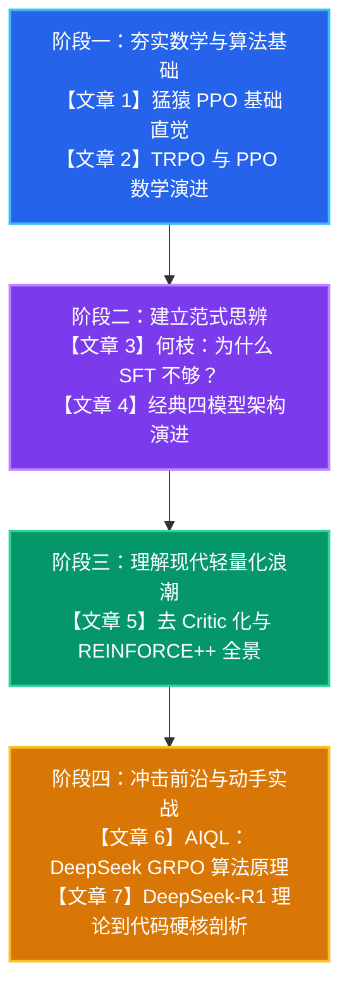

> 🎯 **导读与说明**：在大语言模型（LLM）跨入长思维链（CoT）深度推理与自主探索时代的今天，强化学习（Reinforcement Learning, RL）已从最初的“人类偏好对齐（Helpful & Harmless）”跃升为**模型推理能力飞跃的核心引擎**。  
> 本文对精选的 7 篇核心文章进行了系统分类与深度导读，清晰标注每篇文章**“是干啥的”、“解决了什么痛点”**以及**“包含哪些核心推导与结论”**，并提供最佳进阶研读路线。

---

## 🗺️ 强化学习与大模型后训练演进总路线

```
【第一阶段：经典基石】
  TRPO (信赖域数学约束，二阶优化) 
    └──> PPO (PPO-Clip 一阶裁剪优化，经典 RLHF 四模型霸主)
           │
【第二阶段：范式思辨】
  SFT vs RLHF (为什么做完监督微调还不够？解决 Exposure Bias 与自主探索)
           │
【第三阶段：去 Critic 化轻量浪潮】
  REINFORCE (重访蒙特卡洛策略梯度) 
    └──> REINFORCE++ (组内优势归一化 + Token 级 KL，兼顾极简与稳定)
           │
【第四阶段：深度推理与 DeepSeek 时代】
  GRPO (Group Relative Policy Optimization：彻底抛弃 Critic 网络，推理冷启动基石)
```

---

## 📚 目录与知识模块速览

- [一、基础理论与经典信赖域算法（PPO / TRPO 必读基石）](#一基础理论与经典信赖域算法ppo--trpo-必读基石)
  - [1. 人人都能看懂的强化学习 RL-PPO 理论知识](#1-人人都能看懂的强化学习-rl-ppo-理论知识猛猿)
  - [2. 深入浅出强化学习 PPO / TRPO：从信赖域约束到近端策略裁剪](#2-深入浅出强化学习-ppo--trpo从信赖域约束到近端策略裁剪)
- [二、大模型对齐认知与范式思辨（SFT vs RLHF）](#二大模型对齐认知与范式思辨sft-vs-rlhf)
  - [3. 为什么做完 SFT 之后还需要用 RLHF？SFT 不够吗？](#3-为什么做完-sft-之后还需要用-rlhf-sft-不够吗何枝)
- [三、架构演变与“去 Critic 化”轻量浪潮（从四模型到 REINFORCE++）](#三架构演变与去-critic-化轻量浪潮从四模型到-reinforce)
  - [4. 大模型强化学习演化进阶：从传统四模型协同到现代架构](#4-大模型强化学习演化进阶从传统四模型协同到现代架构)
  - [5. 从 Policy Gradient 到 REINFORCE++，万字长文梳理强化学习最新进展](#5-从-policy-gradient-到-reinforce万字长文梳理强化学习最新进展)
- [四、DeepSeek-R1 深度推理前沿（GRPO 详解与代码工程落地）](#四deepseek-r1-深度推理前沿grpo-详解与代码工程落地)
  - [6. 深入探讨 DeepSeek 策略优化方法 GRPO：从 PPO 到无 Critic 架构的跃迁](#6-深入探讨-deepseek-策略优化方法-grpo从-ppo-到无-critic-架构的跃迁aiql)
  - [7. 从理论到代码剖析 DeepSeek-R1：从 PPO 到 REINFORCE++，再对比 GRPO](#7-从理论到代码剖析-deepseek-r1从-ppo-到-reinforce再对比-grpo)
- [五、推荐通读与研习顺序指南](#五推荐通读与研习顺序指南)

---

## 一、基础理论与经典信赖域算法（PPO / TRPO 必读基石）

### 1. 人人都能看懂的强化学习 RL-PPO 理论知识（猛猿）

*   **原文链接**：[https://zhuanlan.zhihu.com/p/7461863937](https://zhuanlan.zhihu.com/p/7461863937)
*   **本站精校重印**：[人人都能看懂的强化学习 RL-PPO 理论知识与科研场景映射](/posts/rl-ppo-theory/)
*   **所属类型**：知乎专栏长文 · 经典原理入门

#### 🎯 这篇文章是干啥的？
**强化学习入门大模型后训练的第一篇必读打底之作**。很多经典教材（如 Sutton 导论）从 MDP 和 Q-learning 讲起，篇幅冗长且难以快速与现代大模型 RLHF 对齐。猛猿老师直接从“策略优化（Policy-based）”切入，以极强的数学直觉和通俗易懂的语言，从零推导出 PPO 的核心公式，并消除了初学者对 Actor-Critic 的神秘感。

#### 🔍 核心要点与收获：
1.  **从直觉理解策略梯度定理**：为什么目标是增大获得高奖励动作的概率 $\nabla \log \pi_\theta(a|s)$。
2.  **状态价值 $V(s)$ 与动作价值 $Q(s, a)$ 的物理意义**：结合“马里奥游戏”生活化案例，清晰阐释单步奖励、累积折扣奖励与优势函数 $A(s, a)$。
3.  **Actor-Critic 架构的本质**：Actor 负责输出动作策略 $\pi_\theta$，Critic 负责评估局面好坏 $V_\phi(s)$，二者各司其职。
4.  **重要性采样（Importance Sampling）**：为什么可以使用旧策略 $\pi_{\theta_{\text{old}}}$ 采集的数据来更新当前新策略 $\pi_\theta$。
5.  **PPO-Clip 截断目标函数**：详解为何必须引入截断比率 $r_t(\theta) = \frac{\pi_\theta(a_t|s_t)}{\pi_{\theta_{\text{old}}}(a_t|s_t)}$，并用悲观估计（Pessimistic Bound）防止步子迈得太大导致策略崩塌。

---

### 2. 深入浅出强化学习 PPO / TRPO：从信赖域约束到近端策略裁剪

*   **原文链接**：[https://zhuanlan.zhihu.com/p/468828804](https://zhuanlan.zhihu.com/p/468828804)
*   **所属类型**：知乎专栏 · 数学推导与演化对比

#### 🎯 这篇文章是干啥的？
**深入剖析 PPO 的数学前身 TRPO（Trust Region Policy Optimization），彻底搞清“步长控制”与“单调提升”的理论源头**。解答为什么基础的 Policy Gradient 极难训练、学习率稍大就会使性能彻底崩溃，以及 OpenAI 是如何一步步从复杂的理论解法走向工程实用的裁剪解法的。

#### 🔍 核心要点与收获：
1.  **TRPO 的理论高地**：以理论证明新策略相较旧策略能够实现性能的“单调非降（Monotonic Improvement）”，通过引入 KL 散度硬约束定义了每次更新的“信任区域（Trust Region）”。
2.  **TRPO 的工程困境**：求解受限优化问题需要计算二阶导数 Hessian 矩阵的逆，使用共轭梯度法（CG）和线性搜索，在动辄数十亿、百亿参数的神经网络上计算开销巨大。
3.  **PPO 的大道至简**：PPO（特别是 PPO-Clip）用简单的一阶截断函数替代了复杂的二阶优化，既有效抑制了策略更新幅度，又完美兼容标准 Adam 优化器，成为了现代强化学习的黄金标配。

---

## 二、大模型对齐认知与范式思辨（SFT vs RLHF）

### 3. 为什么做完 SFT 之后还需要用 RLHF？SFT 不够吗？（何枝）

*   **原文链接**：[https://www.zhihu.com/question/651021172/answer/3513159005](https://www.zhihu.com/question/651021172/answer/3513159005)
*   **所属类型**：知乎高赞回答 · 对齐机制与方法论思辨

#### 🎯 这篇文章是干啥的？
**解答大模型领域最经典也是最常被误解的问题：“既然监督微调（SFT）已经能教模型回答问题了，为什么还要大费周章地搞 RLHF？”** 答主何枝以“教练随堂指导（On-Policy） vs 赛后看高手录像（Off-Policy）”的精彩比喻，从认知层面深刻阐明了强化学习在大模型能力泛化中的不可替代性。

#### 🔍 核心要点与收获：
1.  **On-Policy 与 Off-Policy 的根本差异**：
    *   *SFT（看录像）*：只给静态标准答案，模型做一次 Forward 算 Cross-Entropy Loss，模型从未在训练阶段经历过“自己即兴生成长文本”的过程。
    *   *RLHF（下场玩游戏）*：模型必须亲自做 Rollout 生成一整串回答，由奖励模型给予动态反馈。
2.  **攻克暴露偏差（Exposure Bias）**：
    *   SFT 训练使用 Teacher Forcing（每次都喂入正确前缀），但在实际推理时一旦某一个词产生微小偏差，后续生成就会雪崩式走偏。
    *   强化学习允许模型犯错并学会“自圆其说与自我纠偏”，大幅提升长文本与多轮对话的鲁棒性。
3.  **负反馈与未见空间的探索**：
    *   语言是开放式的，人类偏好并不存在唯一的标准答案。SFT 强行拟合单一答案容易扼杀创造力；而 RLHF 通过成对对比（Pairwise）和奖励机制，能高效地告诉模型“什么是坏的/不可取的”，为大模型的安全性（Safety）与真实性（Helpfulness）建立清晰的边界。

---

## 三、架构演变与“去 Critic 化”轻量浪潮（从四模型到 REINFORCE++）

### 4. 大模型强化学习演化进阶：从传统四模型协同到现代架构

*   **原文链接**：[https://zhuanlan.zhihu.com/p/20395188451](https://zhuanlan.zhihu.com/p/20395188451)
*   **所属类型**：知乎专栏 · 工业工程架构与演进

#### 🎯 这篇文章是干啥的？
**全景拆解大语言模型在实际工业落地中，强化学习四模型架构的协作流程、工程痛点与演进方向**。适合想要了解大模型分布式训练集群中，各个网络如何协同运作、瓶颈在哪里的工程师和研究者。

#### 🔍 核心要点与收获：
1.  **经典四模型架构拓扑**：
    *   **Actor Model**（生成动作/文本的策略模型）
    *   **Critic Model**（预测当前状态价值的评估网络）
    *   **Reward Model**（对生成序列打分的奖励模型）
    *   **Reference Model**（冻结初始参数、计算 KL 散度防漂移的参考模型）
2.  **传统架构的显存与吞吐瓶颈**：四个庞大模型同时占用 GPU 显存，前向反向传播交错进行，分布式流水线编排极度复杂。
3.  **奖励作弊（Reward Hacking）与应对**：当策略模型学会了钻奖励模型的空子（例如通过特定标点、谄媚语气或超长篇幅骗取高分）时，如何通过 KL 约束与多任务正则化进行约束。

---

### 5. 从 Policy Gradient 到 REINFORCE++，万字长文梳理强化学习最新进展

*   **原文链接**：[https://mp.weixin.qq.com/s/mGlObqTANspHGkujzCmY5A](https://mp.weixin.qq.com/s/mGlObqTANspHGkujzCmY5A)
*   **所属类型**：微信技术长文 · 前沿算法演化全景综述

#### 🎯 这篇文章是干啥的？
**万字长文系统梳理当下大模型后训练中最重要的一股变革浪潮——“去 Critic 化”与轻量策略梯度的复兴**。重点剖析了为什么近两年来学术界与开源界正从复杂的 PPO 逐渐转向 RLOO、ReMax，直至最新提出的 **REINFORCE++**。

#### 🔍 核心要点与收获：
1.  **重访蒙特卡洛 REINFORCE**：传统观念认为 REINFORCE 方差过大无法用于大模型，但它拥有最简洁优雅的单网络特性。
2.  **去 Critic 化的核心手段——组内对比与 Leave-One-Out**：
    *   对同一个 Prompt 并行采样多个候选回答，利用其余回答的平均分作为 Baseline，无需单独训练庞大的 Critic 网络！
3.  **REINFORCE++ 的技术精髓**：
    *   引入 Token 级的精细 KL 散度惩罚；
    *   对组内或批次奖励进行严格的均值与方差归一化；
    *   去除容易引起梯度偏差的截断损失，证明了“只要基线合理、KL可控，纯净的策略梯度能达到甚至超越 PPO 的效果”。

---

## 四、DeepSeek-R1 深度推理前沿（GRPO 详解与代码工程落地）

### 6. 深入探讨 DeepSeek 策略优化方法 GRPO：从 PPO 到无 Critic 架构的跃迁（AIQL）

*   **原文链接**：[https://www.zhihu.com/question/10766825126/answer/88583863333](https://www.zhihu.com/question/10766825126/answer/88583863333)
*   **所属类型**：知乎技术回答 · DeepSeek 算法原理解析

#### 🎯 这篇文章是干啥的？
**直击 DeepSeek-R1 和 DeepSeekMath 的核心动力引擎——GRPO（Group Relative Policy Optimization，组相对策略优化）的理论原理**。详细解答了 DeepSeek 为何能够以极低算力成本实现推理能力爆发，以及 GRPO 在数学逻辑上是如何替代 PPO 中的 Critic 网络的。

#### 🔍 核心要点与收获：
1.  **GRPO 的核心公式推导**：
    对于给定的输入问题 $q$，策略模型采样生成一组 $G$ 个候选回答 $\{o_1, o_2, \dots, o_G\}$，其对应的优势函数直接定义为：
    $$A_i = \frac{r_i - \text{mean}(\{r_1, \dots, r_G\})}{\text{std}(\{r_1, \dots, r_G\})}$$
2.  **彻底释放显存（去 Critic 化）**：原本与 Actor 模型参数量相当的 Critic 模型被彻底砍掉，分布式集群的显存开销直接降低 50% 以上，通信成本大幅缩减。
3.  **长思维链（CoT）推理的冷启动**：配合规则校验器（Rule-based Checker）对数学证明、代码运行结果进行绝对确定性打分，催生了模型在纯强化学习阶段的“顿悟时刻（Aha Moment）”。

---

### 7. 从理论到代码剖析 DeepSeek-R1：从 PPO 到 REINFORCE++，再对比 GRPO

*   **原文链接**：[https://mp.weixin.qq.com/s/qcwR5D03z4YfRmZJctH8mg](https://mp.weixin.qq.com/s/qcwR5D03z4YfRmZJctH8mg)
*   **所属类型**：微信深度技术长文 · 算法理论与代码实现横向对比

#### 🎯 这篇文章是干啥的？
**打通“数学理论推导”到“工业级工程代码”的终极实战篇**。如果说前几篇文章是把原理讲明白，这篇文章则是直接带领读者深入 PyTorch 计算图与分布式实现，逐行对比 PPO、REINFORCE++ 与 GRPO 在代码层面的异同与落地细节。

#### 🔍 核心要点与收获：
1.  **三代主流算法的工程对比矩阵**：
    *   **PPO**：四模型并发、Token 级 GAE 优势计算、Value Loss 反向传播。
    *   **REINFORCE++**：去 Critic、组内优势归一化、Token 级 KL Loss 叠加。
    *   **GRPO**：组内多样本采样、无 Critic 相对优势计算、结合可验证奖励（Verifiable Reward）。
2.  **PyTorch 核心实现逻辑详解**：
    *   Log-Probability 的高效比值计算；
    *   组内张量操作与 Broadcast 归一化；
    *   Mask 掉 Padding Token 后的精确策略梯度回传。
3.  **自研/微调推理模型的最佳技术选型**：在算力有限、显存吃紧的实际场景下，如何根据任务性质（通用对话 vs 严谨推理）选择最合适的高性价比强化学习算法。

---

## 五、推荐通读与研习顺序指南

为了帮助不同学习阶段的同学建立最顺畅的认知模型，推荐按照以下四个阶段循序渐进阅读：



1.  **新手筑基（预计 1~2 天）**：
    *   先精读 **【文章 1】**（配合本站重印版 [/posts/rl-ppo-theory/](/posts/rl-ppo-theory/)），在纸上推导一遍策略梯度与重要性采样，搞懂动作价值与状态价值的定义。
    *   接着研读 **【文章 2】**，弄明白 TRPO 为什么那么繁重、PPO-Clip 究竟是怎么一招制敌的。
2.  **认知跃迁（预计 1 天）**：
    *   细读 **【文章 3】**（何枝答知乎问），彻底搞懂 On-Policy 自主探索和解决 Exposure Bias 的不可替代性。
    *   阅读 **【文章 4】**，直观感受四模型并行的工程复杂度与显存开销。
3.  **拥抱前沿（预计 1~2 天）**：
    *   精读 **【文章 5】**，理解从复杂的四模型走向轻量单/双模型的“去 Critic 化”趋势，吃透 REINFORCE++ 的设计巧思。
    *   细读 **【文章 6】**，掌握 DeepSeek-R1 最具革命性的 GRPO 组相对优势算法。
4.  **实操落地（预计 2~3 天）**：
    *   研读 **【文章 7】**，对照 PyTorch 代码理解 GRPO 和 REINFORCE++ 的实际计算图，尝试在自己的小型数据集或开源推理模型上复现或跑通一次对齐实验！

---

> 💡 **小贴士**：所有强化学习理论学习均可配合西湖大学赵世钰老师的视频课程《强化学习的数学原理》作为底层数学参考；本站后续也将同步更新各算法的手写 PyTorch 复现与实验笔记。
